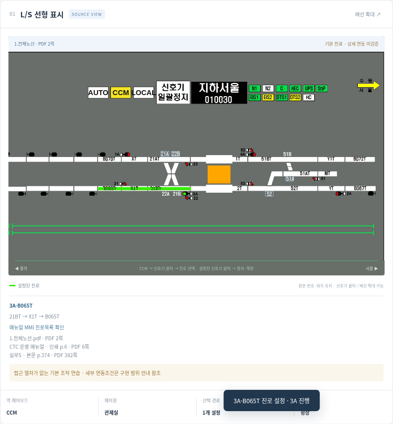
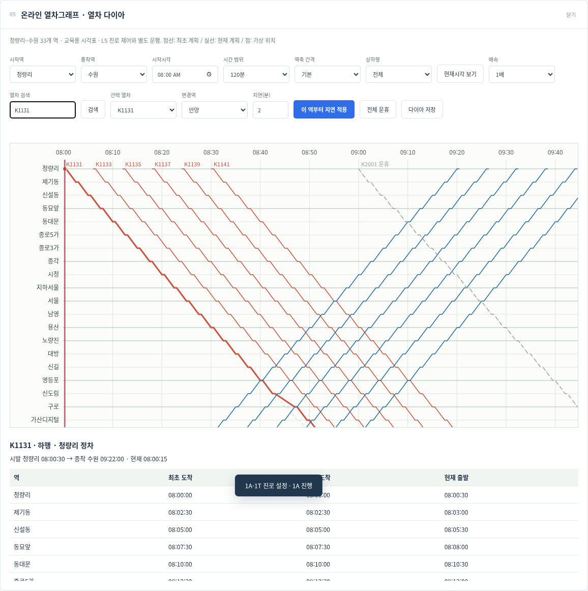

# CTC LAB — LS·MMI 관제 조작 연습

매뉴얼과 교육장 배선도에 맞춰 LS와 MMI 조작을 반복 연습하는 프로그램입니다. **v0.5.1: 관제 대상 15개 역 전환·기본 제어, 온라인 열차 다이아, 전체 33개 역 온라인 스케줄 관리.**

[v0.5.1 실행본 ZIP](archive/CTC-LAB-v0.5.1.zip)을 내려받아 압축을 풀어도 됩니다.

## 바로 실행
저장소를 내려받고 `simulator/index.html`을 브라우저로 여세요. 빌드나 외부 라이브러리가 필요 없습니다.
로컬 서버를 쓰려면 `python3 -m http.server 8765 --directory simulator` 실행 후 http://localhost:8765/ 에 접속합니다. localhost는 실행 중인 본인 컴퓨터에서만 열립니다.

1. LS 상단 CCM → 예.
2. 3A 신호기 → RT_3A_B065T.
3. B065T–X1T–21BT 녹색 경로와 3A 진행 표시 확인.
4. 3A 재클릭 → 예: 정지·해정. 취소하면 유지.
5. MMI 진로제어에서 같은 설정·해정 연습 가능.

## 새 배선도

[1.전체노선.pdf](references/diagrams/1.전체노선.pdf)로 배선 배경을 교체했습니다. 선택역 화면은 해당 구간을 확대하고, **전체노선 보기**에서 PDF 4쪽을 전환할 수 있습니다. 전체노선 1쪽의 역 이름을 누르면 제어 화면으로 돌아옵니다.



## 전체 역·다이아·스케줄

- 역 탭 또는 LS/MMI 제어역에서 청량리~수원 연동역 15개를 전환합니다.
- MMI **열차 그래프 → 온라인 열차그래프 열기**: 상하행 계획선·가상 위치·열차 검색·범위/축 조절·지연·운휴.
- MMI **열차스케줄 → 온라인 열차스케줄 관리**: 전체 33개 역을 대상으로 생성·조회·시각/속성 수정·복사·전체 운휴. 편집 적용 시 다이아에도 반영됩니다.
- 초기 시각표는 교육용입니다. 실제 열차운행·전 역 상세 연동조건을 재현한 모델은 아닙니다.

[사용법·근거·구현 범위](docs/전체역과열차다이아.md)




## 개발 검증
```sh
node simulator/core.test.cjs
node simulator/practice.test.cjs
node simulator/network.test.cjs
node simulator/schedule.test.cjs
node --check simulator/app.js
```
Playwright와 Chromium이 있는 환경에서는 `python3 simulator/browser.test.py`로 데스크톱·모바일에서 9개 과제 전체를 검증합니다. `python3 simulator/map.browser.test.py`는 PDF 4쪽과 15개 역의 새 조작 영역을 검증합니다. 추가로 `python3 simulator/network.browser.test.py`는 15개 역과 다이아·온라인 스케줄 관리 전체 흐름을 검증합니다. 파일 직접 실행 검증은 브라우저 정책이 허용하는 환경에서 `--include-file`을 추가합니다.

## 문서 안내
- [제작 지침](docs/제작지침.md): 목표, 고증 원칙, 구현 판단 기준
- [구현 현황](docs/구현현황.md): 작동하는 기능과 미구현 범위
- [조작 절차 체크리스트](docs/조작절차체크리스트.md): 매뉴얼 페이지별 절차와 현재 검증 범위
- [앞으로 할 일](docs/개발로드맵.md): 우선순위와 완료 조건
- [참고자료 원본·목록](references/README.md): 교재·매뉴얼·배선도·시나리오·세션 로그 27개와 원본 검증 정보
- [자료 근거](docs/자료근거.md): 문서 페이지와 CAI 사진의 역할
- [개발 인수인계](docs/개발인수인계.md): 구조·실행·검증·후속 작업 시작점
- [검증 기록](simulator/검증결과.md)
- [변경 이력](CHANGELOG.md)
- [백업 목록](BACKUP-MANIFEST.json)

## 백업 범위
최신 소스·필수 배선 이미지·미리보기·과거 v0.1/v0.2/v0.3 ZIP을 보존합니다. 사용자가 제공한 PDF·PPTX·HWP·HWPX·JSONL 원본 27개는 [references](references/README.md)에 보존했습니다. 현행 배경은 새 전체노선 PDF에서 추출한 원본 JPEG를 사용합니다. 노선 PNG 4장은 이 PDF로 대체했고, CAI 사진 원본의 미보관 상태는 참고자료 목록에 기록했습니다.

이 저장소는 개인 학습용 비공개 백업입니다. 첨부 자료에 대한 별도 공개 재배포 허가는 부여하지 않습니다.


