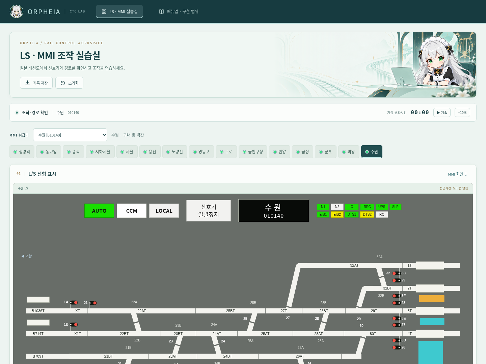
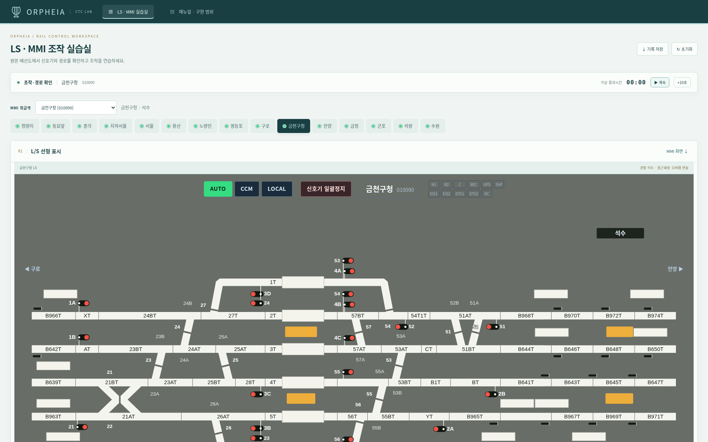
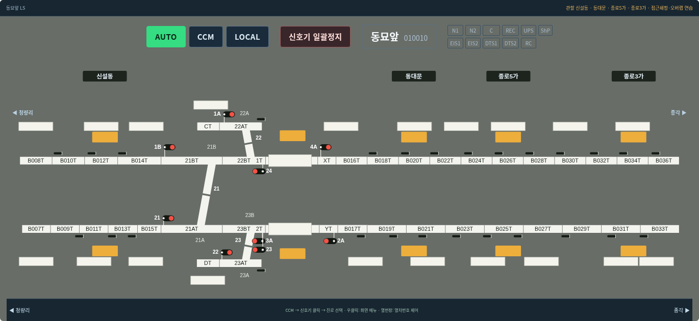
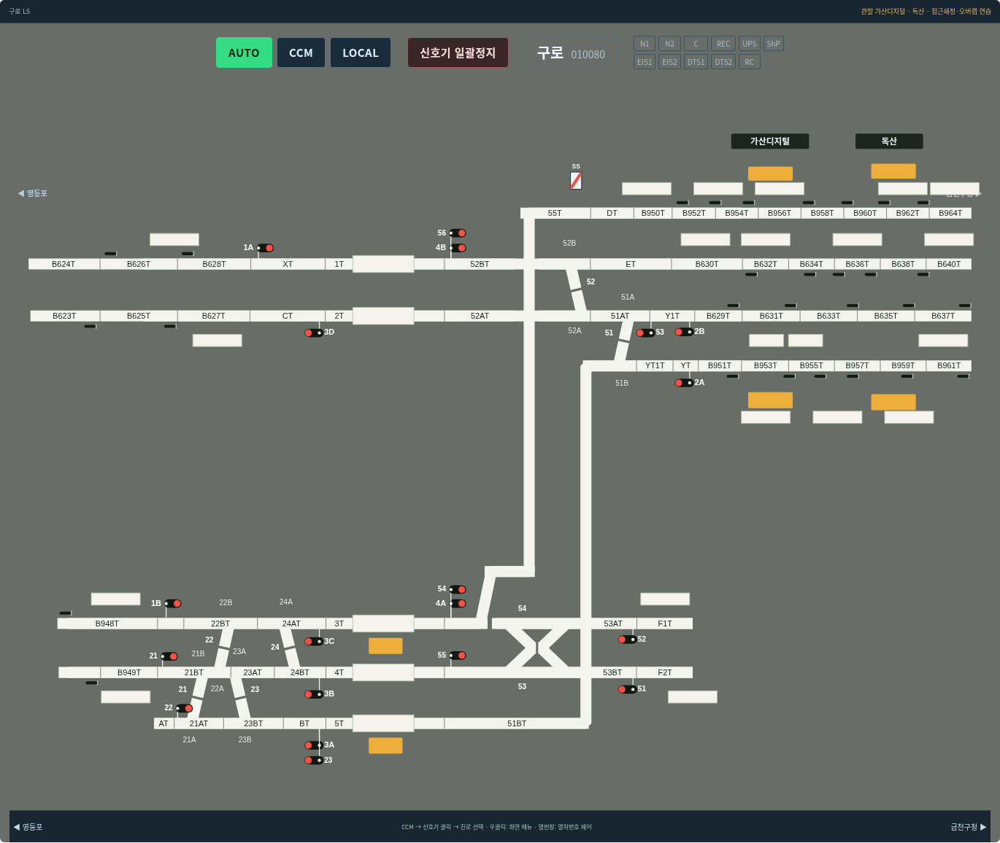
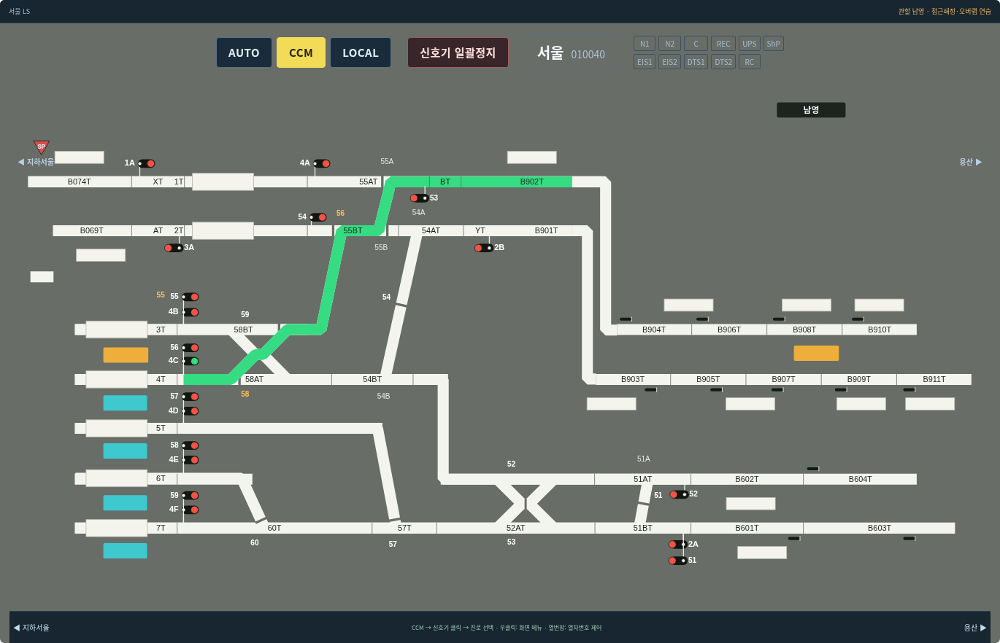
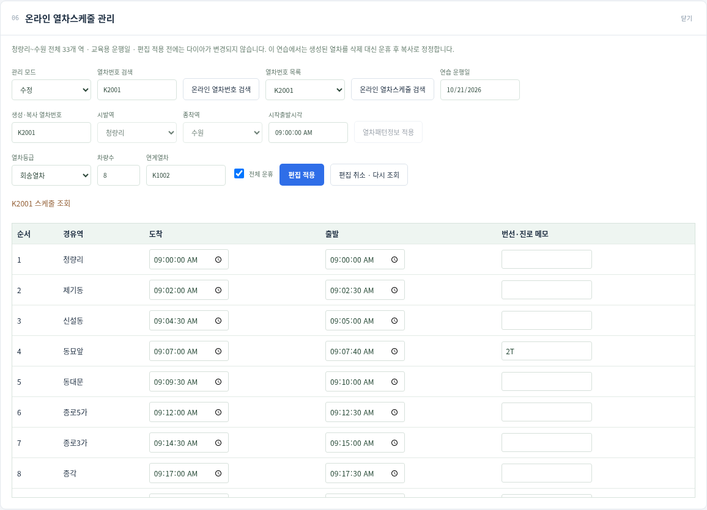
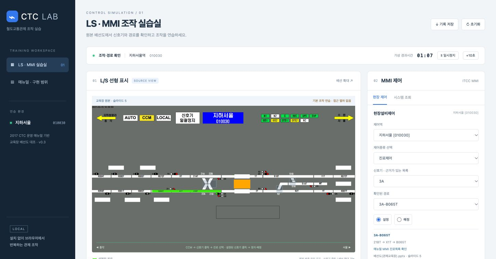

# CTC LAB — LS·MMI 관제 조작 연습

매뉴얼과 교육장 배선도에 맞춰 LS와 MMI 조작을 반복 연습하는 프로그램입니다. **v0.18.2: 선로 기준 표식 정렬·기지 문구 배치와 민트 디자인 정돈.**

[v0.18.2 실행본 ZIP](archive/CTC-LAB-v0.18.2.zip)을 내려받아 압축을 풀어도 됩니다.

**데스크톱 전용입니다. 모바일 레이아웃·모바일 검증은 제거했습니다.**

## v0.18.2 위치·간격 정돈

괄호 표식의 폭·선로 여백을 통일하고, 기지 문구를 관련 선로 중심과 위·아래 대칭 간격에 맞췄습니다. 민트 포인트와 짙은 청록 패널로 글자의 외곽선 번짐도 정리했습니다. [정렬 화면·검증](docs/v0.18.2-위치정렬.md)

## v0.18.1 원본 표식 복원

구로 4쌍·노량진 2쌍의 괄호 표식과 구로·동묘앞·의왕의 기지 문구를 네이티브 SVG로 복원했습니다. [대조 근거·화면·검증](docs/v0.18.1-원본표식복원.md)

## 오르페이아 전체 디자인

첨부 캐릭터를 바탕으로 image_gen에서 투명 캐릭터·엠블럼·민트 배너를 생성했습니다. 헤더·MMI 대기 화면·안내뿐 아니라 메뉴·도킹 창·표·달력·시나리오·기록까지 같은 시각 체계로 정리했습니다. [디자인 화면](docs/v0.18.0-오르페이아디자인.md) · [에셋 갤러리](simulator/assets/orpheia/README.md)



## v0.17.1 LS 표시 수정

CCM 확인 상자와 모드·역명·설비 색을 사진에 맞췄습니다. 지하청량리~지하서울은 파란 역명판, 나머지는 검정이며 진로 메뉴의 이전 항목 강조가 남는 문제를 수정했습니다. [수정 화면·검증](docs/v0.17.1-LS표시수정.md)

## v0.17.0 추가 기능

실기 시나리오 총 16종(대피 5·비상 9·경합/생성 2), 단계별 LS 열번 배치·이동, 선택한 알람 확인, 반투명 표지판 크기 조절과 Y/N 해정 확인을 통합했습니다. 안양 진로 2개를 추가하고 새 팝업에도 민트 디자인을 적용했습니다. 필기 퀴즈는 제거했으며 교재 레퍼런스는 보존합니다. [사용법·화면·남은 한계](docs/v0.17.0-통합.md)

## 오르페이아 디자인

철도관제 프로그램의 화면과 조작 구조를 역공학으로 재현하고 오르페이아 스타일로 구성합니다. 민트 `#BEE3E3`·짙은 청록·차분한 금색을 중심으로 메뉴·창·패널을 통일했습니다. [디자인과 화면](docs/오르페이아디자인.md)



## MMI·그래프·스케줄 도킹

클로드 브랜치의 MMI 메뉴·알람/이벤트·ONLINE T/G·스케줄 편집기를 통합했습니다. 제목줄의 **도킹 / 창으로**로 배치하고, **MMI↓ / LS↑**로 작업 영역을 오갑니다. MMI 열차번호제어는 LS 열번창과 같은 데이터를 사용합니다. 그래프와 스케줄은 지연·부분 운휴·구간 복사를 공유하며, 이미 열린 편집 창을 메뉴에서 다시 선택해도 초안을 유지합니다. [사용법·연결 범위·검증 화면](docs/MMI와그래프통합.md)

## 바로 실행
저장소를 내려받고 `simulator/index.html`을 브라우저로 여세요. 빌드나 외부 라이브러리가 필요 없습니다.
로컬 서버를 쓰려면 `python3 -m http.server 8765 --directory simulator` 실행 후 http://localhost:8765/ 에 접속합니다. localhost는 실행 중인 본인 컴퓨터에서만 열립니다.

1. 취급역에서 지하서울 선택 → 해당 역 CCM → 예.
2. 3A 신호기 → RT_3A_B065T.
3. B065T–X1T–21BT 녹색 경로와 3A 진행 표시 확인.
4. 3A 재클릭 → 예: 정지·해정. 취소하면 유지.
5. MMI 진로제어에서 같은 설정·해정 연습 가능.

## 우클릭과 열차번호

LS 빈 공간을 우클릭하면 베이스스캔·인쇄·재실행·표지판·Overview를 선택합니다. 원본 PPTX의 열번창 276개(선로 위의 흰 블록 71개 포함)를 입력·수정·삭제·이동·교환할 수 있습니다. 중간역 이름판은 위로 옮기고 같은 선로의 열번창은 높이를 맞췄습니다. [사용법·자료 대조·검증](docs/우클릭메뉴와열번창.md)

## 전체 배선과 취급역

[1.전체노선.pdf](references/diagrams/1.전체노선.pdf)를 대조 자료로 사용하고, **그 역의 구내와 관할 중간역·역간을 코드로 그립니다.** 금천구청은 석수까지, 안양은 관악·명학을 표시합니다. 청량리에는 제기동, 동묘앞에는 신설동·동대문·종로5가·종로3가, 서울에는 남영, 구로에는 가산디지털·독산이 포함됩니다. 좌우 화살표와 역 탭으로 인접 취급역을 전환합니다. LS에는 래스터 이미지나 이미지 위의 투명 클릭 영역을 사용하지 않습니다.

15개 취급역의 신호기 246개에서 진로 설정·해정과 선 표시를 조작할 수 있습니다. 대피선·입환, 전환기 쇄정, 일괄정지, 모의 점유와 연속진로제어를 포함합니다. 전체 진로표·세부 연동조건까지 완전 재현한 버전은 아닙니다. [수정 내용·근거·현재 범위](docs/전체배선과역별제어.md)를 확인하세요.





## 중간역 코드와 건넘선

중간역의 모든 선로 칸에 구간 코드를 표시합니다. PPT 원본의 순서에 따라 PDF에서 합쳐진 칸을 나누고, `B616T1T` 같은 복합 코드도 그대로 표시합니다. 건넘선은 원본처럼 중앙 목과 좁은 틈을 그리며, 반위·진로 설정 시 선택된 경로가 이어집니다. [대조 자료와 화면](docs/중간역코드와건넘선.md)

## 진로에 따른 선형 전환

서울역에서 CCM → 4C → `4C-B902T`를 선택하면 58·56·55번 전환기가 선택 경로에 맞춰 이어집니다. 정위·반위에 따라 통하지 않는 방향의 선로에 틈이 생기고, 쇄정 중에는 위치를 바꿀 수 없습니다. [화면과 검증 내용](docs/데스크톱배선정리.md)



## 전체 역·다이아·스케줄

- 역 탭 또는 LS/MMI 제어역에서 청량리~수원 연동역 15개를 전환합니다.
- MMI **열차스케줄 → 온라인 열차그래프**: 상하행 계획선·가상 위치·열차 검색·범위/축 조절·지연·운휴.
- MMI **열차스케줄 → 온라인열차스케줄 관리 → 온라인 열차스케줄관리**: 전체 33개 역을 대상으로 생성·조회·시각/속성 수정·복사·전체 운휴. 편집 적용 시 다이아에도 반영됩니다.
- 초기 시각표는 교육용입니다. 실제 열차운행·전 역 상세 연동조건을 재현한 모델은 아닙니다.

[사용법·근거·구현 범위](docs/전체역과열차다이아.md)




## 개발 검증

`python3 simulator/ls-context.browser.test.py`는 데스크톱 우클릭 조작과 원본 열번창 배치를 검증합니다.
```sh
node simulator/core.test.cjs
node simulator/practice.test.cjs
node simulator/network.test.cjs
node simulator/schedule.test.cjs
node simulator/wiring.test.cjs
node --check simulator/app.js
```
Playwright와 Chromium이 있는 환경에서는 `python3 simulator/browser.test.py`로 1440px·1920px 데스크톱에서 10개 과제 전체를 검증합니다. `python3 simulator/ls.browser.test.py`는 15개 역의 246개 신호기 조작, 대피선·점유·연속제어를 검증합니다. `python3 simulator/wiring.alignment.test.py`는 Pillow로 원본 선로 픽셀과 경로 위치를 대조합니다. 추가로 `python3 simulator/network.browser.test.py`는 15개 역과 다이아·온라인 스케줄 관리 전체 흐름을 검증합니다. 파일 직접 실행 검증은 브라우저 정책이 허용하는 환경에서 `--include-file`을 추가합니다.

## 문서 안내
- [제작 지침](docs/제작지침.md): 목표, 고증 원칙, 구현 판단 기준
- [구현 현황](docs/구현현황.md): 작동하는 기능과 미구현 범위
- [조작 절차 체크리스트](docs/조작절차체크리스트.md): 매뉴얼 페이지별 절차와 현재 검증 범위
- [앞으로 할 일](docs/개발로드맵.md): 우선순위와 완료 조건
- [참고자료 원본·목록](references/README.md): 교재·매뉴얼·배선도·시나리오·세션 로그 27개와 원본 검증 정보
- [자료 근거](docs/자료근거.md): 문서 페이지와 CAI 사진의 역할
- [개발 인수인계](docs/개발인수인계.md): 구조·실행·검증·후속 작업 시작점
- [검증 기록](simulator/검증결과.md)
- [변경 이력](CHANGELOG.md)
- [백업 목록](BACKUP-MANIFEST.json)

## 백업 범위
최신 소스·필수 배선 이미지·미리보기·과거 v0.1/v0.2/v0.3 ZIP을 보존합니다. 사용자가 제공한 PDF·PPTX·HWP·HWPX·JSONL 원본 27개는 [references](references/README.md)에 보존했습니다. 현행 배경은 새 전체노선 PDF에서 추출한 원본 JPEG를 사용합니다. 노선 PNG 4장은 이 PDF로 대체했고, CAI 사진 원본의 미보관 상태는 참고자료 목록에 기록했습니다.

이 저장소는 개인 학습용 비공개 백업입니다. 첨부 자료에 대한 별도 공개 재배포 허가는 부여하지 않습니다.


