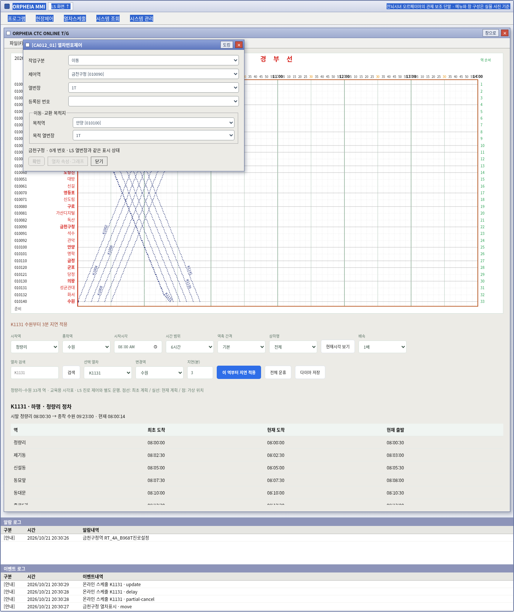
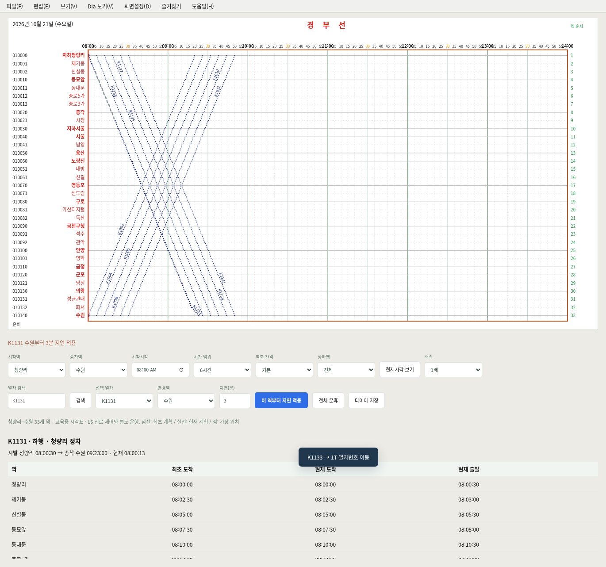
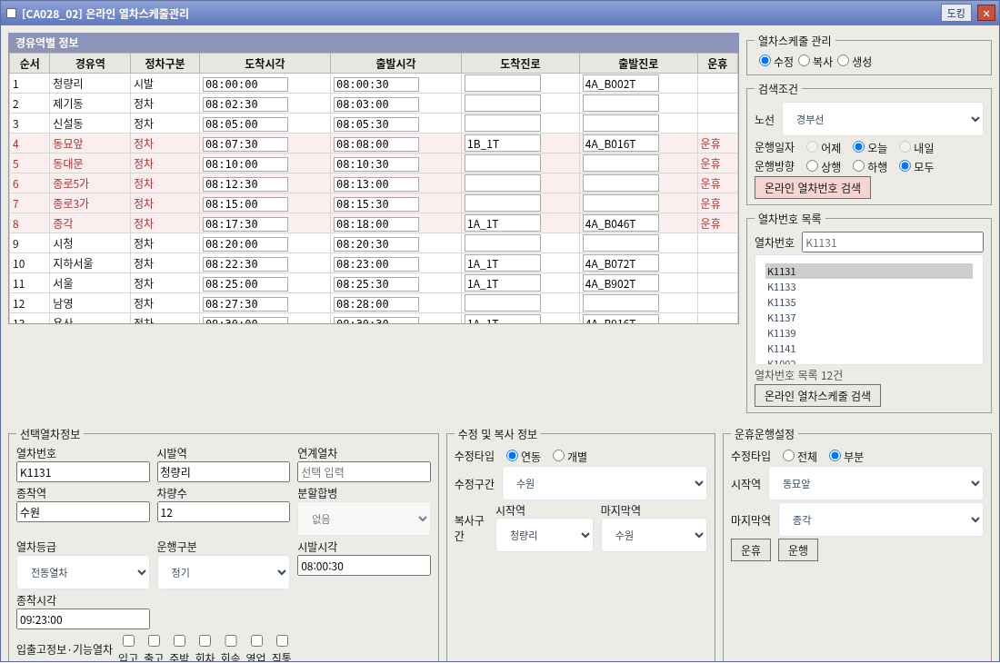
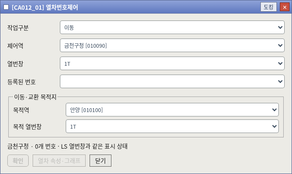

# v0.16.0 통합 안내

현행 동작과 한계는 [v0.16.0 통합](v0.16.0-통합.md)을 따른다. 아래 내용은 이전 버전 기록이다.

# MMI·그래프 통합 — v0.14.0

Claude `claude/practical-dirac-68tgp6`의 `ed81a24`까지 병합했다. ORPHEIA MMI 메뉴·창·알람/이벤트, ONLINE T/G와 `[CA028_02]` 스케줄 편집기를 기존 SVG LS와 연결했다. 기존 15개 역 배선·우클릭·276개 열번창은 보존했다.

## 실행과 도킹

`simulator/index.html`을 열거나 `python3 -m http.server 8765 --directory simulator`로 실행한다. 데스크톱 전용이다.

- **MMI↓ / LS↑**: 두 작업 영역 사이로 이동한다.
- MMI **현장제어 → 현장설비제어**: LS와 같은 역·진로·전환기·모드 상태를 조작한다.
- **현장제어 → 열차제어 → 열차번호제어**: LS 흰 열번창의 삽입·수정·삭제·이동·교환. 취소하면 번호와 UID를 유지한다. 다른 역으로 옮겨도 같은 UID를 사용한다.
- **열차스케줄 → 온라인 열차그래프**: 33개 역 계획선·현재 계획·가상 위치, 검색·범위·지연·운휴. 역 이름을 누르면 해당 취급역 LS로 이동한다. 비취급역은 그래프의 대상 역으로 선택한다.
- **열차스케줄 → 온라인열차스케줄 관리 → 온라인 열차스케줄관리**: 조회·생성·수정·구간 복사·전체/부분 운휴. 시각은 `HH:MM:SS`로 입력한다. 연동 수정은 선택한 수정구간의 마지막 역까지 반영한다.
- 제목줄 **도킹 / 창으로**: 작업 영역에 붙이거나 떠 있는 창으로 전환한다. 떠 있는 창은 제목줄로 이동한다. 이미 열린 창을 메뉴에서 다시 선택해도 선택 열차와 편집 초안을 유지한다.

## 같은 데이터를 사용하는 범위

| 영역 | 연결 동작 |
| --- | --- |
| LS ↔ MMI 현장설비 | 같은 역별 core 상태. 진로·모드 변경과 설정/해정 로그 동기화 |
| LS 열번창 ↔ MMI 열차번호제어 | 같은 SimLSUI 모델. 번호·방향·UID·역간 이동과 교환 공유 |
| 그래프 ↔ 온라인 스케줄 | 같은 SimTimetable 모델. 생성·수정·지연·운휴·복사와 속성 반영 |
| 열차번호 속성·그래프 | 같은 번호의 등록 스케줄을 선택. 스케줄이 없으면 안내 |
| 모의 시계 ↔ 그래프 | 같은 실습 초 단위 시각 사용 |
| 기록 저장 | 역별 상태·수동 표시·시각표·MMI 로그를 함께 JSON으로 저장 |

다이아에서 수정한 뒤 오래된 스케줄 초안을 적용하면 다시 조회하도록 안내한다. 부분 운휴 구간은 회색 점선으로 분리하고 해당 구간의 가상 위치를 표시하지 않는다. 구간 복사는 새 시발·종착과 시작시각에 맞춰 만들며 원 열차의 운휴 상태를 복제하지 않는다. 알람/이벤트는 실제 적용된 동작을 기록한다.

## 근거와 한계

실물 사진 전사: [MMI 사진 확인값](../references/route-menus/evidence/mmi-photos-2026-10-21.txt). 경유역 기본 진로의 사진 확인값과 규칙 추정값은 `schedule-routes.js`의 `photo` / `estimate`로 구분한다. 원본 자료를 수정하지 않았다.

수동 열차번호, 모의 궤도 점유, 시각표상 가상 위치는 서로 다른 정보다. 실제 궤도 검지에 따른 자동 열번 추적이나 실제 열차 운행을 구현한 것은 아니다. 초기 시각표는 교육용이며 전 역의 실제 연동표를 검증한 모델도 아니다. 그래프 우측 녹색 눈금은 **역 순서**이며 실제 거리(km)가 아니다. 온라인 편집은 오늘의 실습 시각표를 대상으로 하며, 미구현 메뉴와 분할·병합 등은 안내 또는 비활성화한다. 실행 중 데이터는 새로고침 시 초기화되므로 기록 저장을 사용한다.

## 검증

1440×1080·1920×1080 Chromium에서 MMI 메뉴·창 이동/도킹·다시 열기, LS/MMI 진로 공유, 동일 UID 열번 수정/역간 이동, 그래프 역 선택, 시계, 부분 운휴, 오래된 초안 거부, 속성 수정과 로그·JSON 저장을 검증했다. 15개 역 신호기 246개의 설정/해정, N/R 문자 배치, 서울 4C 진로 쇄정, LS 우클릭·276개 창, 33개 역 스케줄과 기존 과제도 회귀 검사한다. 모바일 검증은 수행하지 않는다.

- `python3 simulator/docking.browser.test.py`
- `python3 simulator/mmi.browser.test.py`
- `python3 simulator/network.browser.test.py`
- 기존 `simulator/*.test.cjs`, LS·배선·과제 브라우저 검사

