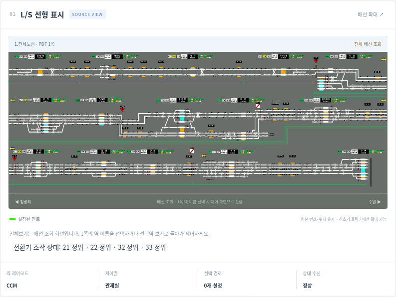

# 전체노선 PDF로 배선 배경 교체 — v0.5.1 이력

현재 v0.6.0은 아래의 역별 자르기 방식을 폐기하고 전체 시트를 유지한다. [현재 구현](전체배선과역별제어.md)을 참고한다.

2026-10-20, v0.5.1. 사용자가 제공한 [1.전체노선.pdf](../references/diagrams/1.전체노선.pdf)를 현행 LS 배선 배경으로 채택했다. 이전에 대화 이미지로만 있던 PNG 4장을 이 파일로 대체한다.

| PDF 페이지 | 화면 | 제어 화면 연결 |
|---:|---|---|
| 1 | 전체노선 | 15개 역 이름 선택 → 해당 역 확대 |
| 2 | 청량리–영등포 | 청량리·동묘앞·종각·지하서울·서울·용산 |
| 3 | 구로–수원 | 안양·금정·군포·의왕·수원 |
| 4 | 노량진–금천구청 | 노량진·영등포·구로·금천구청 |

PDF는 텍스트 레이어가 없는 이미지 기반 4쪽이며, 각 쪽에 5760×2160 JPEG가 하나씩 들어 있다. `pdfimages -j`로 원본 JPEG 스트림을 추출해 `simulator/assets/line-map/page-1.jpg`부터 `page-4.jpg`까지 저장했다. 이미지 재압축·이미지 자체 편집·배경 재생성은 하지 않았다. [추출 정보](../simulator/assets/line-map/SOURCES.json)에 PDF와 이미지의 SHA-256·크기를 기록했다.

화면은 2048×768의 SVG 좌표계를 사용해 원본 이미지를 표시한다. `network.js`의 `map.focus`로 선택역 구간을 확대하고 `map.modes`, `map.signals`, `map.points`에 조작 위치를 별도로 연결했다. 지하서울 기본 5개 진로의 표시 경로는 `map.paths`, 궤도명은 `map.labels`에 새 배경 기준으로 배치했다. 기존 엔진의 레거시 도형 좌표를 새 배경 위에 그대로 겹치지 않는다. 다른 역의 미확인 선형은 잘못된 경로선을 그리지 않고 설정 상태로 표시한다.

**전체노선 보기**에서는 페이지 선택으로 PDF 4쪽을 조회한다. 전체보기는 배선 조회 상태이며 정적인 배경 모드 표시를 실제 조작 버튼으로 취급하지 않는다. 1쪽의 역 이름 선택 또는 **선택역 보기**로 조작 화면에 돌아온다. 역별 상태·기존 과제·다이아·온라인 스케줄 모델은 유지된다.

기존 PPTX와 과거 실행본·배경 이미지는 진로 근거 및 이력 대조를 위해 보존한다. 현행 렌더러는 새 PDF 이미지와 좌표를 사용한다. CAI 사진 원본 3장의 미보관 상태는 이번 배선도 대체와 별개다.

검증 명령: `node simulator/network.test.cjs`, `python3 simulator/map.browser.test.py`. 기존 상태·과제·다이아/스케줄 시험도 실행했다. 화면 예시:

