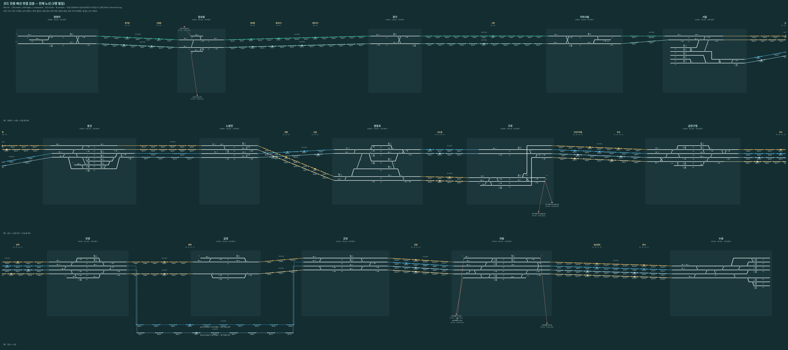

# 코드만으로 전체 배선 연결 재구성

검사 대상은 main `f0b7c87`(v0.37.1)입니다. 기존 LS 이미지·스크린샷·PDF·PPTX를 열거나 이미지에서 선을 추출하지 않았습니다. 엔진의 실행 가능한 JS/JSON 데이터만 읽었습니다. 아래 그림은 새로 생성한 검사 결과물입니다.



- [연속 배선도 SVG](network-full.svg): 청량리에서 수원까지 한 줄로 이어진 확대 가능한 원본.
- [연속 배선도 PNG](network-full.png): 23,269×1,230 이미지.
- [3행 펼침 PNG](network-overview.png): 6,400×2,854. 왼쪽에서 오른쪽으로 읽고 다음 행으로 이어집니다. 행 경계는 같은 연속 원본의 절단면입니다.
- [역 이동·확대 뷰어](index.html): 외부 라이브러리 없이 실행됩니다. 파일을 브라우저에서 열고 역 선택 및 확대 슬라이더를 사용합니다.
- [검사 JSON](audit.json): 입력 파일 해시, 코드 커밋, 그래프 수치, 금정 구내 미모델링 구간과 외부 경계.

## 어떻게 그렸는가

`network.js`의 역 목록과 구내 topology, `wiring.js`의 선로·신호기·전환기 정의, `line.js`가 생성하는 공통 그래프를 사용했습니다. `track-network.js`가 만든 실제 그래프의 연결선마다 SVG 경로 하나를 만들고 ID도 유지했습니다. SVG에서 선 위에 마우스를 올리면 엔진의 연결선 ID와 양끝 노드가 나옵니다.

구내 좌표는 `topology.nodes[].point`를 균일 배율로 이동해 그렸습니다. 역간은 회로 체인의 순서와 양끝 포트만으로 잇습니다. 역간 거리·기울기는 읽기 위한 도식이며 실제 측량 선형이 아닙니다. 선이 교차해도 코드에 접속 노드가 없으면 연결하지 않습니다. 신호 기호는 위치 표시이며 적색·녹색 현시나 운행 상태를 임의로 설정하지 않았습니다. 승강장 장식·열번창 등 LS 화면 구성은 재현 범위가 아닙니다.

색상은 흰색=구내, 민트=지하철 계열, 금색=전동선, 청색=일반선입니다. 전환기 번호·신호기 번호·선로명·폐색 회로 번호와 18개 비연동 중간역의 회로 위치를 함께 표시했습니다. 색상은 이 검사 그림의 범례이며 프로그램의 실제 신호 색상과 구분됩니다.

## 검사 결과와 드러난 한계

| 항목 | 결과 |
| --- | ---: |
| 전체 역 / 취급역 | 33 / 15 |
| 폐색 회로 | 320 |
| 본선 역간 구간 | 46 |
| 전체 노드 / 연결선 | 1,355 / 1,444 |
| 연결 성분 | 1 |
| 구내 연속 진로 | 710 |
| 기지 외부 경계 | 7 |

모든 노드에 위치를 부여하고, 1,444개 그래프 연결선을 빠짐없이 한 번씩 그렸습니다. 전체 노드는 무방향 그래프 기준 하나로 연결됩니다. 기존 `physical-network`, `network-unified`, `wiring` 검사도 통과했습니다. 중간역의 모든 슬롯은 실제 코드의 회로에 대응했습니다. 뷰어의 1,444개 연결선·15개 취급역 이동·확대도 확인했습니다.

연결 성분이 하나라는 결과만으로 실제 배선 복원이나 모든 방향·전환기 상태에서의 통행 가능성이 입증되지는 않습니다. 특히 다음 한계가 그림에 드러납니다.

1. **금정 일반선 구내가 없습니다.** 일반선 하1·상1선은 `GD:anyang>gunpo`, `GU:anyang>gunpo`로 금정 취급역을 건너뛰어 연결됩니다. 코드의 `skipped`를 읽어 점선으로 표시했습니다. 그림에 보이는 아래쪽 굴절은 이 우회 관계를 설명하기 위한 배치이며 실제 일반선이 그렇게 꺾인다는 뜻이 아닙니다.
2. **기지 외부는 경계까지만 있습니다.** 동묘·구로·의왕의 7개 외부 연결은 끝점을 표시하고, 코드에 없는 외부 배선을 덧그리지 않았습니다.
3. **폐색 번호 정규화가 있습니다.** `B615T1T`·`B615T2T`와 같은 이름은 공통 회로 그래프에서 `B615T`로 정규화됩니다. 이 그림의 폐색 번호는 해당 그래프의 ID이며, 원본 화면의 모든 세부 회로 구분을 독립 노드로 복원했다는 뜻이 아닙니다.

프로그램의 배선·배치·운행 로직은 변경하지 않았습니다. 이 작업은 현재 코드의 연결 상태를 그림으로 드러내는 검사입니다.

## 재생성

저장소 루트에서 다음 순서로 실행합니다.

```sh
node tools/render-code-network.cjs
python tools/rasterize-code-network.py
node --test simulator/engine/physical-network.test.cjs simulator/engine/network-unified.test.cjs simulator/engine/wiring.test.cjs
```

PNG 생성에는 Python Playwright와 `/usr/bin/chromium`, 한글 표시에 Noto CJK 글꼴을 사용했습니다. SVG와 뷰어 생성에는 Node.js만 필요합니다. 이후 코드에서 다시 실행하면 JSON에는 그때의 커밋과 입력 파일 해시가 기록됩니다.
