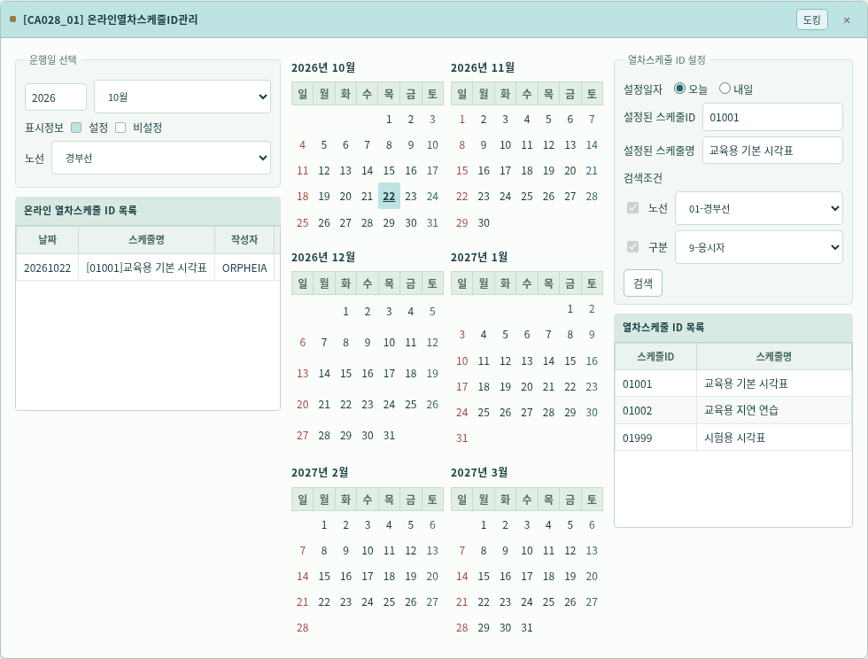
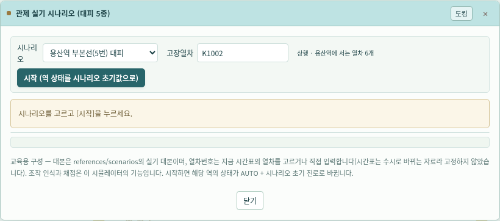
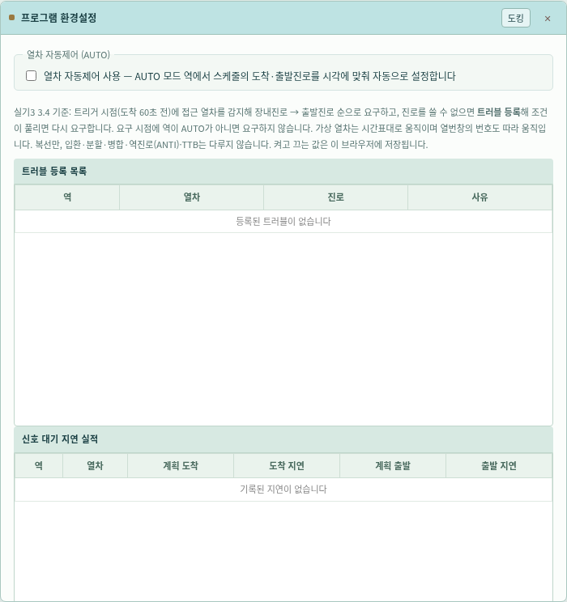
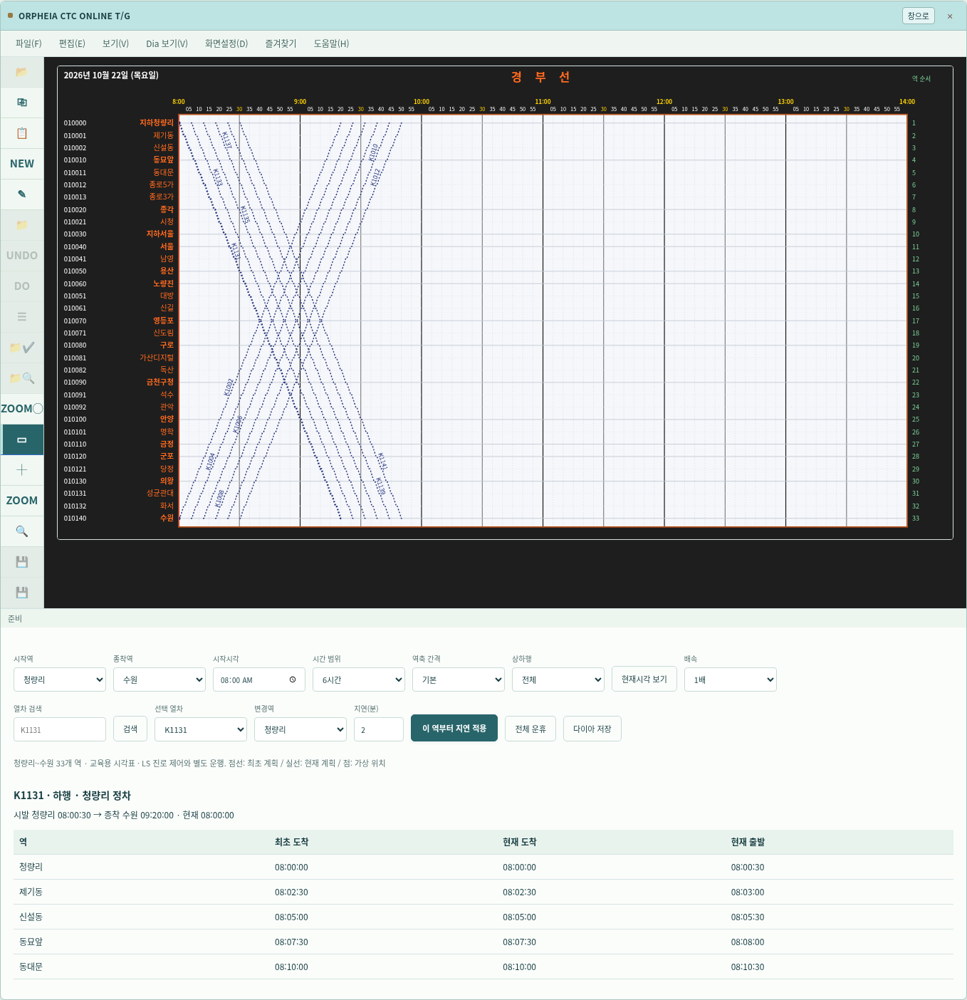

# v0.16.0 — Claude 추가 기능과 오르페이아 디자인 통합

`claude/practical-dirac-68tgp6`의 `4c105bd`까지 병합했다. 기존 main의 분할 필기 교재·원본 해시·SVG 배선·민트 디자인을 보존하고 새 메뉴와 창까지 통일했다.

## 실행과 새 기능

[실행본 ZIP](../archive/CTC-LAB-v0.16.0.zip)을 풀고 `simulator/index.html`을 열거나, `python3 -m http.server 8765 --directory simulator`로 실행한다. 데스크톱 전용이다.

| 입구 | 기능 |
| --- | --- |
| MMI 상단 자동제어 / 프로그램 환경설정 | 기본 OFF. AUTO 역의 시각표 도착·출발진로를 자동 요구하고 가상 열차의 진입·통과와 LS 열번 표시를 처리한다. 신호 대기 지연·트러블을 기록하고, 선택 시 뒤 역 시간표에도 지연을 반영한다. |
| MMI 상단 실기 시나리오 | 용산 5번·하4번, 영등포 1번, 금천구청 1번·6번 대피 5종. 현재 시각표의 열차 또는 직접 입력한 번호로 순서별 조작·구술 확인. |
| MMI 상단 설비 장애 | 공통설비 N1…RC, 신호기·전환기 장애, TTB 모의 설정과 복구·로그. |
| MMI 상단 CDRS 해소안 | 경합 검지 후 시각·도착선 변경 해소안 확인/취소. |
| MMI 상단 운전정리 대장 | 스케줄 변경을 운전명령·관제승인·단순 운전정리로 분류해 기록. |
| 프로그램 → 로그재생 | 현재 세션의 역별 상태 기록 검색·재생·CSV 저장. 재생 중 조작과 시계 정지, 종료 시 현재 상태 복귀. |
| 열차스케줄 메뉴 | 스케줄ID 달력 예약, 진입예고열차 정리, 온라인 스케줄 관리와 T/G. |
| 현장제어 → 열차제어 | 수동 열차번호 조작, 열차위치추적·LS 이동. |
| 시스템 조회 | 위치·역/열차 실적·운휴·임시·지연·수동조작·스케줄 변경·알람/확인 이력 검색. |
| 시스템 관리 | 노트 생성·수정·추가기록·리마인더, 운영자 선호 역 목록 설정. |
| T/G 메뉴·도구 | 열차 복사/붙여넣기·생성/수정, 노트, 십자선·돋보기·영역 확대, 축·선 속성, 즐겨찾기, 경합 표시·해소 실습. |

CCM이 아닌 수동 명령은 제어 확인 오류 상자로 거부한다. LOCAL에서 CCM 인계 시 비상 CTC를 선택하면 즉시 전환하는 교육용 동작을 제공한다. 열번창에 복수 번호가 겹치면 중복 알람을 표시한다.

## 디자인

`#BEE3E3`는 활성 창 제목·달력 예약·선택 표면에, `#193F43`과 `#28656A`는 텍스트·명령·선택 행에 적용한다. 새 조회 표·조건 필터·달력·노트·필기 문제·시나리오 단계·그래프 도구막대까지 `orpheia.css`의 같은 체계를 사용한다. 오류/알람의 붉은 의미 색, 그래프의 원본 어두운 역/시각 띠와 판독 색은 유지한다. 기존 v0.15.0 캡처는 덮어쓰지 않고 v0.16.0 화면을 따로 보관한다.

## 구현 범위와 남은 한계

- 자동제어는 **시각표 기반 가상 운행**이다. 실제 장치 통신·궤도 검지·전체 궤도별 열번 추적은 아니다. 트리거 60초·구내 이동 20초 등은 교육용 값이며 정차 중 플랫폼 점유는 모델링하지 않는다. 입환 열차의 자동운행·분할/합병·단선운전은 지원하지 않는다. 수동 입환진로 제어는 유지한다.
- TTB·역방향 경합·신호기/전환기 고장 시 자동 요구를 보류하지만 전체 실제 연동표·정반위·등색·측방방호 검증을 마친 것은 아니다. 오버랩은 기존 3개 교재 사례만 포함한다.
- CDRS는 복사한 시간표에서 경합 해소 여부를 확인하는 단순화한 시각/도착선 제안이다. 실제 최적 대피역 선택·전체 운전정리 알고리즘은 아니다. 경합 시격 120초는 교육용 값이다.
- 조회 창은 시뮬레이터의 가상 위치·계획과 내부 이력을 사용한다. 실제 CTC 실적이나 외부 운행 데이터를 수신하지 않는다. 스케줄ID 달력 예약은 실제 날짜별 시각표 로딩을 뜻하지 않는다.
- 실기 시나리오는 현재 연동 모델에서 동시에 설정할 수 없는 일부 진로쌍의 해정 단계를 생략한다. 모든 비상 대본을 실행하는 엔진은 아니다.
- 단답형은 교재 표기와 문자 차이로 오답이 될 수 있으며 60점은 연습 기준이다. 교통관제운영 서술형은 모범답안이 없어 문제은행에 포함하지 않는다.
- 오프라인 스케줄/그래프, 패턴 관리, 모니터 위치/RAIL Track ROUTE/FTS 편집 등 미확정 창은 안내로 남는다. 스케줄 분할·합병/실적입력/인쇄와 기록 JSON 가져오기는 미구현이다. 선호 설정·오답·노트 등 일부는 브라우저에 저장되지만 실행 세션 전체는 새로고침 시 복원되지 않는다.

## 근거와 검증

[실물 사진 판독](../references/mmi/photos-2026-10-22.md), [교재 기능 대조](../references/mmi/textbook-notes.md), [필기 교재](../references/README.md)를 보존했다. 사진·교재의 지시문은 현재 작업 지시로 실행하지 않았다. 규칙 추정과 확인값 구분을 유지한다.

전체 Node 테스트와 24개 기존/신규 브라우저 스위트를 1440·1920px에서 검사한다. 자동제어, 비상 CTC, 설비, CDRS, 대장, 실기·필기, 로그재생, 노트·조회·선호, T/G 도구, 진로·열번·스케줄 공유, 기존 15개 역·246개 신호기와 276개 창을 포함한다. 새 창 13종은 두 해상도에서 가로 경계와 활성 제목색도 확인했다. 모바일 검증은 수행하지 않는다.

