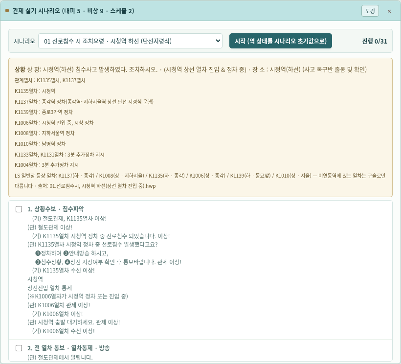
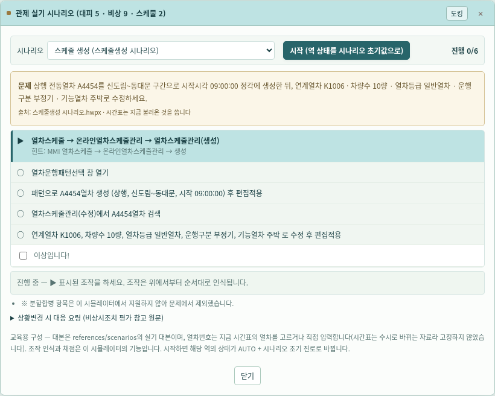
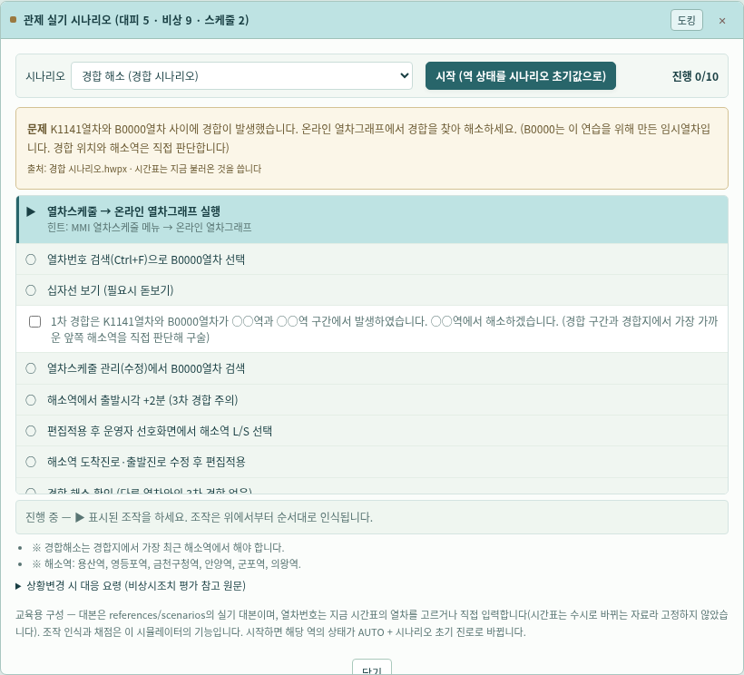
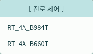
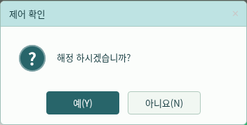
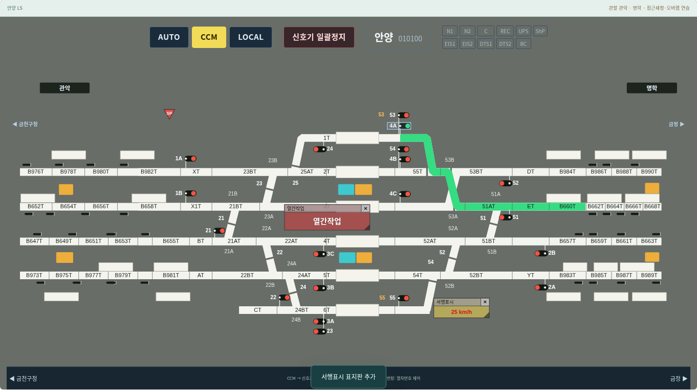

# v0.17.0 — 실기 시나리오·열번 이동·LS 조작 통합

Claude `claude/practical-dirac-68tgp6`의 `90726e2`까지 병합했다. main에 미전송 상태였던 비상 대본 10개 재첨부 확인 기록(`0008ab9`)도 포함한다. 교재·배선·대본 원본은 유지한다.

## 새 동작

MMI 상단 **실기 시나리오**를 열면 세 묶음, 총 16종을 선택할 수 있다.

| 묶음 | 내용 |
| --- | --- |
| 부본선 대피 5종 | 용산 5번·하4번, 영등포 1번, 금천구청 1번·6번. 시작 시 등장 열차를 방향과 함께 LS에 배치하고, 진로 설정·구술 확인·출발 단계에 따라 대피선·본선·출발 열번창으로 이동한다. |
| 비상시조치 9종 | 시청 침수, 동묘앞·석수 충돌, 금정 사상사고, 가산디지털 차량고장(구원/정상복구), 화재(구원연결/역간정차/자력회송). 대본의 통화·지시를 확인하고 CCM·신호 정지·진로·열번 수정/이동/삭제·AUTO를 순서대로 인식한다. |
| 스케줄 연습 2종 | 현재 시간표를 바탕으로 경합 해소 문제 또는 스케줄 생성·속성 수정 문제를 만든다. 그래프 검색·십자선·시각/진로 편집·해소역 선택과 패턴 적용·생성·속성 적용을 인식한다. |

시청·석수·가산디지털·독산·관악·당정 등 비취급 중간역의 열차도 이웃 취급역 LS의 해당 열번창에 배치한다. 예를 들어 석수는 금천구청 LS에서 표시한다. 충돌·구원연결 단계에서 같은 창에 번호가 겹치면 중복 알람을 발생시킨다. 상황변경 시 대응 원문은 참고 영역으로 제공한다.

- **알람 확인**: 확인할 알람의 체크칸을 선택한 다음 확인한다. 선택한 알람만 사라지고 확인이력에 기록된다. 체크 없이 확인하면 유지한다. ✕는 숨기기이며 확인이력으로 처리하지 않는다.
- **표지판**: 회색 제목과 반투명 붉은 본문, 서행은 반투명 노란 본문·붉은 속도 문자. 우하단 모서리로 확대/축소하고 고정하면 이동과 크기 변경을 막는다. 입력 허용 크기는 폭 60–1200, 높이 30–400이다.
- **진로 제어**: 신호기 옆에 목적지 목록을 표시하고 바깥을 누르면 닫는다. 긴 목록은 화면 안에서 스크롤한다. 해정 시 제어 확인 상자를 표시하며 Y/N 키를 지원한다. 점유·접근쇄정 중의 해정 제한은 유지한다.
- **안양**: `4A-B660T`, `4B-B660T`를 추가해 656개 경로를 제공한다. 관련 경합 검사와 스케줄 진로 선택에 연결한다. **목적지 근거와 전환기 구성의 확정 여부는 다르다.** 4A는 브랜치의 LS 사진 판독 기록, 4B는 사용자 확인 기록을 따른다. 전환기 구성은 모두 추정이며 4B 목록은 사진과의 재대조가 필요하다는 브랜치 기록도 보존한다.
- **필기 연습 제거**: 실기용 FTS 범위에 맞춰 필기 퀴즈·문제은행·생성기·버튼을 제거했다. 필기 교재 레퍼런스와 이전 버전 ZIP·검증 이력은 그대로 보존한다.

## 오르페이아 디자인

`#BEE3E3` 민트와 짙은 청록의 공통 디자인을 유지한다. 새 진로 목록과 해정 상자에도 같은 제목·선택·확인 색을 적용한다. 선로·알람·서행 표지판의 의미 색과 원본 배치는 유지한다. 시나리오 선택 줄의 줄바꿈과 팝업 화면 경계를 정리했다.

## 범위와 한계

시나리오의 열번 이동은 단계·모의 시간에 따른 표시 재현이다. 실제 열차의 연속 주행, 실제 궤도 검지와 순차 점유·해정, 구원연결의 물리 모델을 구현한 것은 아니다. 대본의 진입·통과 확인과 교신은 일부 구술 체크로 처리한다. 상황변경 참고문은 자동 분기 엔진이 아니다. 시나리오 초기화는 해당 실습 역 상태를 바꾸므로 진행 중 연습과 구분해 사용한다.

대피·비상 시나리오는 대본의 번호를 표시에 사용하고 스케줄 연습은 현재 시간표로 문제를 만든다. 모든 등장 열차가 온라인 시간표에 등록되는 것은 아니다. 입환 자동운행·분할/병합·실제 단선 운전 모델·전체 연동표·신호 등색 검증 등 v0.16.0의 남은 한계는 유지한다. 알람 ✕의 원본 동작은 미확인 가정이다.

## 검증

전체 Node 검사와 데스크톱 브라우저 스위트 27개를 수행한다. 비상 9종의 시작·대본 단계·동묘앞 구원 흐름, 대피 5종의 열번 배치/이동, 경합·생성 문제 해결, 선택 알람 확인, 표지판 확대·축소·고정, Y/N 해정, 안양 추가 경로의 설정·해정·경합, 기존 15개 역·246개 신호기·276개 창·스케줄·자동제어·로그재생 회귀를 포함한다. 새 비상·스케줄·표지판·등장 열차 검사를 1440·1920px로 확대했다. 모바일 검증은 하지 않는다.

