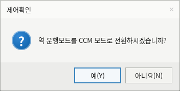
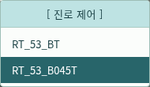
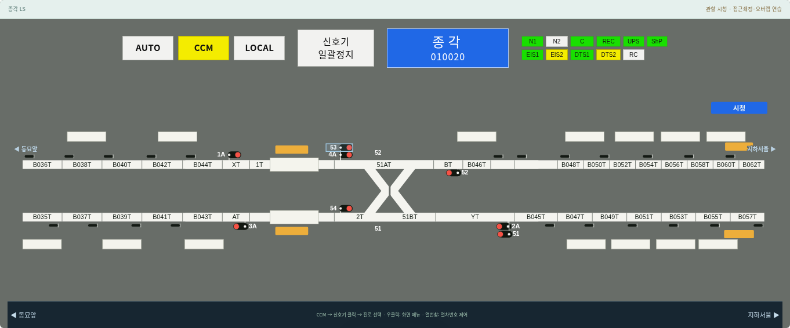
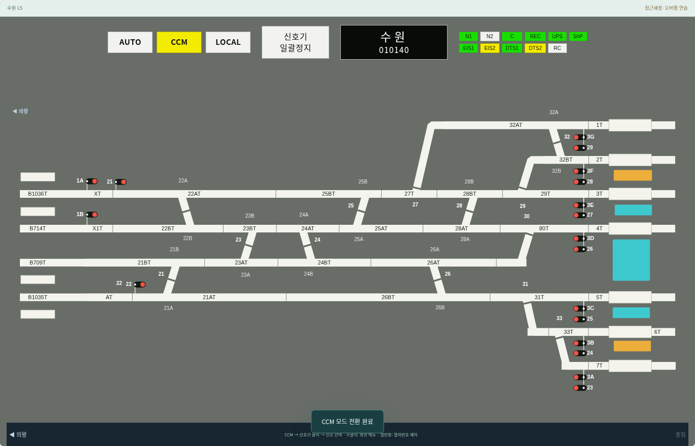

# v0.17.1 — CCM 확인·진로 메뉴·LS 표시 수정

사용자 제공 수원·지하청량리 LS 사진과 2026-10-22 역명판 색 설명을 반영했다. 주변 작업 영역의 #BEE3E3 오르페이아 테마는 유지하며 LS의 설비·역명·모드 현시를 원본에 맞췄다.

- CCM을 누르면 **제어확인 / 역 운행모드를 CCM 모드로 전환하시겠습니까? / 예(Y)·아니요(N)** 상자를 표시한다. 흰 바탕·파란 물음표·오른쪽 버튼 배치를 사용하고 Y/N 키와 취소 시 상태 보존을 지원한다. LOCAL 인계·비상 CTC 선택 기능도 유지한다.
- 진로 메뉴의 자동 포커스 항목과 마우스 올림 항목이 함께 초록색으로 남던 문제를 수정했다. 초록색 채움은 마우스가 올라간 한 항목에만 적용하고, 키보드 포커스는 윤곽선으로 구별한다. 항목 사이를 옮기거나 제목으로 나가면 이전 채움을 즉시 지운다.
- **지하청량리·동묘앞·종각·지하서울과 그 구간 중간역** 이름판은 파란색, 그 밖의 역은 검정색이다. 취급역 이름과 역 코드를 위아래로 배치하고 청량리 LS 이름을 지하청량리로 표시한다.
- 비활성 모드 버튼과 신호기 일괄정지는 흰 바탕·검은 글자, 활성 AUTO는 녹색·CCM은 노란색이다. 설비 기본 현시는 N1/C/REC/UPS/ShP/EIS1/DTS1 녹색, N2/RC 흰색, EIS2/DTS2 노란색이다. 장애를 설정하면 기존 붉은 표시를 우선하며 복구 후 기본색으로 돌아간다. 실제 장치 통신 상태를 수신한 색은 아니다.

1440·1920px에서 15개 역의 이름판·중간역 색, CCM 확인/취소, Y/N, 설비 장애/복구, 진로 항목 간 마우스 이동·이탈·키보드 포커스를 검사했다. 기존 과제·비상 CTC·표지판·도킹·문자 배치와 전 역 246개 신호기의 설정/해정도 회귀 검증한다. 모바일 검증은 수행하지 않는다.

검증: `python3 simulator/ls-header.browser.test.py`. 기능 데이터·연동 범위는 [v0.17.0 통합](v0.17.0-통합.md)을 따른다.

