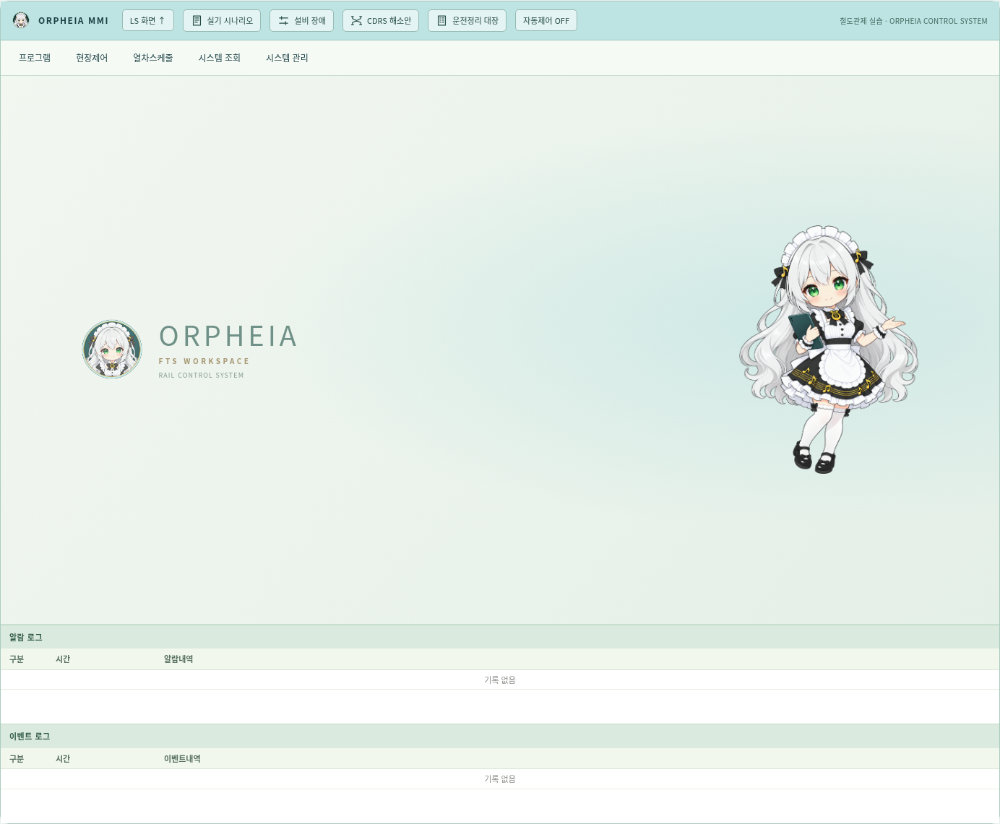
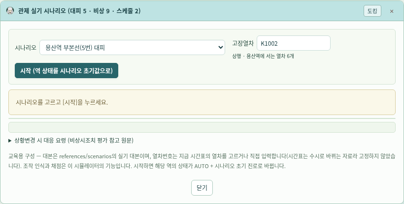
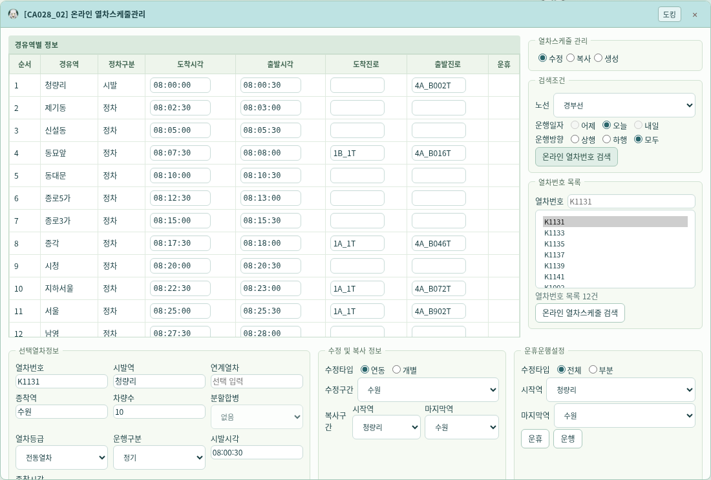
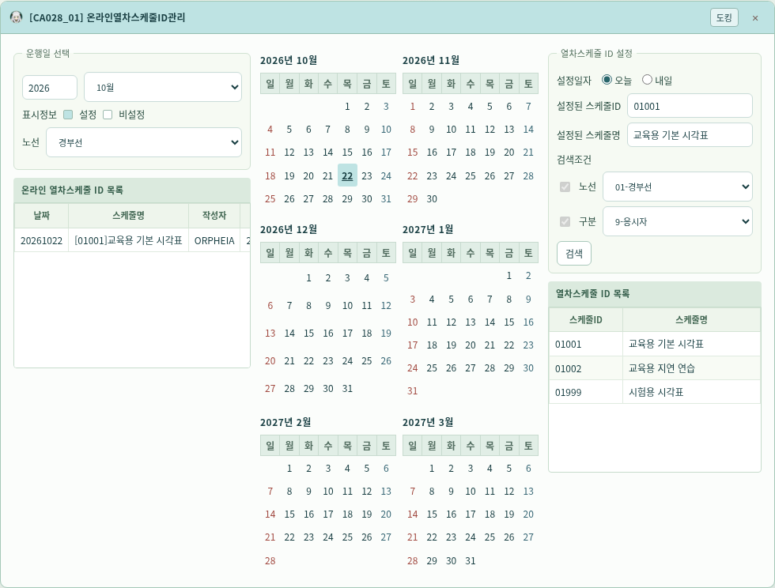
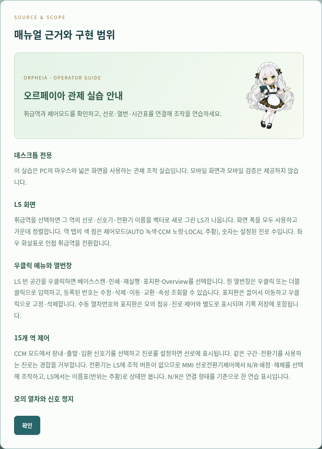

# v0.18.0 — 오르페이아 에셋과 프로그램 전체 디자인

사용자가 제공한 캐릭터를 참고해 **image_gen으로 새 에셋 3종**을 생성하고 실제 프로그램에 적용했다. 메인 컬러 #BEE3E3, 깊은 청록 #193F43, 따뜻한 아이보리, 작은 금색 포인트를 공통 체계로 사용한다. 캐릭터의 은발·초록 눈·메이드 의상과 음악/리라 장식을 유지한다.

## 적용 범위

| 영역 | 변경 |
| --- | --- |
| 앱 브랜드·헤더 | 원형 엠블럼·favicon, 작업 영역 배너, 배경과 자연스럽게 이어지는 페이드, 공통 SVG 조작 아이콘 |
| 취급역·LS 주변 패널 | 역 탭·세션 바·범례·상태 스트립·진로 현황의 여백·톤·글자 대비 정리 |
| MMI | 대기 화면의 안내 캐릭터와 엠블럼, 메뉴·도킹 창·제목 아이콘·버튼 체계 통일 |
| 조회·시간표 | 표 제목·선택 행·필터·달력·입력·확인/취소·비활성 상태·스크롤 표면 통일 |
| 실기 시나리오·조작 연습 | 단계·문제·힌트·완료 상태의 표면과 타이포그래피 정리 |
| 안내·기록·기타 창 | 사용 안내의 캐릭터 소개, 빈 조작 기록의 엠블럼, 노트·선호·재생·설비·대장의 같은 디자인 적용 |

배너나 캐릭터로 실제 선로를 덮지 않는다. LS의 지하청량리~지하서울 파란 역명판·나머지 검정, 설비 기본색·장애색, 모드 색, 사진 기반 CCM 제어확인, 진로 메뉴 hover 수정은 보존한다. 그래프의 계획/실적/경합 판독 색과 원본 어두운 역/시각 띠도 유지한다. 장식 이미지는 클릭을 받지 않고, 작은 아이콘은 스크린리더에서 제외한다. 폰트·이미지·아이콘은 외부 서비스에 의존하지 않는다.

## 에셋과 구조

- [에셋 갤러리·PNG](../simulator/assets/orpheia/README.md)
- [생성 출처·해시·치수](../simulator/assets/orpheia/MANIFEST.json)
- `orpheia.css`: 앱 전반의 디자인, `design.js`: 기존 버튼의 ID와 이벤트를 유지하는 아이콘 표시.
- 사용자 원본 참고 그림과 생성 결과를 구별하며, 생성된 PNG는 별도 이미지 가공 없이 그대로 보관한다. 배너 페이드와 크기는 CSS로 표시한다.

## 검증 및 범위

1440·1920px에서 에셋 요청 오류·투명 PNG·favicon·브랜드·가이드 로딩, 새 디자인 창 13종의 경계와 민트 제목, 캐릭터의 비상호작용 영역을 확인한다. 기존 15개 역·246개 신호기·276개 열번창·표지판·CCM·스케줄·자동제어·시나리오·조회·재생·노트의 데스크톱 회귀 검사를 수행한다. 표지판 검사는 변경된 헤더 높이에서도 조절점을 화면에 스크롤해 확대/축소한다. 모바일 검증은 하지 않는다.

LS 벡터 검사에서는 페이지 장식 에셋 3개만 허용하고 LS DOM의 img/image/canvas 및 배경 URL 부재를 따로 검사한다. 기능·연동조건의 구현 범위는 [v0.17.0](v0.17.0-통합.md), LS 사진 반영은 [v0.17.1](v0.17.1-LS표시수정.md)을 따른다. 디자인 변경이 실제 연동조건의 추가 검증을 뜻하지 않는다.

