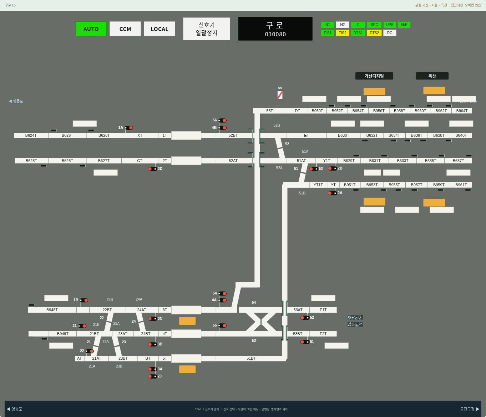
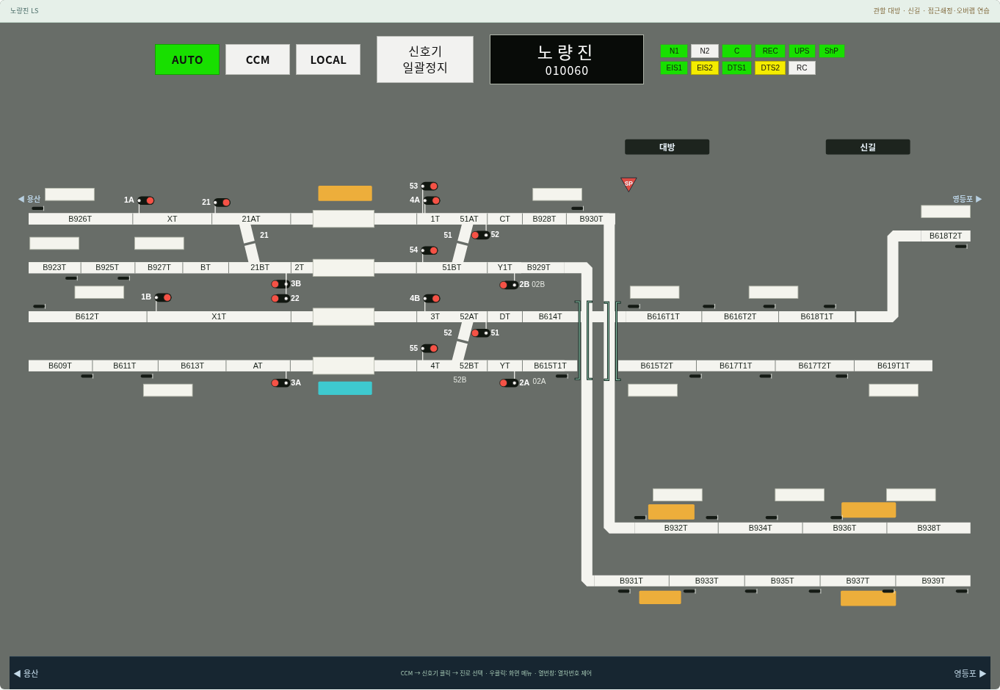
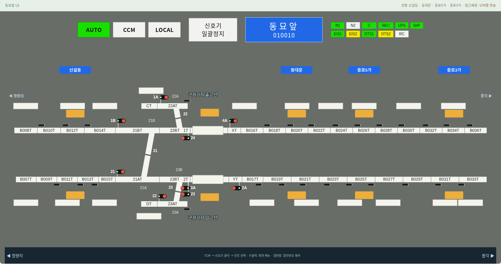
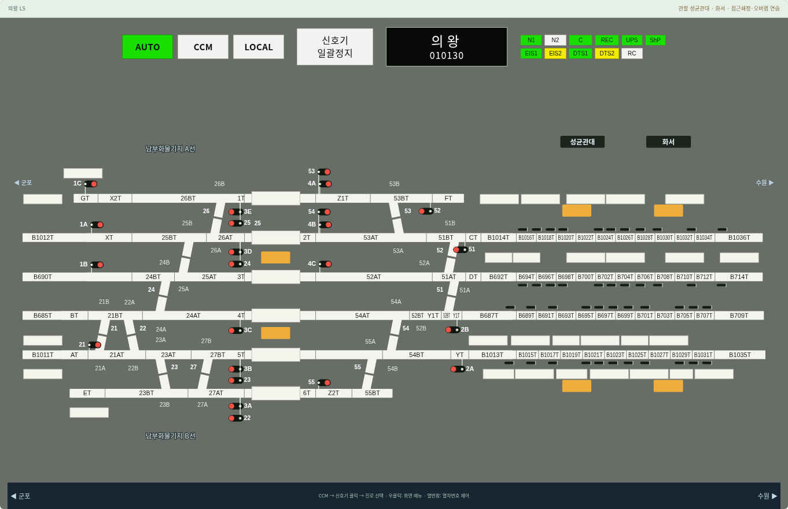

# v0.18.1 원본 괄호 표식·기지 문구 복원

구로 사진에서 지적한 `] [` 모양을 PDF 확대본과 대조했다. 구로 52BT/52AT와 53AT/53BT 쪽 네 쌍, 노량진의 병행선 경계 두 쌍을 네이티브 SVG 경로로 복원했다. 구로의 차량기지 입출고선, 동묘앞의 군자기지 출고선·입고선, 의왕의 남부화물기지 A선·B선 문구도 복원했다.

이 요소들은 기존 추출기가 흰색 선로와 숫자 코드를 중심으로 읽으면서 누락했다. [전사 좌표](../references/transcriptions/fixed-symbols.json)에 원본 페이지와 위치를 기록했고 `tools/build-fixed-symbols.py`가 역별 선로 좌표로 변환한다. 선로와 같은 확대·좌표 변환을 쓰며 문자·열번창 배치 시 충돌 영역으로 예약한다. 원본의 반복 구간은 실제 관할 화면에 한 번씩만 표시하고, 시안색 승강장 가장자리를 괄호로 오인하지 않았다.

괄호의 실제 설비 의미와 상태별 색 변화는 자료만으로 확정하지 않았다. 이번 구현은 원본 고정 표식의 복원이며 별도의 제어 기능이나 연동 조건을 추가하지 않는다.

1440·1920px에서 15개 역의 개수·잘림·문자/열번창 겹침·진로 설정 후 표식 유지 검사를 통과했다. 기존 전 역 N/R 문자 배치, 네이티브 선로, 우클릭 메뉴, 쇄정 시 선형 변화, CCM 확인·설비색 회귀와 전체 Node 테스트 24개 파일도 통과했다. 모바일 검증은 수행하지 않았다.

