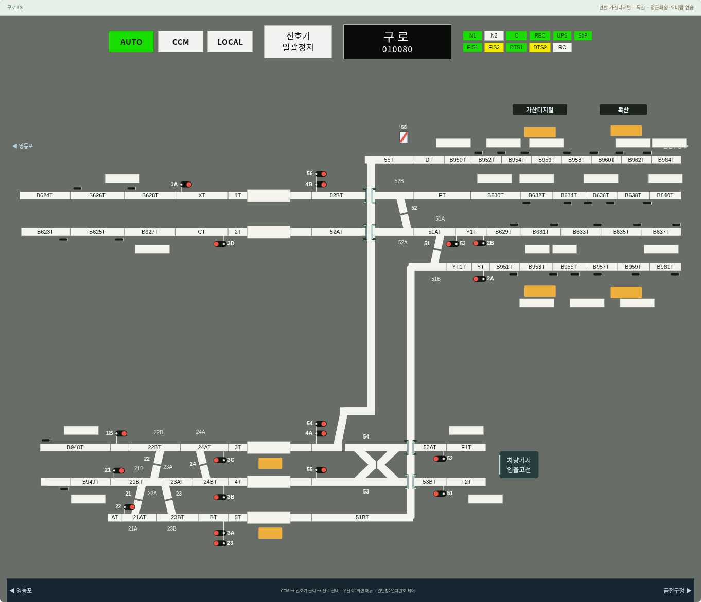
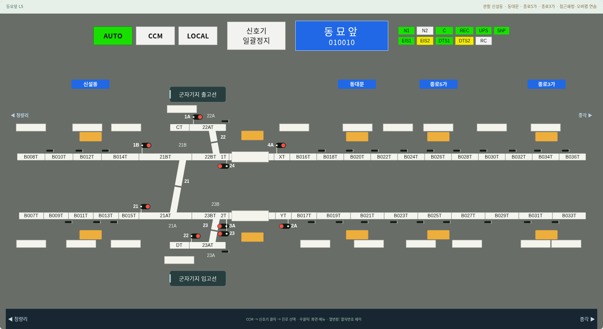
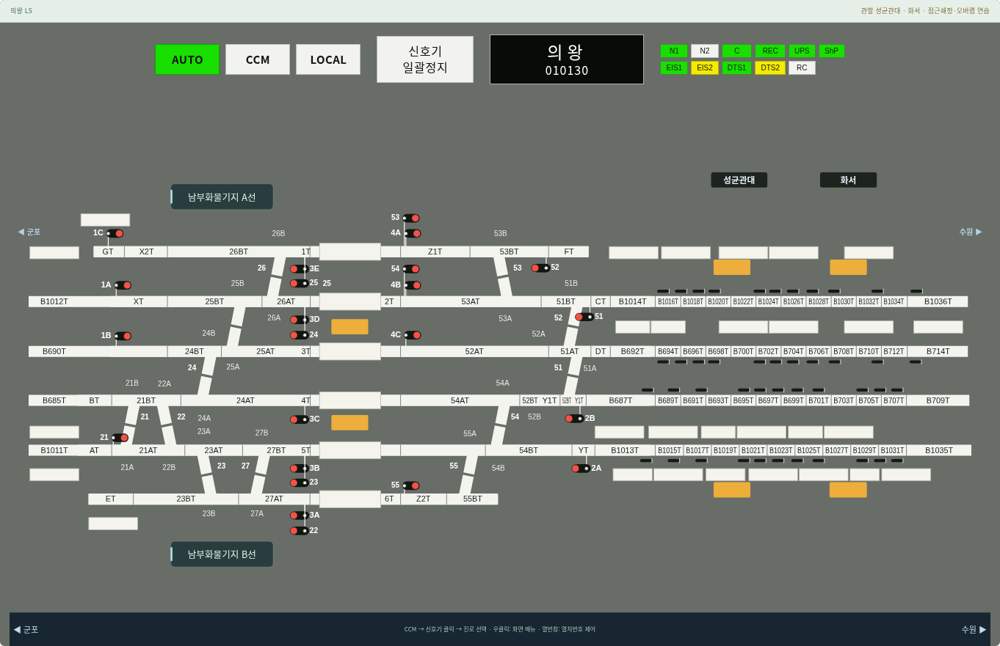
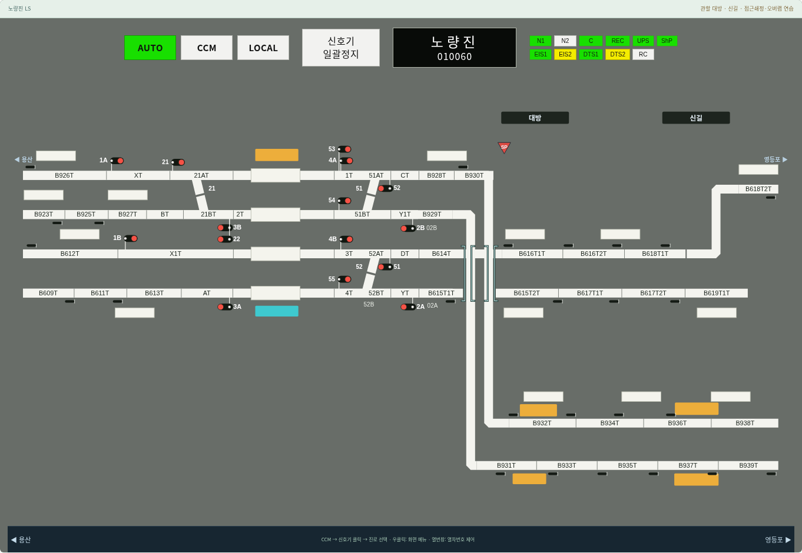

# v0.18.2 — 표식·기지 문구 위치 정돈

추가한 표식과 문구를 원본 이미지의 픽셀 중심에 그대로 놓던 배치를 다듬었다. 원본 좌표 전사는 보존하고 화면에서 보이는 위치는 실제 선로의 중심과 끝점을 기준으로 계산한다.

- 구로·노량진 괄호: 폭 28, 선로 중심에서 위·아래 17의 동일한 여백. 여러 선로를 감싸는 원본 형태는 유지한다.
- 동묘앞 군자기지 출고선·입고선: 두 지선의 같은 중심에 배치하고 선로에서 각각 위·아래 90의 간격을 둔다.
- 의왕 남부화물기지 A선·B선: 문구 중심과 패널 폭을 일치시켜 같은 세로축에 정렬한다.
- 구로 차량기지 입출고선: 두 입출고선 끝에서 32를 띄우고 두 선로 사이 높이의 중심에 배치한다.
- 기지 안내 문구: 두꺼운 외곽선을 제거하고 차분한 청록 바탕·민트 `#BEE3E3` 포인트·일정한 안쪽 여백을 적용한다. 안내 패널은 클릭을 가로채지 않는다.

패널 영역을 문자·열번창의 배치 장애물로 예약하고 하단에는 일정한 여백을 확보한다. 회로 연결과 원본 식별 코드, 열번창과 진로 제어는 보존한다.

1440·1920px에서 15개 역의 N/R 문자 겹침·클리핑, 표식 폭, 대칭 문구 정렬과 진로 상태 유지 검사를 통과했다. 네이티브 LS·쇄정 시 선형 변화·프로그램 디자인 회귀 및 전체 Node 테스트 24개 파일도 통과했다. 모바일 검증은 수행하지 않았다.

