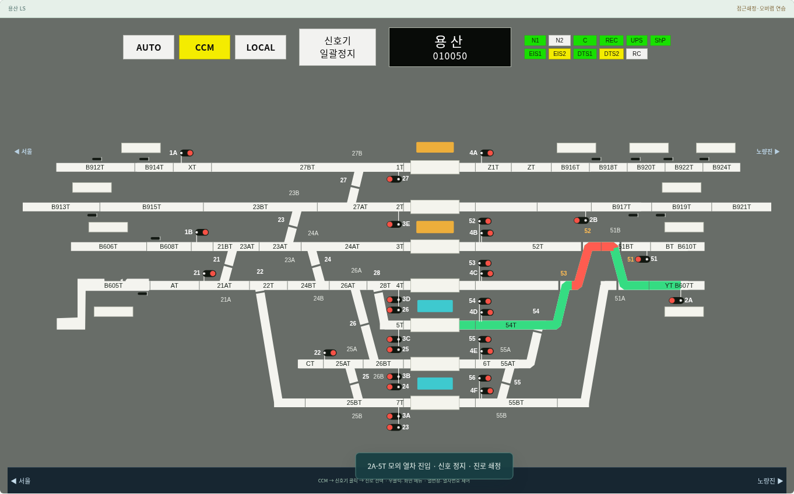
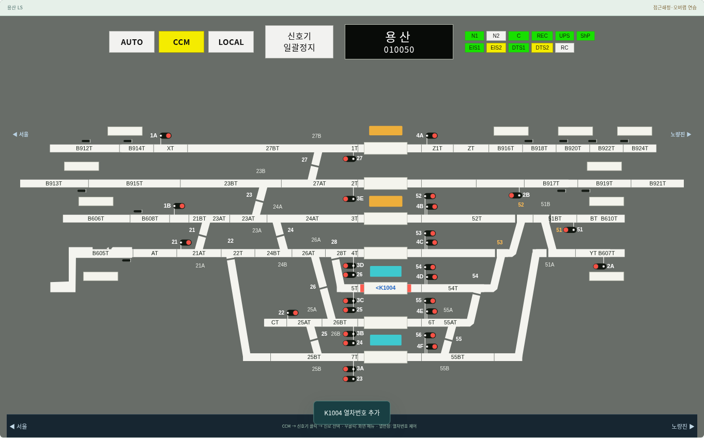

# v0.18.3 — Claude 브랜치 검토·통합

`claude/practical-dirac-68tgp6`의 `c85f717`까지 현재 main의 후속 변경임을 확인하고 기존 이력을 보존해 통합했다. 새로운 코드 차이는 열차 점유·진행 현시가 중심이다. 클로드 CHANGELOG의 알람·표지판·진로 확인·안양 진로 내용은 이전 통합에 이미 포함되어 있어 중복 추가하지 않았다.

적용한 동작:

- 열차번호가 있는 회로는 붉게 표시하고, 번호를 이동·삭제하면 표시도 바뀐다.
- 열번창은 흰색을 유지하며 승강장 창 양옆으로 점유색이 드러난다.
- 접근 열차는 신호기 외방의 회로에 점유 표시를 남긴다.
- 모의 진로 진입 후 가상 시계에 따라 붉은 구간이 이동하고, 통과 명령 전까지 끝 위치를 유지한다.
- 자동제어·시나리오·수동 열번 제어와 같은 데이터를 사용한다.

통합하면서 보완한 부분:

- 배속 틱이 이동 완료 시각을 지나더라도 마지막 프레임을 갱신한다. 완료 후에는 불필요하게 LS 전체를 다시 그리지 않는다.
- Overview도 주 화면처럼 열차번호에 따른 점유를 표시한다. Overview는 열 때의 스냅샷이다.
- 이동 시간은 양의 유한 숫자만 사용하고, 잘못된 값은 기본 20초로 처리한다. 연속진로가 재설정되면 이전 이동 메타데이터를 지운다.
- 움직이는 구간과 열번 위치에 따른 점유색을 동일한 붉은색으로 맞춘다. 기존 #BEE3E3 디자인·표식 정렬·문자 배치는 유지한다.
- 세션 내보내기의 앱 버전 표기를 갱신했다.

검증: 전체 Node 테스트 25개 파일, 데스크톱 브라우저 9개 스위트 통과. 1440·1920px에서 60배속의 종료 프레임, 열번창 색 유지, 이동·삭제·해정, Overview 공유, 자동제어·재생, 전 역 N/R 문자 배치·기존 디자인을 확인했다. 모바일 검증은 수행하지 않았다.

한계: 열차의 길이와 소요 시간은 교육용 시각화 값이다. 이동하는 붉은 부분은 진로의 SVG 길이를 따라 보간하며 실제 차량 길이·속도·궤도회로 검지 경계의 재현은 아니다. 실제 연동 자원은 통과 명령까지 기존 점유 쇄정을 유지한다. 열차번호 입력에 따른 붉은 표시는 화면용이며 실제 검지나 자동 제어 조건을 새로 만들지 않는다.

