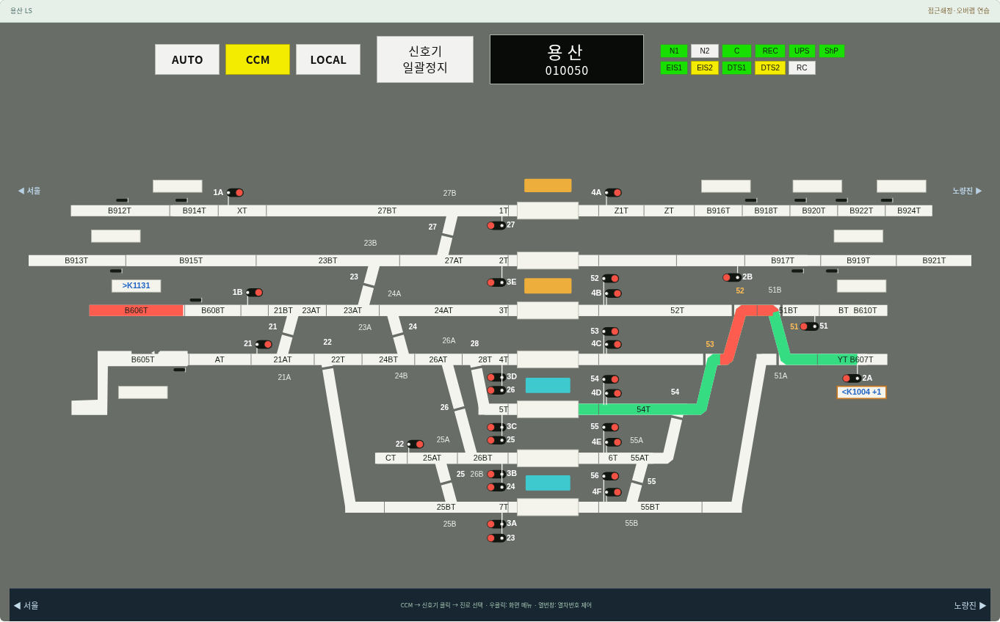
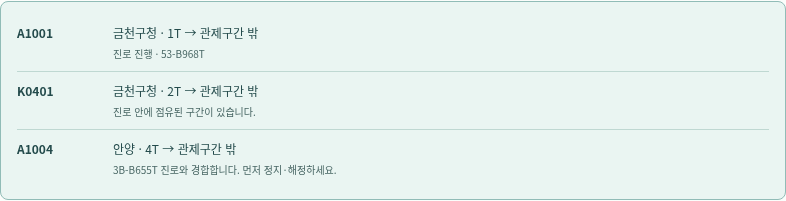

# v0.19.0 — 시나리오와 열차 운행 연결

시나리오의 번호 이동과 진로 위 붉은 이동 구간이 분리되어 있던 문제를 보완했다. 대피 5종·비상 9종은 같은 시나리오 이동 엔진을 사용하고, 스케줄 2종은 편집 결과를 기존 시간표 AUTO 운행과 공유한다.

## 사용

1. MMI에서 관제 실기 시나리오를 시작하고 지시된 모드·진로 조작을 한다.
2. 이동 지시가 발생하면 시나리오 창에 열차번호, 출발·도착 위치, 진행 또는 대기 이유가 나타난다.
3. 가상시계를 진행한다. 일시정지하면 움직임도 멈추고 `+10초`나 배속으로 진행할 수 있다.
4. 진로의 이동이 끝나면 도착 열번창에 번호가 나타나고, 모의 통과로 자원과 진로를 해제한다. 이동 중에는 출발 번호를 중복 현시하지 않는다.
5. 시나리오 중지 버튼은 대기·이동·시나리오 소유 점유를 정리한다. 다시 시작하거나 다른 시나리오를 선택해 시작하면 이전 등장 열차 표시도 정리한다. 창 닫기는 시나리오 중지와 별개다.

## 연결 범위

| 구성 | 연결한 동작 |
|---|---|
| 대피 5종 | 고장·후속·타 열차 14개 여정의 진입, 승강장 도착, 출발과 구간 이탈 |
| 비상 9종 | 대본의 21개 구술 단계에서 31개 열차 여정, 49개 이동 지시 생성 |
| 운행선 변경 | 안양→금천구청, 안양→군포, 금천구청→구로의 출발 진로·경계 인계·도착 진로 연결 |
| 수동 이동·구원연결 | 기존 7개 수동 지시를 시간에 따른 표시 인계로 처리하고 실제 도착 후 조작을 인식 |
| 스케줄 2종 | 생성·수정한 시간표가 AUTO 운행의 입력으로 유지됨. 시간표 편집만으로 열차를 강제 출발시키지 않음 |
| 자동제어와 중복 방지 | 진행 중인 대피·비상 시나리오 등장 열차는 별도 시간표 AUTO에서 중복 운행하지 않음 |
| 기록·재생 | 실제 도착 때 중복 알람과 단계 인식 갱신, 재생 중 시나리오 정지, 세션 내보내기에 진행·이동 큐 포함 |

진로가 없거나 신호가 정지이면 기다린다. AUTO에서 요청하는 진로도 기존 코어의 고장·경합·오버랩·전환기 쇄정·제어권 조건을 통과해야 한다. 목적 승강장에 선행열차가 있으면 도착을 강행하지 않는다. 사용자가 모의 점유를 바꾸거나 번호를 삭제하면 진행 중인 이동을 취소해 뒤늦게 다른 위치로 옮기지 않는다.

비상 큐는 `emergency-data.js`의 번호별 구술 지시를 대조해 `emergency.js`의 `MOTION`에 명시했다. 정차 지시나 일반 방송을 출발 명령으로 자동 해석하지 않는다. 아직 없는 회송 번호는 이름 변경을 기다린 뒤 처리한다. 초기 출발 신호의 기본 진로가 기지 막다른 선을 향하던 문제도 수정했다. 안양 K0811은 대본의 4B-B660T에 연결되는 2T에서 시작하도록 맞췄다.

## 검증과 범위

전체 Node 테스트 26개 파일과 데스크톱 브라우저 12개 스위트를 검증했다. 대피 14개 여정과 비상 31개 여정은 정상 진로의 개별 완주를 검사했다. 대표 후속열차 운행에서는 선행열차의 진로·목적 선로가 빌 때까지 기다리는 것도 확인했다. 수동 이동 7개 지시, 고장 대기·외부 모의 점유 변경 취소를 검사했다. 1440·1920px에서는 대피 5종, 비상 9종 시작·구술 큐와 대표 구원연결, 스케줄 2종, 일시정지·배속·재시작·중지, 출발 번호 중복 현시 방지 및 기존 AUTO·재생·정렬·디자인을 확인했다. 모바일 검증은 수행하지 않았다.

선로를 따라 움직이는 부분은 기존 진로 좌표를 사용하며 열차 길이·시간은 교육용이다. 역간 전체를 한 SVG로 이어 그리거나 원본에 없는 건넘선을 만들지 않는다. 관할 경계에서는 출발 화면과 도착 화면의 인계를 표시한다. 실제 진로가 확인되지 않은 수동 반대선 이동·구원연결은 **운영자의 열차번호 인계 표시**이며, 반대선 운행 허가나 실제 검지·연동 기능을 구현했다고 간주하지 않는다.

