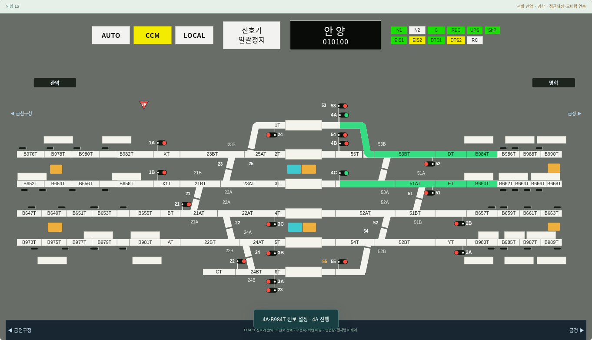

# v0.19.1 — 안양 4C-B660T · 4A-B984T 동시 설정

2026-10-23 사용자가 실제 LS에서 `4C-B660T` 설정 중 `4A-B984T`를 추가 설정할 수 있다고 확인했다. 이 사용자 확인을 해당 조합의 동시 취급 근거로 등록했다. 전체 실설비 연동표를 확보했다는 의미는 아니다.

원인은 전환기 번호를 하나라도 공유하면 경합으로 판단하는 기존 조건이었다. 두 진로의 배선 모델을 대조하면 공유 선로 자원은 없고, 공유하는 53번 전환기는 모두 정위(N)다. `interlocking.js`에 해당 조합과 확인 출처를 등록하고, 그 조합에서 공유 전환기의 요구 방향이 알려져 있고 일치할 때 함께 설정하도록 수정했다.

- 어느 순서로 설정해도 4A와 4C가 함께 진행 현시된다.
- 두 진로는 독립적으로 모의 점유·통과·해정할 수 있다.
- 한 진로를 해정해도 다른 진로의 점유와 신호는 유지한다.
- 53번 전환기는 마지막 진로가 해정될 때까지 수동 전환을 막는다.
- 같은 신호, 공유 선로 자원, 반대 전환기 방향과 방향 누락은 여전히 경합이다.
- 다른 조합의 보수적인 기존 판정과 접근쇄정·오버랩 검사는 유지한다. AUTO와 시나리오도 같은 코어 규칙을 사용한다.

전체 Node 테스트 26개 파일과 데스크톱 브라우저 5개 스위트를 검증했다. 양방향 설정 순서, 동시 점유, 한쪽 통과 후 다른 점유 보존, 공유 전환기 보호, AUTO 동시 설정과 실제 경합 유지 조건을 확인했다. 브라우저에서는 1440·1920px로 LS 메뉴에서 직접 두 진로를 설정하고 진행 현시·독립 점유·통과를 검사했다. 기존 전환기 선형 변화, 시나리오와 자동제어 회귀도 수행했다. 모바일 검증은 수행하지 않았다.

