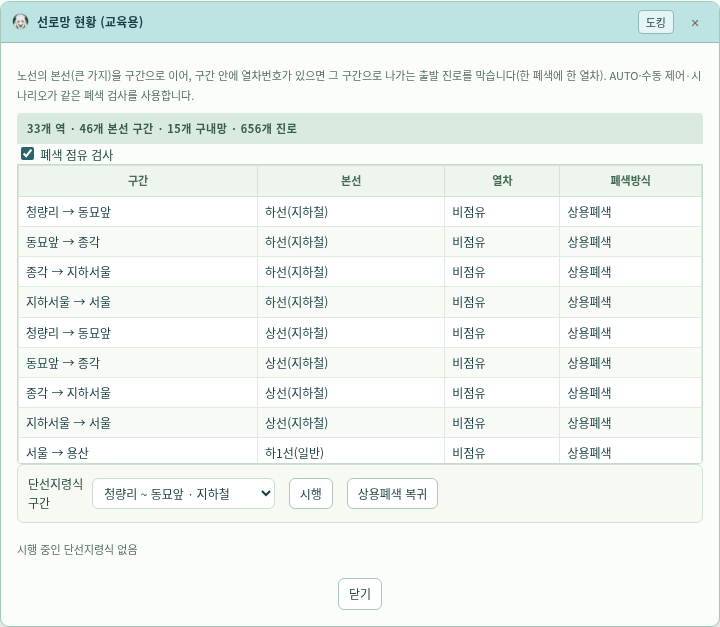

# v0.19.3 — Claude 선로망 통합과 전체 운행 검수

검수한 브랜치는 `claude/practical-dirac-68tgp6`, 원격 커밋은 `cae0a0afa3b44f8b0dc6fbaa0c3e6212983786a4`다. 이 브랜치의 본선 연결·역간 열차번호 인계·접근 전달·중간역 표시·폐색 검사·단선지령식 구현을 통합하고, 실제 운행 순서와 보호 조건의 누락을 보완했다.

## 전체를 구성하는 방식

전체망은 본선과 구내망을 가진 **계층형 복합 그래프**다. 본선 계열(M: 지하철 / G: 일반 / E: 전동, D·U: 방향)별 46개 역간 구간이 15개 연동역을 잇는다. 18개 비연동 중간역을 포함한 33개 역이 같은 노선 순서를 공유한다. 서울의 M↔E 계열 전환과 금정을 지나가는 G선의 별도 연결을 유지한다.

각 역의 작은 가지는 배선 추적 그래프의 분기·합류·건넘선·부본선·기지 경계로 보존한다. 구내 그래프는 692개 노드·734개 연결로 구성되며, 코어에서 쇄정하는 656개 진로의 선로 자원과 같은 식별자를 사용한다. 화면 좌표상 교차한다는 이유만으로 두 선로를 연결하지 않는다. `network-topology.js`는 별도의 가상 배선을 만드는 대신 이 구내망과 `line.js`의 본선 연결을 함께 참조한다.


## 검수에서 수정한 동작

1. **앞 역에서 출발하지 않은 열차가 뒤 역에 생성되는 문제**: AUTO가 같은 열차의 앞 연동역 통과를 기다리도록 변경했다. 단순히 열번을 한 곳에서 지우는 표시 처리와 달리 뒤 역의 진로 요청·진입 자체를 앞 역의 진행 상태와 연결한다.
2. **실제 지연과 계획 시각의 분리**: 시간표 반영 옵션을 꺼도 실제 지연은 다음 역 운행과 중간역 표시로 전파한다. 옵션을 켜면 계획 수정과 실제 지연을 중복 적용하지 않는다. 같은 처리 주기에 시간표가 바뀌었을 때 뒤 역이 이전 시각을 사용하는 오류도 수정했다.
3. **다이아의 현재 위치**: AUTO를 사용할 때 실제 운행 커서를 참조한다. 시나리오가 맡은 열차는 시나리오의 현재 열번 위치와 관할 인계 진행을 사용한다. AUTO를 끄고 시나리오도 맡지 않은 열차는 기존 계획 위치를 표시한다. 내보내기 파일에도 실제 위치와 망 검수 정보를 포함한다.
4. **시나리오의 폐색 검사 자동 해제**: 비상 시나리오 시작 시 검사를 끄던 처리를 제거했다. 시나리오도 같은 전방 폐색을 검사하며, 이미 설정된 출발진로라도 전방에 다른 열차가 있으면 이동을 기다린다.
5. **빈 단선 구간의 대향 출발진로**: 열번이 들어오기 전에도 먼저 설정된 출발진로가 상대 출구를 예약한다. 두 취급 순서를 모두 검사했다. AUTO도 각 진로 요청 전에 현황을 다시 읽는다.
6. **열번창 코드와 진행 방향**: `B615T1T`처럼 복합 표기가 있는 창도 폐색 검사와 진입 창 탐색에 포함한다. 역간 인계는 회로 홀짝만으로 진행 방향을 뒤집지 않고 열차의 실제 상·하행을 사용한다. 반대 방향 장내신호기가 자료에 없으면 신호기를 만들어 내지 않는다.
7. **선로망 현황 창**: 점유된 구간만 보이던 화면에 전체 46개 본선 구간과 33개 역·15개 구내망·656개 진로 집계를 표시한다. 기존 민트 테마를 사용한다.

## 데이터 검수와 한계

[전체 집계·구간·경계·중간역 매핑 JSON](network-audit-v0.19.3.json)에 결과를 저장했다. 18개 중간역의 모든 매핑 열번창이 실제 등록된 창인지, 모든 본선 구간의 진입 창을 찾을 수 있는지 검사했다. 654개 직접 추적 진로는 시작 신호기에서 선로 자원이 연속되는지도 검사했다.

안양 `4A-B660T`·`4B-B660T`는 이전 버전부터 LS 목록 확인을 바탕으로 모양과 보호 자원을 합성한 두 진로다. 이들의 자원 목록은 보수적인 **보호 집합**이며 원본 그래프의 연속 경로로 취급하면 안 된다. `resourceModel: conservative-composite`로 명시하고 검수 JSON에 별도로 노출했다. 기존의 공유 선로·전환기 보호는 유지한다. 세부 크로스오버 구성을 실물과 대조하기 전에는 직접 추적 경로로 확정하지 않는다.

본선 구간은 교육용 역간 구간이다. 실제 역간 폐색 회로를 전부 세분화한 모델이나 실설비의 연동표 전체를 재현했다는 뜻은 아니다. 기지·외부 노선은 제공된 경계까지만 표현하며 목적지가 없는 경계를 임의의 다른 역으로 연결하지 않는다. 비상 시나리오의 수동 구원·연결과 명시적 역간 인계는 기존 교육용 절차를 유지하며, 전 구간의 물리 이동 경로를 새로 검증한 것으로 보지 않는다.

## 검증 결과

전체 Node 테스트 29개 파일과 데스크톱 브라우저 10개 스위트(network-unified·line·line-block·autocontrol·scenario-motion·mmi-scenario-cast·emergency·interlocking·route-conflicts·ls-switches)를 통과했다. 새 화면 시험은 1440·1920px에서 앞 역 고장 중 뒤 역 생성 방지, 실제 위치, 중간역 지연, 시나리오 공통 폐색 검사, 빈 단선 구간의 대향 출발진로 예약을 확인한다. 1920px에서는 폐색 검사를 켠 채 열차 12편을 가상 12,000초 동안 운행해 남은 열번·진로·트러블이 없음을 검사했다. 19,392쌍의 진로 경합 회귀도 유지했다. 모바일 검증은 수행하지 않았다.

## 재현

```sh
node tools/audit-network.cjs /tmp/network-audit.json
node --test simulator/*.test.cjs
python simulator/network-unified.browser.test.py
```


