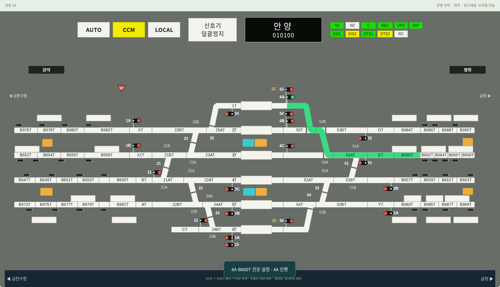
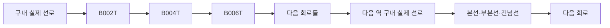
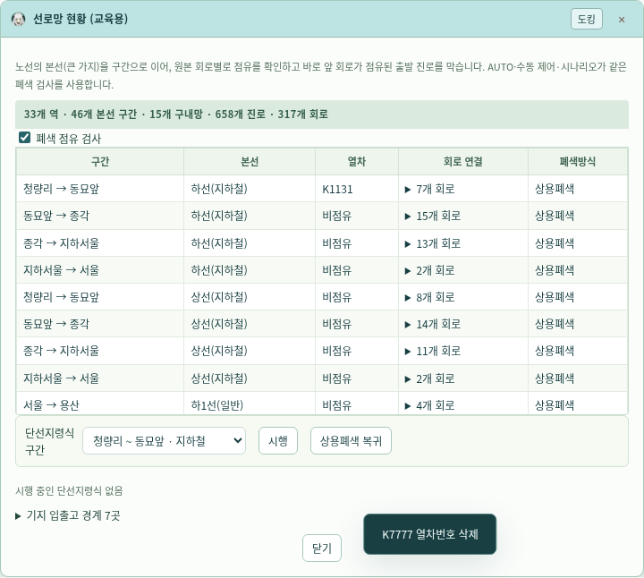

# v0.19.4 — 회로 단위 전체망과 안양 원본 연결 복원

제공된 원본에 있는 역간 회로를 구내망과 같은 그래프에 연결하고, 안양에서 합성하던 두 진로를 원본 연결로 복원했다. 기지 내부는 자료에 없으므로 확인된 입출고선 경계까지만 연결한다.

## 안양 53번 건넘선 수정

[배선도 PPT 12번 슬라이드](../references/diagrams/배선도(관제교육장).pptx)와 [전체노선 PDF 3쪽](../references/diagrams/1.전체노선.pdf#page=3)을 다시 대조했다. 53B→53A 건넘선은 수원 방향으로 **2T에서 3T로 내려간다**. 기존 입력은 반대로 3T→2T였고, 이 때문에 실제 LS에서 확인한 `4A-B660T`·`4B-B660T`를 별도 합성하고 있었다.

53번 연결을 원본 방향으로 고치고 합성 코드 전체를 제거했다. 두 진로는 이제 원본 그래프의 연속된 선로 구간과 전환기 조건으로 계산된다. 반대 모양을 전제로 계산되던 `4C-B984T`·`52-3T`는 제거되며, 올바른 방향에서 계산되는 입환 경로가 추가된다. 전체 진로는 658개이며 모두 연속 경로다. 추정 합성 진로는 0개다.



## 317개 실제 표기 회로를 공통 자원으로 연결

`track-network.js`는 대조 완료된 `schematic-details.js`의 회로 열과 구내 경계 코드를 읽어 317개의 회로 식별자를 만든다. 같은 회로가 인접 화면에 반복돼도 식별자는 하나다. `B615T1T` 같은 복합 표기의 원문은 보존하고, 역간 회로 식별에는 `B615T` 부분을 사용한다.

전체 그래프에는 구내 692개 노드·734개 연결과 회로 양 끝, 경계 연결, 기지 인계 경계가 포함된다. 합계는 **1,333개 노드·1,421개 연결**이다. 46개 본선 구간은 개별 회로의 순서로 세분화된다. 서울의 지하철↔전동 계열 전환도 구내 선로를 통해 이어진다. 배선의 시각적 교차를 새로운 분기로 만들지 않는다.



AUTO 열차는 이 회로 열을 따라 이동하며, 앞 회로가 점유되면 현재 회로에서 기다린다. 열번창이 모든 회로에 하나씩 있는 것은 아니므로 번호는 인접한 등록 열번창에 표시하되, 점유 판정과 붉은 현시는 **현재 실제 회로**를 사용한다. 다이아의 실제 위치와 세션 내보내기에도 현재 회로가 포함된다.

진로 설정뿐 아니라 모의 진입 때도 전방 점유를 다시 확인한다. 같은 구간의 먼 회로가 점유됐다는 이유만으로 비어 있는 첫 회로까지 막던 동작을 제거했다. 단선지령식의 구간 전체 대향 보호는 유지한다. 접근은 장내 앞 회로에서 먼저 전달하고, 실제 진입은 경계 회로에 도달한 뒤 허용한다.

원본 연결을 엄격히 적용하면서 기본 스케줄 선택 오류도 수정했다. 안양에서 정차 열차가 일반선으로 나가 금정을 우회하도록 선택되던 문제다. 추정 기본 진로는 같은 승강장에서 출발하며 반위 전환이 적은 경로를 우선한다. 사용자가 지정한 스케줄과 사진으로 전사한 값은 이 선택 규칙으로 덮어쓰지 않는다.



## 기지 경계와 자료 범위

확인된 외부 인계 경계 7곳을 그래프의 명시적 끝점으로 연결했다.

| 역 | 경계 | 원본 설명 |
|---|---|---|
| 동묘앞 | CT·DT | 군자기지 출고선·입고선 |
| 구로 | F1T·F2T | 차량기지 입출고선 |
| 의왕 | GT·FT | 남부화물기지 A선 |
| 의왕 | ET | 남부화물기지 B선 |

이는 구내 선로에서 기지 경계로 이어지는 연결이다. AUTO에서 이 경계로 출발한 열차는 기지 인계 상태로 기록하고, 남은 본선 시간표를 따라 다음 역에 다시 생성하지 않는다. 같은 기지 이름이라는 이유로 경계 바깥의 서로 다른 선로를 임의로 묶지 않는다. **기지 내부의 실제 분기·신호·쇄정은 원본이 없어 복원하지 않았다.** 이를 확정하려면 해당 기지 내부 배선도와 연동 조건이 필요하다.

번호가 건너뛰는 아래 연결 3곳은 JSON에 `numberGap`으로 남겼다. 번호가 비어 있다는 사실만으로 실제 회로가 빠졌는지 단정할 수 없으므로 없는 회로를 자동 생성하지 않는다.

- 금정~군포 하2선: B996T → B1000T
- 금정~군포 상2선: B995T → B999T
- 의왕~수원 상2선: B1031T → B1035T

이 구간의 실물 표기·폐색 회로표를 확보하기 전에는 317개 확인 회로 밖의 물리 회로를 모두 재현했다고 주장하지 않는다. 본선 계열·방향과 원본의 순서는 연결하지만 미제공 회로·신호·조건을 만들어 넣지는 않았다.

## 검증 결과

전체 Node 테스트 30개 파일과 데스크톱 브라우저 12종(physical-network·network-unified·line·line-block·autocontrol·scenario-motion·mmi-scenario-cast·mmi-scenarios·emergency·interlocking·route-conflicts·ls-switches)을 통과했다. 신규 시험은 1440·1920px에서 실제 회로 진행·앞 회로 점유 대기와 해소·접근 전달·붉은 점유 현시·안양 두 진로의 연속성·기지 경계 인계 후 다음 역 생성 방지를 검사한다. 1920px 전체망 시험은 열차 12편을 가상 12,000초 동안 운행해 남은 열번·진로·트러블이 없음을 확인했다.

변경된 658개 진로의 역내 모든 조합 19,487쌍을 양방향 설정 순서로 38,974회 검사했다. 공통 정위 공유 1,558쌍은 독립 점유·통과·최종 해정까지 3,116회 검사했다. 모든 658개 진로가 원본 추적 그래프에서 연속되며 기존 합성 진로는 0개다. 모바일 검증 없음.

## 검수 자료와 재현

[전체망·회로 출처·경계·번호 공백 JSON](network-audit-v0.19.4.json) · [전체 진로 경합 검사 JSON](route-conflict-audit-v0.19.4.json)

```sh
node tools/audit-network.cjs /tmp/network.json
node tools/audit-route-conflicts.cjs /tmp/routes.json
node --test simulator/*.test.cjs
python simulator/physical-network.browser.test.py
```
