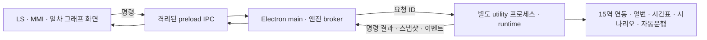

# v0.23.0 — 별도 프로세스 관제 엔진

0.22.0은 폴더와 세션을 나눴지만 자동운행과 시나리오의 실행 주체가 LS 렌더러에 남아 있었다. 이번 버전에서는 실행 주체와 상태를 실제 Electron utility 프로세스로 옮겼다.

## 실행 구조

- `desktop/engine-process.cjs`가 가상 시계와 런타임을 실행한다. Electron main은 창 관리와 명령 중계, renderer는 표시와 입력을 담당한다.
- `engine/runtime.cjs`가 역 상태, 진로·쇄정, 열번, 시간표, 실제 회로 점유, 자동운행·지연 반영, 시나리오·이동 대기열·단계 판정, 폐색 검사·단선지령식, 공통설비 장애와 시각 전송을 소유한다.
- `auto-controller`, `scenario-controller`, `conflict-drill`, `equipment-controller`는 DOM 없이 실행한다. `track-geometry.js`로 공통 좌표 계산을 옮겨 엔진이 UI 파일을 가져오던 의존성도 제거했다. 런타임의 전이 의존성 전체가 UI 디렉터리를 참조하지 않는지 시험한다.
- `ui/remote-engine.js`는 명령 결과와 스냅샷을 화면용 복사본에 반영한다. 실제 조작은 엔진에 전달하며 로컬 Core 계산은 메뉴 후보·채점 미리보기 등 임시 복사본에 한정한다. 화면용 복사본 수정으로 실제 엔진 상태를 바꿀 수 없다.
- 엔진에 DOM 콜백은 없다. 말하기 체크·선택한 보고서 등 사용자 입력은 명령으로 전달한다. UI 창 배치·그리기·메뉴·내보내기·학습 완료 표시 등 표현 계층은 UI에 남는다.
- 일반 브라우저 실행은 기존 로컬 엔진 방식으로 유지한다. **데스크톱 진입은 엔진 연결이 없을 때 로컬 실행으로 우회하지 않는다.**

## 창과 세션의 수명

LS 창 X는 숨기기다. 시뮬레이션은 계속 실행되며 Windows 트레이·Mac Dock 또는 실습 화면 메뉴에서 LS를 다시 연다. MMI 닫기는 기존대로 LS와 합치지 않는다. UI를 다시 불러오면 엔진의 같은 세션·PID에 재연결해 진로·열번·시간표·시나리오·설비 상태를 복원한다. 로그재생의 화면 투영은 재연결 시 종료하고 실시간 엔진으로 돌아온다.

**프로그램 종료 메뉴(Cmd+Q 등)는 엔진도 종료한다.** 이번 변경은 앱 종료·운영체제 재부팅 이후의 실습 자동 저장·복구를 뜻하지 않는다. 창 배치만 기존처럼 파일에 저장한다. 조작 기록은 내보내기를 사용한다.

격리된 preload는 허용된 LS 주 프레임의 엔진 요청만 main으로 중계한다. Node 통합은 끄고 sandbox·contextIsolation을 유지한다. 엔진 응답 제한시간은 5초이며 실패한 조작을 자동 재전송하지 않는다. 엔진 시작 실패·연결 종료·시계 실행 오류는 명시적으로 알리고 로컬 엔진으로 바꾸지 않는다. 엔진 오류 시에는 운행을 멈춘다.

## 창 크기 조절

1280×720 논리 작업 영역을 기준으로 가로·세로 중 작은 비율을 적용한다. 작은 **데스크톱 창**에서도 도구 모음·배선·역 전환이 같은 배율로 줄어든다. 배선 SVG는 비율을 보존하며, 확인창·우클릭 메뉴는 실제 화면 좌표로 표시한다. LS 최소 창 크기는 320×240, MMI·그래프의 기존 최소 크기는 유지한다. 모바일 전용 화면이나 모바일 검증은 추가하지 않았다.

## Electron 다운로드 502

Actions는 Electron 실행 파일을 테스트 전에 준비하고 운영체제·아키텍처·lockfile별 다운로드 캐시를 사용한다. HTTP 502/503/504/500·429 및 일시적 연결 오류는 2·4·8초 간격, 최대 4회 시도한다. 체크섬 오류와 영구 오류는 즉시 실패하며, 다운로드 실패를 테스트 성공으로 처리하지 않는다. 양쪽 네이티브 설치본 빌드·패키지 시험이 모두 성공해야 릴리스를 게시한다.

## 검증

Node 단위·통합 51개, 기존 데스크톱 브라우저 회귀 18종, 15역×6종 데스크톱 창 크기 시험을 수행했다. 실제 Electron에서 엔진과 renderer의 PID 차이, 시나리오의 연동·이동, MMI 시간표 수정, LS renderer 강제 정지 중 엔진 시계 진행, LS 닫기·재불러오기 후 같은 PID와 상태 유지를 검사한다. 기존 두 창·알람·그래프·MMI 닫기 회귀도 유지한다. Linux 소스·ASAR 실행본에서 같은 네이티브 시험이 통과했고 1024×768 작업 영역에서도 검사했다. Linux·Windows x64·Mac ARM64 디렉터리 패키지를 만들어 각 ASAR의 필수 런타임 99개 파일을 원본 바이트와 대조했다. Windows·Mac 네이티브 실행은 각 OS의 Actions가 담당한다.

이 클라우드에서 직접 실행한 네이티브 시험은 Linux Electron이다. Mac ARM64·Windows x64 설치본의 최종 네이티브 결과는 GitHub Actions에서 각각 확인해야 한다. 공인 서명·Apple 공증과 앱 종료 후 자동 세션 복구는 이번 범위에 포함하지 않는다.
