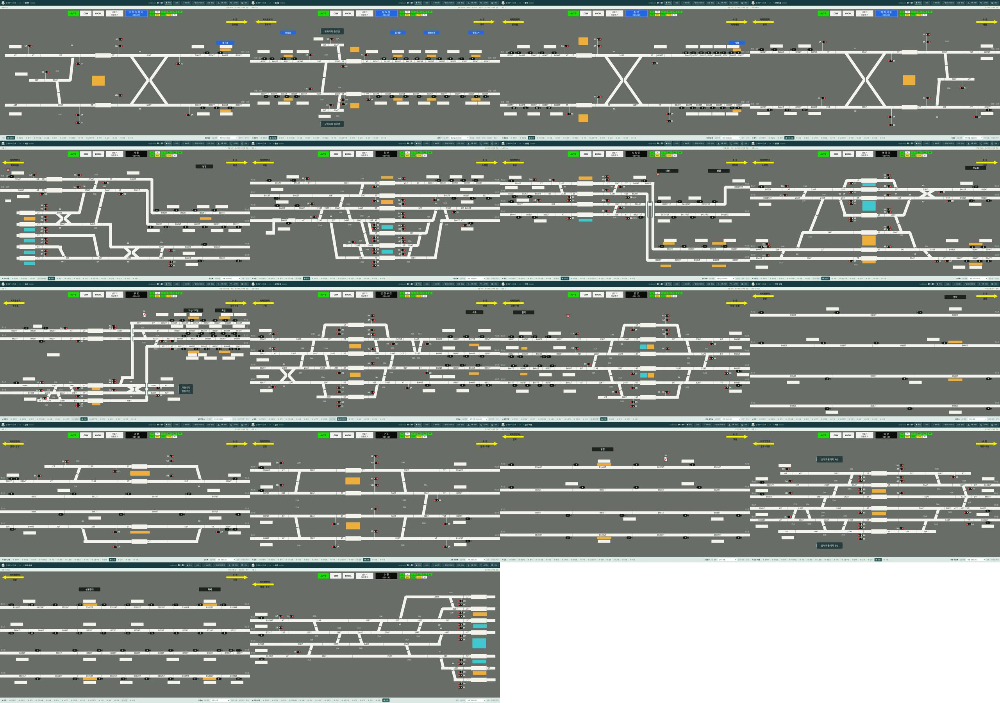
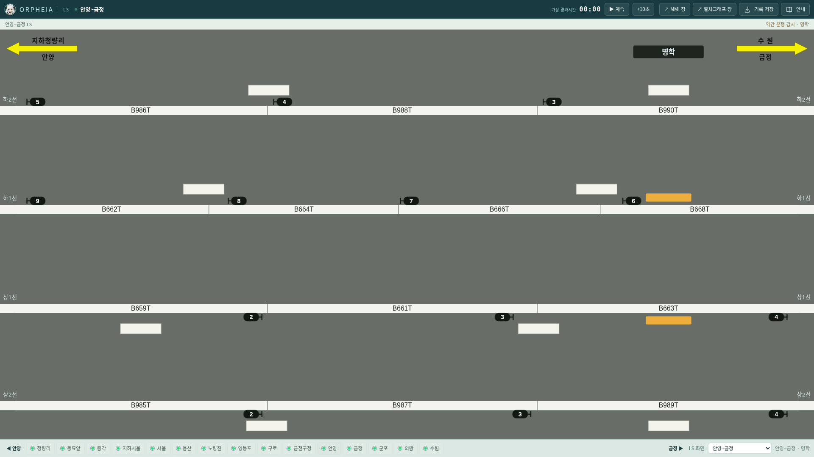
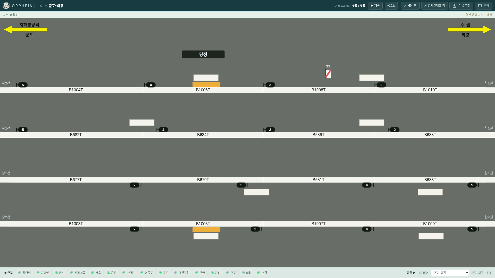

# v0.26.1 공통 철도망과 LS 표시 범위

배선은 하나의 철도망이다. LS 프리셋은 역별 조작이 편하도록 범위와 배율·배치를 고정한 화면이다. 프리셋을 바꿔도 선로 연결이나 열차 위치가 바뀌지 않는다.

## 반영 범위

Claude 초벌 `1a1bceb`의 용산~수원 361개 LS 진로 목록과 회로 도착점·건넘선 보정, 역간 화면 분리·원본 노란 화살표를 검수했다. 사용자 재확인에 따라 군포 B999T와 수원 26→XT/AT는 확정값으로 유지한다. 목록에 없는 신호기는 기존 배선 도출 후보를 유지하며, 목록이 없는 것을 사용 불가로 해석하지 않는다.

| LS 화면 | 원본 | 중간역 | 설비 제어 | 열번 제어 |
|---|---|---|---|---|
| 안양~금정 | PPT 13 | 명학 | 없음 | 입력·수정·삭제·이동·교환·조회 |
| 군포~의왕 | PPT 16 | 당정 | 없음 | 입력·수정·삭제·이동·교환·조회 |
| 의왕~수원 | PPT 18 | 성균관대·화서 | 없음 | 입력·수정·삭제·이동·교환·조회 |

하단 역 탭은 취급역 15개만 둔다. 세 역간 화면은 상단의 노란 화살표로 오간다. 화살표는 키보드 Enter·Space로도 동작한다. 열번 입력·속성 조회의 위치에는 현재 보는 구간 이름이 나온다. 추가 LS 창도 같은 엔진의 상태를 표시한다.

## 연결과 배치의 구분

- `engine/line.js`·`track-network.js`·`network-topology.js`가 본선·역간·구내의 연결과 회로 식별자를 관리한다. 프리셋 이름으로 엔진 상태나 새 선로 자원을 만들지 않는다.
- `ui/ls-presets.js`는 원본 회로 식별자로 어느 화면에 표시할지 정한다. 화면 좌표가 바뀌어도 회로 소속을 잘못 자르지 않는다. 다음 역 진입 경계 회로는 해당 역 화면에 남긴다.
- `ui/ls-view.js`는 동일한 회로 상태에 화면별 좌표를 적용한다. 각 역의 조작 간격과 원본 분기 모양을 유지하며, 이웃 화면과 높이를 강제로 일치시키지 않는다. 본선은 각 화면의 좌우 끝까지 수평 연장한다.
- 열차번호와 실제 운행 중 회로 점유는 공통 엔진에서 받는다. 창을 이동하거나 프리셋을 바꿔도 번호를 재생성하거나 열차의 진행을 초기화하지 않는다. 수동 열번 이동은 기존처럼 확인 후 즉시 처리한다.

## 검증

- 76개 Node 시험 통과: 33개 정차역·46개 본선 구간, 구내 710개 진로의 연결·자원·경합, 동일 선로망의 회로 점유·운행, 표시 범위 전환의 상태 불변성 포함.
- 세 구간의 원본 회로, 열번창, 폐색 번호를 분할 전과 비교했다. 다음 역으로 넘긴 경계 회로의 표시도 확인했다. 전체 276개 열번창·274개 폐색 번호를 유지한다.
- 18개 화면 전체를 1440·1920 폭에서 N/R 상태로 표시해 텍스트 겹침·잘림을 검사했다. 6개 데스크톱 창 크기에서 비례 표시, 3개 창 크기에서 좌우 수평 연장을 검사했다.
- 노란 화살표 왕복과 키보드 이동, 세 구간의 열번 입력·조회·유지, 의왕 구내와 역간의 즉시 이동·교환을 실제 브라우저 조작으로 확인했다.
- Linux Electron에서 별도 엔진의 창 정지·닫기·재열기·재시작 지속성을 확인했다. 세 역간 추가 LS 창의 입력·이동이 같은 엔진 PID와 다른 창에 반영되는 것을 확인했다. Mac·Windows의 네이티브 실행 결과는 GitHub Actions에서 별도로 확인해야 한다.

## 확인 화면

