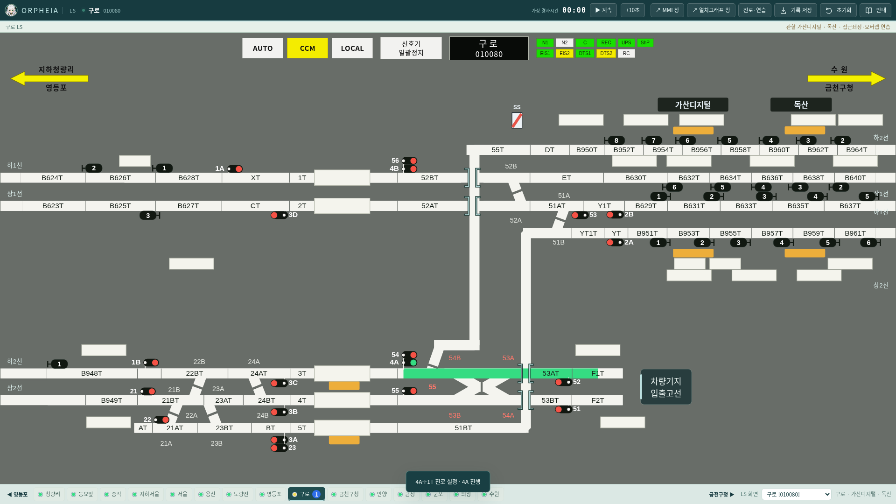
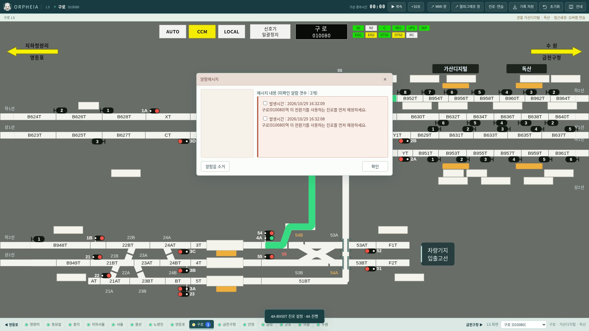
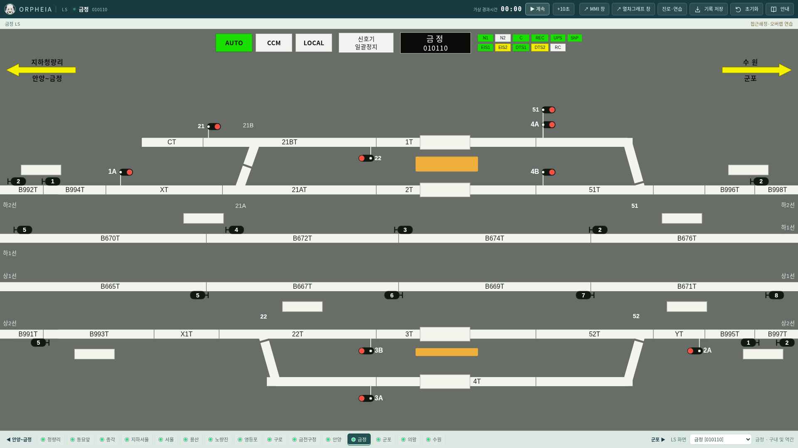
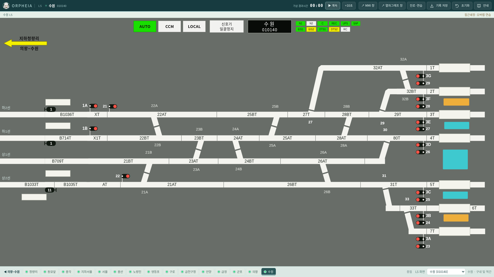
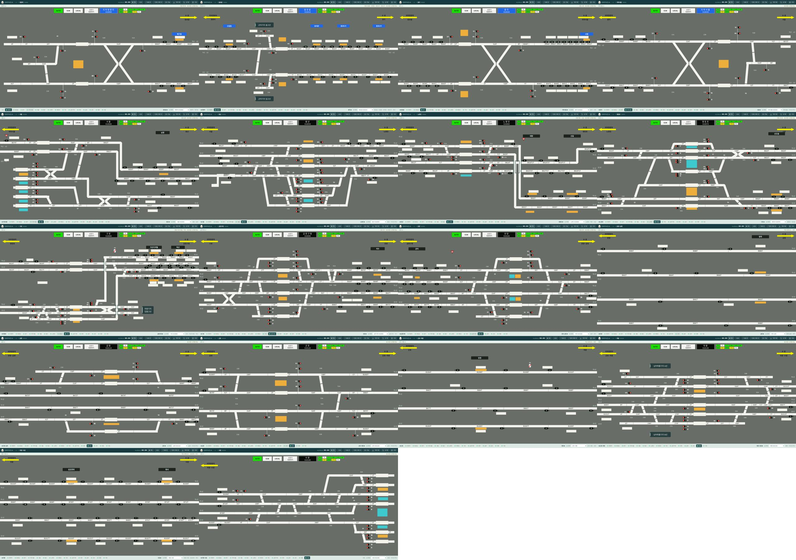

# v0.26.2 원본 폐색·선로전환기 검수

PPT 슬라이드 2~19와 PDF 기반 배선을 대조했다. 표시된 것만 클릭해 보는 검사로는 누락 설비를 찾을 수 없으므로, 원본 설비 목록과 엔진·렌더러의 설비 목록을 별도로 비교했다.

## 확인한 오류와 수정

| 대상 | 이전 문제 | 수정 |
|---|---|---|
| 금정 B998T·B997T | 해당 회로가 없고 폐색 2를 B996T·B995T에 대신 표시 | 원본 슬라이드 14의 실제 회로·표식으로 복원 |
| 수원 B1033T | 회로가 없고 폐색 11을 B1035T에 대신 표시 | 원본 슬라이드 19의 진입 전 회로로 복원. 의왕~수원 슬라이드 18에 임의로 넣지 않음 |
| 노량진 폐색 5 | 계단 형태의 위 선로 표식을 아래 B618T1T에 부착 | 원본 B618T2T의 아래쪽으로 정정 |
| 폐색 표식 가로 위치 | 일부 수동 보정값과 좌우 74px 제한이 원본 위치를 바꿈 | 원본 기호 사각형·회로 사각형의 부호 있는 비율로 계산. 경계 앞에 걸친 몸체도 보존하고 화면 잘림 방지 여유만 적용 |
| 구로 55 | 분기 모양은 있으나 엔진의 제어·쇄정 대상에서 누락 | 기지 직진 N / B950T 분기 R. 4A 진로가 해당 55를 쇄정하고 조작·고장 검사를 수행 |
| 전환기 A/B | 47개 끝 표기·조작 누락, 가까운 글자로 물리 그룹을 추정 | 176개 A/B 끝을 명시 매핑으로 관리. 모든 88개 건넘선에 양 끝 제어를 제공 |
| 전환기 번호 대응 | 일부 원본 번호와 내부 연결 번호가 전치 | 청량리 51/52, 금천구청 21/22·51/52, 의왕 51/52, 서울 58/59 대응을 원본으로 고정 |

구로 55는 새 진로를 임의로 만드는 설비가 아니다. 기존 `4A-B950T`의 분기와 `4A-F1T`·`4A-F2T`의 기지 직진이 실제로 공유하는 분기기다. 구내 710개 진로와 사용자 확정 LS 메뉴를 유지하면서 이 설비의 N/R 조건과 쇄정을 복원했다. B997T·B1033T의 기존 열번창도 자기 회로를 기준으로 배치하며, 열번 슬롯 이름과 전체 276개 창은 유지한다.

서로 다른 번호 체계는 원본 A/B 이름과 내부 물리 그룹의 대응으로 구분한다. 예를 들어 서울 `59A/B`는 내부 그룹 `58`의 상승 건넘선을 제어한다. 화면에서 `59A`를 반위로 제어하면 반대쪽 원본 `58` 건넘선을 바꾸는 오류가 없어야 한다.

## 데이터·재현 도구

- `references/transcriptions/switch-survey.json`: 원본 PPT·역별 이미지 해시, 119개 전환기 그룹, 176개 A/B 이름·그룹·좌표의 검수 자료.
- `tools/build-switch-survey.py` → `engine/point-survey.js`: 이미지 해시와 양 끝 대응을 검사하고 명시 매핑 생성. 거리 추정으로 제어 대상을 고르지 않는다.
- `references/transcriptions/block-signals.json`·`intermediate-circuits.json`: 실제 회로·표식 사각형 및 회로 순서. 원본 첨부파일은 바꾸지 않는다.
- `tools/audit-source-equipment.cjs`: 원본 목록과 엔진·제어·형상 대조, 모든 그룹의 정위/반위·수동 쇄정·고장 차단, 모든 표식의 회로 및 부호 있는 위치를 검사.
- [검수 보고서](source-equipment-audit-v0.26.2.json): 119개 그룹별 A/B·쇄정 진로 목록을 포함한다.

## 검증 결과

- 119개 전환기 그룹, A/B 제어 176개, 단동 제어 31개. 원본 선언에서 엔진·조작·형상으로 누락된 그룹 0개.
- 폐색 표식 274개를 18개 표시 범위에서 누락·중복 없이 확인. 이웃 회로를 빌린 표식 0개.
- 공통망의 원본 회로 317→320개. 원본에서 찾지 못했던 번호 공백 3개가 슬라이드 14·19의 회로로 해소되어 번호 공백 0개. 선로 구간은 기존 46개를 유지한다.
- Node 시험 80개 통과. 710개 진로와 22,718개 진로 쌍의 양방향 경합·독립 점유·해정 검사를 포함한다.
- 실제 데스크톱 브라우저에서 15개 역의 모든 표시 제어를 R과 N으로 각각 조작하고 엔진 상태와 물리 형상을 확인했다. 18개 화면의 정위·반위 텍스트 배치, 276개 열번창 위치, 좌우 수평 연장도 검사했다.
- 구로 55의 N/R 직접 조작, 세 진로의 올바른 방향, 진로 사용 중 전환 차단을 실제 UI로 검사했다. 고장 상태 차단은 엔진 시험으로 검사했다.
- Linux Electron에서 분리 엔진, LS/MMI/그래프 공유, 창 닫기·재열기·재시작을 검사했다. Mac·Windows 네이티브 실행은 GitHub Actions 대상이다.

## 수정 화면

정위: `4A-F1T`가 기지로 직진하고 55는 N으로 쇄정된다.

반위: `4A-B950T`가 상부 선로로 분기하고 55는 R로 쇄정된다.

