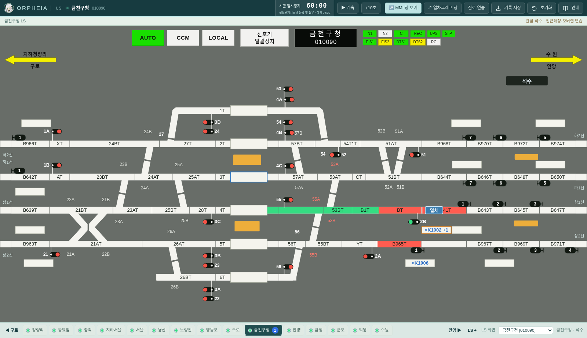
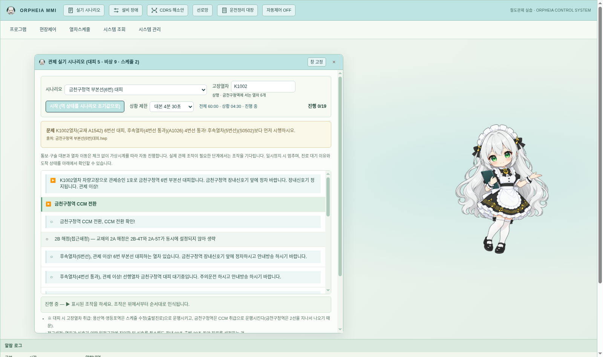

# v0.27.0 시험·실습 카운트다운

단순 경과시간을 시험·실습의 남은 시간으로 교체했다. 자유 조작 중에는 `대기 --:--`이며, 상단 시간 버튼에서 시험을 시작하거나 기본 LS 과제·시나리오·경합 연습을 시작하면 카운트다운이 작동한다.

## 자료 조사 결과

저장소의 PDF 13개와 HWP/HWPX 18개를 텍스트로 추출하고 전체 실기·과목·대본 시간과 실제 운전/쇄정 시간을 구분해 조사했다. 조사 파일 목록, 인용, PDF 페이지, 원본 SHA-256은 [시간 전사 자료](../references/transcriptions/assessment-timing.json)에 있다. 원본 문서는 변경하지 않았다.

| 적용 범위 | 확인한 시간 | 근거 |
|---|---:|---|
| 전체 실기 | 60분 | 실무5 PDF 2·10·202쪽 |
| 금천구청 6번선 대피 | 4분 30초 | 해당 HWP 제목 |
| 시청 선로침수 | 6분 | 01 대본 제목 |
| 동묘앞·석수 열차충돌 | 각각 12분 | 02·03 대본 제목 |
| 금정 사상사고 | 6분 | 04 대본 제목 |
| 가산디지털 차량고장·구원 | 9분 | 05 대본 제목 |
| 차량고장·구원 없음 | 6분 또는 7분 | 05-1 대본 제목의 `6분_7분` |
| 열차화재·구원 | 9분 | 06 대본 제목 |
| 열차화재·역간 정차 | 9분 또는 11분 | 06-1 대본 제목의 `9분_11분` |
| 열차화재·자력 회송 | 6분 | 06-2 대본 제목 |

열차운행계획·철도관제시스템 운용 및 실무·운행선 관리의 **독립 제한시간은 확인되지 않았다**. 교재가 네 과목을 제시한다는 이유로 각 15분으로 나누지 않는다. 이들 실습은 전체 60분 예산을 공유한다. 다른 대피 대본·스케줄 대본에도 확인되지 않은 별도 시간을 만들지 않았다.

60분은 사용자 제공 학습 교재의 기준이다. 이 교재의 내용을 현행 공식 시험 공고로 확대 해석하지 않는다. `6분_7분`, `9분_11분` 표기는 임의로 하나로 확정하지 않고 시작 전 선택하게 한다. 상단에서 전체 시간을 바꾸면 기록의 근거를 `사용자 설정`으로 구분한다. 접근쇄정의 90/30초와 시간표의 +2분 지연은 시험 제한시간이 아니므로 기존 관제 기능에 남긴다.

## 실습과 연결되는 동작

- 전체 남은 시간과 현재 상황의 별도 남은 시간을 함께 표시한다. 과목·시나리오·역·추가 LS 창을 바꿔도 전체 시간은 초기화하지 않는다.
- **열차·대본과 같은 가상시간**을 쓴다. 1배속에서는 1초마다 1초가 줄며, 일시정지·배속·10초 진행은 운행과 카운트다운에 같이 적용된다. 실제 벽시계와 별도로 흐르는 타이머가 아니다. 실습 중 메뉴나 확인창을 열었다는 이유만으로 시간을 멈추지 않는다.
- 기본 LS 과제는 실제 조작 조건, 시나리오는 기존 조작·구술·열차 이동의 완료, 경합 연습은 실제 채점 결과에 연결한다. 단순히 시간을 다 썼다는 이유로 합격 처리하지 않는다. 교재 대본의 구술 자동 진행은 기존 교육용 동작이며 음성 인식으로 평가하는 것은 아니다.
- 상황 완료·중지·다음 실습 전환은 그 상황 기록만 끝낸다. 전체 시간은 계속 흐르고 상단의 `시험 종료·기록`으로 종료한다. 새 시험 시작은 새로운 전체 예산을 만든다.
- 시간이 끝나면 한 번만 이벤트를 남기고 `00:00`을 표시한다. LS 조작이나 열차 운행을 차단하지 않는다. 이후 완료하면 초과 시간과 시간 내 완료 여부를 보존한다. 상황별 기록과 전체 시험 기록은 구분한다.
- 별도 관제 엔진이 시간을 소유한다. LS 렌더러가 멈추거나 창을 닫아도 계속되며, 세션 저장·복구 후에는 기존 잔여 시간에서 일시정지 상태로 열린다. 예전 버전의 시간 정보 없는 세션도 열 수 있다.
- 상단 시간 버튼에 현재 실습과 최근 4개 기록을 표시하고 엔진은 최근 100개를 보관한다. 조작 기록 JSON에도 시간 상태·이력을 포함한다.

## 구성과 검증

`tools/build-assessment-timing.py`가 원본 해시를 확인해 `engine/assessment-data.js`를 생성한다. `engine/assessment.js`는 DOM 없는 시간 상태 기계이며 `engine/runtime.cjs`와 브라우저 UI가 같은 규칙을 사용한다. 데스크톱에서는 엔진 상태를 표시하며 UI가 별도 시간을 만들지 않는다.

Node 검사 88개 통과. 새 검사는 자료별 시간·대본 범위·공유 예산·실습 완료·시간초과·일시정지·배속·명시적 시간 진행·역 전환·세션 복구·다른 창 중단의 격리를 검증한다. Chromium에서 카운트다운과 실제 LS 조작을 검증했고, 기존 시나리오 검사(1440×1000·1920×1080) 및 15역 전환기/자동 시나리오/시간표 편집 검사도 통과했다. 모바일 검증은 수행하지 않았다.

Linux Electron 네이티브 검사에서 렌더러 정지 중 카운트다운 진행과 앱 재시작 후 잔여 시간 복구를 확인했다. Linux·Windows x64·Mac ARM64 패키지의 런타임 파일 포함과 원본 일치를 검사했다. Mac/Windows의 실제 실행·서명·설치 검증은 해당 OS의 GitHub Actions에서 수행하며, Linux의 교차 패키징 결과만으로 네이티브 통과를 주장하지 않는다.

## 미리보기

독립 LS 창의 전체 남은 시간과 현재 상황:

독립 MMI 창의 대본 시간 선택과 실습 진행:

