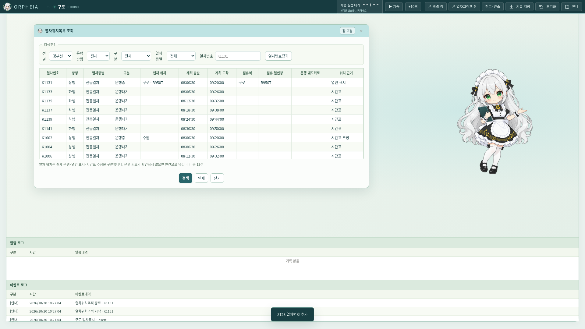

# v0.27.1 구술 대본으로 역산한 LS·MMI 기능

[구술(관제)_열차운행계획,운용및 실무.hwp](../references/scenarios/구술(관제)_열차운행계획,운용및%20실무.hwp)의 21개 항목을 순서대로 대조했다. [추출 원문](../references/extracted/구술(관제)_열차운행계획,운용및%20실무.txt), [항목별 인용·원본 해시·구현 파일](../references/transcriptions/oral-functions-audit.json)을 함께 보관한다.

대본은 기능 명세의 근거로 읽는다. 메뉴가 있더라도 대본에서 말한 데이터·제어·이력이 연결되지 않았다면 부분 구현이다. 정의나 구술 문장을 프로그램 실행 지시로 취급하지 않는다.

## 이번에 수정한 차이

1. **열차추적**: 시간표에서 계산한 위치를 우선하던 방식에서 현재 LS 열번창을 우선하는 방식으로 수정했다. 수동 등록 열차도 목록과 추적에 포함한다. 방향과 위치 근거를 표시한다.
2. **열차위치목록**: 점유역·열번창·확인된 운행 회로·위치 근거를 추가하고 시간표에 없는 수동 열차를 포함한다. 엔진이 위치를 반환하지 않았는데 시간표 위치로 대체하던 경로를 제거했다. 자동운행 중 확인된 위치가 없으면 `위치 미확인`으로 표시한다.
3. **열차속성**: LS·MMI에서 공통 조회를 사용한다. 시간표 없는 열차도 조회할 수 있으며, 시발·종착역/시각, 연계열번, 상태, 표시 위치, 계획·운용시각, 실제로 기록된 지연을 제공한다. 계획을 실적으로 위장하지 않고 수집되지 않은 값은 `미기록`으로 남긴다. 본선의 확인된 운행 회로와 LS 표시 열번창도 구분한다.
4. **그래프 툴팁**: 빠졌던 시발/종착역 이름과 연계열번을 추가했다. 십자선과 돋보기는 기존 기능을 유지한다.
5. **Overview**: 열 때만 만들던 스냅샷을 열린 동안 매초 현재 상태로 갱신하도록 바꿨다. 열번·모드·진로·표지판과 회로 점유 표시가 함께 갱신된다.

`engine/train-status.js`는 상태를 변경하지 않는 공통 조회이고, 데스크톱에서는 독립 관제 엔진의 스냅샷을 읽는다. UI가 별도 열차 상태를 만들지 않는다. 시간표 추정은 자동운행을 끈 계획 표시에서만 구분해 제공한다. 열번창 이동을 물리적 운행 실적으로 간주하지 않는다.

## 21개 항목 대조

| 번호 | 원문 항목 | 판정 | 코드 대조 결과 |
|---:|---|---|---|
| 1 | 열차추적 | 보완 | 방향·실제 열번 위치로 추적. 시간표 추정과 실제 운행을 구분하고 수동 등록 번호도 추적한다. |
| 2 | L/S 표지판 | 구현 | 6종 표지판 입력·이동·크기·삭제. 운행 제한을 자동 집행하는 설비 명령과 구분한다. |
| 3 | 오버뷰 | 보완 | 18개 LS 화면의 열번·진로·모드·표지판을 표시하고 열린 동안 매초 현재 상태로 갱신한다. 표시 화면 선택은 같은 엔진 상태를 사용한다. |
| 4 | L/S 재실행 및 베이스스캔 설명 및 차이점 | 부분 | LS 재실행은 재그리기이며 렌더러 자체 재시작은 아니다. 베이스스캔은 LS·MMI에서 지원하나 외부 설비 재수신이 아닌 모의 상태 조회다. |
| 5 | 온라인열차 그래프 기능 중 노트란 | 구현 | 그래프의 시각·구간에 메시지 노트를 배치한다. |
| 6 | 열차운행 관련 조회 | 부분 | 조회 창은 있으나 일부 실적은 지난 운용 시각을 실적으로 간주한다. 실제 도착·출발 사건만 누적하는 원장과 연결해야 한다. |
| 7 | 열차그래프 화면모드 설명하고 기능실행 | 보완 | 툴팁·십자선·돋보기 구현. 빠졌던 시발/종착역 이름과 연계열번을 툴팁에 추가한다. |
| 8 | 접근쇄정 | 구현 | 장내 90초·출발 30초 접근쇄정과 보호 대기. 시험 카운트다운과 별개다. |
| 9 | 오버랩(조사쇄정) | 부분 | 조사쇄정 계산과 해정 보호 구현. 실제 역별 안전측 전환기와 조사 구간을 원본 연동표로 전부 입증한 것은 아니다. |
| 10 | 수동제어 이력조회 | 부분 | 열번·모드·현장설비·스케줄·확인 이력을 조회한다. 장비계 절체·복구·선로지장 이력 전체의 공통 영속 원장은 아직 없다. |
| 11 | 로그재생 설명 및 실행 | 부분 | 역 조건·시간에 따른 로그 재생과 실시간 조작 차단 구현. 현재 창이 수집한 기록 기반이며 서버에 저장된 전체 세션 재생은 아니다. |
| 12 | 운용자 조작 관련 조회 | 부분 | 수동 조작 이력 조회 지원. 실제 사용자 식별·콘솔별 행위와 모든 기록의 영속 DB 연결은 부족하다. |
| 13 | 열차위치목록 조회 | 보완 | 목록에 수동 열번·점유역·열번창·운행 회로·위치 근거 추가. 엔진 위치 없음은 미확인으로 표시하며 완료로 추정하지 않는다. 전체 열차의 확정 운행 종료 기록은 추가 필요. |
| 14 | 관제업무종사자의 정의 | 지식 | 관제업무종사자의 정의이며 단독 소프트웨어 명령으로 해석하지 않는다. |
| 15 | 「철도교통관제운영규정」상의 운전정리의 정의 | 지식 | 운전정리의 정의이며 각 조작·시나리오의 목적을 설명하는 요구사항이다. |
| 16 | 「철도교통관제운영규정」상의 운전정리의 종류 | 부분 | 운휴·시각/진로 변경·열번 변경·임시열차 등 일부 지원. 열차합병·특발·폐색방식 변경 등 모든 운전정리가 완전한 엔진 명령으로 구현된 것은 아니다. |
| 17 | 진로제어 | 구현 | LS·MMI 진로 설정/해정이 같은 엔진의 쇄정 상태를 바꾼다. |
| 18 | 진입열차 예고 관리 | 부분 | 진입예고 등록/삭제 창은 있으나 목록이 MMI 메모리에만 존재하며 엔진의 진입 허가·실제 운행순서를 제어하지 않는다. 임시열차 및 대기열 순서의 엔진 연결이 필요하다. |
| 19 | 열차속성 조회 | 보완 | LS·MMI 속성 조회를 공통화. 시발/종착·상태·현재위치·연계열번·계획/운용시각·기록된 지연을 제공한다. 수집되지 않은 실적은 미기록으로 남긴다. |
| 20 | 선로전환기(Local 취급) | 부분 | CCM 정위/반위 및 연동된 A/B 제어 구현. LOCAL 취급 시간·목적·승인번호의 승인/만료 절차는 없다. |
| 21 | 알람/이벤트 조회 | 부분 | F/E/W 등급·조건 조회·확인 이력 구현. 모든 이벤트가 독립 엔진의 영속 DB에 보관되는 것은 아니다. |

## 남은 구현을 정하는 기준

다음은 사용자에게 다시 원본을 요청해야만 착수할 수 있는 목록이 아니다. 대본으로 목적은 확인됐지만 아직 엔진/기록 구조를 연결해야 하는 개발 과제다.

- **진입예고 대기열 → 운행순서**: 현재 등록 목록은 MMI 메모리에만 있다. 엔진이 역·신호기·운행일별 대기열을 소유하고 등록/삭제/순서 변경을 실제 진입 허가와 연결해야 한다. 임시열차 생성과 예고 등록도 별개로 구분해야 한다.
- **실적 원장 → 조회/속성**: 실제 도착·출발·통과·완료 사건을 전체 열차에 누적해야 한다. 현재 자동운행의 일부 지연 기록은 실제 기록이나, 기존 실적 조회는 시간이 지난 운용 계획을 실적으로 간주하는 경로가 남아 있다. 그 부분까지 완성됐다고 표시하지 않는다.
- **공통 영속 행위 원장 → 이력/로그재생**: 사용자·콘솔·설비·열번·절체·복구·선로지장·확인 사건을 같은 엔진의 영속 기록으로 모아야 한다. 현재 UI가 수집한 기록만으로 완전한 서버 로그재생이라고 할 수 없다.
- **LS 개별 복구**: 현재 우클릭의 재실행은 재그리기다. 별도 데스크톱 엔진은 렌더러 재시작을 견디지만 메뉴를 대상 LS 창의 실제 재시작과 연결하는 보완이 남아 있다. 베이스스캔과 재실행은 서로 다른 동작으로 유지해야 한다.
- **LOCAL 승인 절차**: 대본에 나온 취급 시간·목적·승인번호의 발급/만료 및 조작 이력을 모델링해야 한다. 모드 전환 버튼만으로 이 절차를 대체하지 않는다.

실제 역별 조사쇄정 안전측 전환기·구간은 연동표 검증이 필요한 부분이며, 일반적인 UI 구현과 구분한다. 구술에 열거된 운전정리 종류도 명칭만으로 모든 설비 명령을 임의 생성하지 않는다.

## 검증

Node 검사 91개 통과. 새 검사는 시간표와 LS 위치 불일치, 수동 열번, 실제 운행 회로와 표시 창의 구분, 엔진 위치 없음의 처리까지 확인한다. Chromium에서 추적의 실제 역 전환, 수동 번호 조회, LS/MMI 속성, Overview의 열린 상태 갱신을 검증했다. 기존 MMI 조회·창 조작·LS 우클릭 검사도 1440×1000·1920×1080에서 통과했다. 18개 프리셋의 속성 표시와 Linux Electron 네이티브 회귀 검사를 통과했다. Linux·Windows x64·Mac ARM64 교차 패키지마다 116개 런타임 파일의 포함·내용 일치를 확인했다. Mac/Windows 네이티브 실행·설치는 해당 OS의 CI 검증 범위다. 모바일 검증은 하지 않았다.

