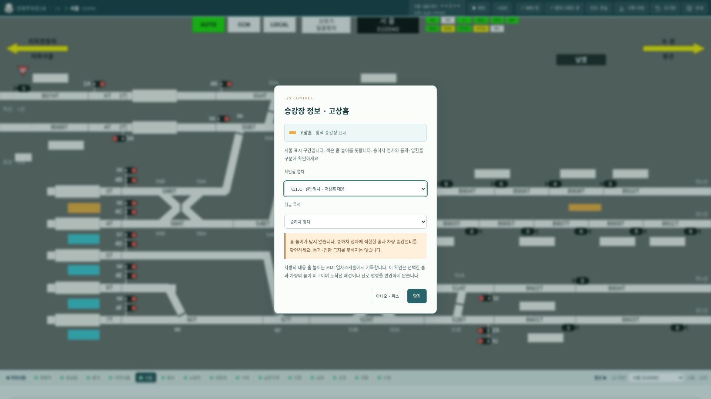

# v0.27.2 승강장 높이의 의미와 취급

> v0.27.3에서 검수해 조정했다: 승강장 클릭 창과 스케줄의 `대응 홈 높이` 칸은 없앴고, 높이는 열차등급으로 정한다. [검수 내용](v0.27.3-승강장높이검수.md)

사용자 확인에 따라 **황색 승강장은 고상홈, 청색 승강장은 저상홈**으로 확정했다. [확인 내용과 해석 범위](../references/transcriptions/platform-heights.json)를 전사 자료로 보관한다. 원본 색·위치·배선은 유지했다.

## 이 정보로 알 수 있는 것

승강장 색은 장식, 점유 현시, 역 제어모드가 아니라 **승하차 시설의 높이 구분**이다. 진로 설정·열차 점유·쇄정 상태가 바뀌어도 이 시설 정보는 유지되어야 한다.

18개 프리셋에서 표시하는 승강장 심벌 75개는 황색 61개·청색 14개다. 이는 화면의 심벌 수이며 물리적인 승강장 또는 승강장 면 수로 단정하지 않는다. 서울·용산·노량진·영등포·안양·수원은 두 높이의 표시가 함께 있다. 따라서 같은 역의 진로라도 승하차 정차 시 동일하게 대체할 수 있다고 가정하면 안 된다.

판단에는 **차량의 실제 승강설비와 대응 홈 높이**가 필요하다. 열차 종별만으로 모든 전동열차·일반열차·KTX의 대응 높이를 확정하지 않는다. 승하차 없는 통과·입환은 홈 높이의 승하차 적합성 비교와 구분하며, 해당 진로·쇄정 조건은 계속 적용한다.

## 반영한 개선

- **시설 의미 부여**: 공통 `engine/platforms.js`에 고상/저상 유형과 비교 규칙을 정의했다. 모든 LS·역간 감시 화면에 범례를 표시하며 SVG에도 높이 정보·이름·도움말을 제공한다. 원본 청색/황색 심벌은 동일 위치와 색을 유지한다.
- **승강장 조회**: 심벌을 클릭하거나 키보드 Enter/Space로 선택하면 고상/저상 정보와 열차별 높이 비교 창을 연다. 역간 감시 화면에서도 조회할 수 있다.
- **차량 정보**: MMI 열차스케줄의 `대응 홈 높이`에 미확인·고상·저상·양쪽 대응을 기록한다. LS·MMI 열차 속성 조회에도 표시한다. 기존 파일에 값이 없으면 미확인으로 처리한다. 생성·수정·복사·실행취소/다시실행·시간표 JSON·엔진 세션 복구에서 유지된다.
- **취급 목적 구분**: 승하차 정차에는 기록된 대응 높이와의 일치/불일치/미확인을 표시한다. 통과·승하차 없는 입환에는 이 비교를 적용하지 않는다. 높이가 일치해도 유효장·차량길이·정차 위치·선로 조건까지 확인됐다는 뜻은 아니다.

## 자동으로 확정하지 않은 것

홈 색만으로 정확한 밀리미터 높이, 각 심벌의 선로별 승강장 면 귀속, 차량의 실제 승강설비, 유효장을 확정하지 않았다. 특히 두 선로 사이의 심벌을 단순한 거리 계산으로 양쪽 선로에 모두 배정하면 잘못된 정차 적합성 판정이 생길 수 있다.

이번 비교는 **선택한 승강장 심벌과 기록된 차량 대응 높이**를 비교하는 기능이다. 도착 진로에 홈을 자동 배정하거나, 불일치라는 이유만으로 진로를 차단하지 않는다. 실제 정차 진로의 자동 추천·검증에는 각 홈의 승강장 면과 선로의 검증된 대응이 추가로 필요하다. 차량 대응 정보가 미확인인데 종별로 추정하여 기존 시나리오 진로를 바꾸지도 않는다.

## 검증과 화면

Node 검사 96개 통과. 새 검사는 두 색의 의미, 미확인/양쪽 대응, 승하차와 통과/입환 구분, 잘못된 속성 거부, 편집·복사·이력·JSON 및 독립 엔진 세션 복구, 18개 화면의 색·높이 의미 보존을 확인한다. Chromium에서 실제 MMI 편집 후 홈 비교, 일치·불일치·미확인·통과, 키보드 및 감시 구간 조회와 진로 무변경을 검증했다. 기존 스케줄 시나리오·18개 프리셋 검사와 Linux Electron 네이티브 회귀 검사도 통과했다. Linux·Windows x64·Mac ARM64 패키지마다 118개 런타임 파일의 포함·내용 일치를 확인했다. Linux 패키지로도 네이티브 회귀 검사를 수행했다. Mac/Windows 실제 실행·설치는 해당 OS의 CI 검증 범위다. 모바일 검증은 하지 않았다.

다음 화면은 비교 검증을 위해 시험 열차의 종별을 일반열차, 대응 홈 높이를 저상으로 편집한 상태다. 기존 열차의 실제 승강설비를 확인했다는 의미는 아니다.

