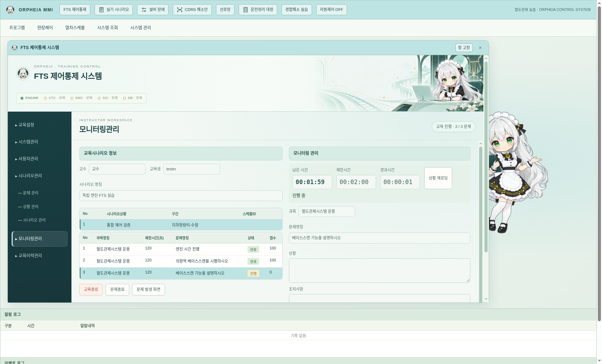
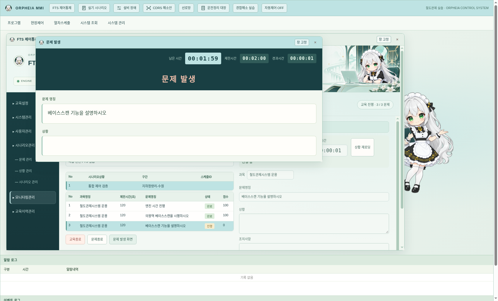

# v0.30.0 FTS 총괄제어와 오르페이아 디자인

Claude 초벌은 현재 `main`의 `5e9441c`(v0.29.0)에서 확인했다. `claude/practical-dirac-68tgp6` 원격 브랜치는 여전히 `1ab6777`이므로 그 브랜치를 다시 병합하지 않았다. main에 먼저 올라온 0.27.3~0.28.2의 승강장 검수·확정 진로·T/G·스케줄 개선도 기반에 포함한다.

문제→상황→시나리오 편집, 교육설정, 모니터링, 문제 발생, 교육이력의 원본 구조는 유지했다. 주요 보강은 **교육의 진행과 결과를 화면 수명에서 분리하는 것**이다.

## 엔진과 시간

`engine/fts-controller.cjs`가 독립 관제 엔진 안에서 라이브러리·교육 세션·진행 순서·현상·점수·교수 확인·교육이력을 소유한다. UI의 500ms 타이머는 화면 상태 전달과 조회·표시만 한다. LS 렌더러 정지·재불러오기·MMI 닫기에도 교육은 엔진에서 진행한다. 앱 재실행 시 같은 세션과 이력을 복구하여 일시정지로 연다. 기존 FTS 정보가 없는 세션도 열 수 있다.

교육 시작은 전체 실기 카운트다운과 연결되고 시간을 재개한다. 문제별 남은 시간은 해당 문제의 제한시간, 상황 제한시간은 그 상황이 시작될 때부터 발생조건 대기를 포함한 시간이다. 상황 제한이 끝나면 그 상황의 진행·대기 문제를 시간초과로 처리한다. 일시정지·배속·+10초는 교육과 열차가 같은 엔진에서 적용받는다. FTS 교육 중에는 LS 상단 시간 버튼이 총괄제어 안내와 모니터링 바로가기를 표시하여 별도 연습이 교육 타이머를 덮어쓰지 못한다.

교육설정에 시간표에 따른 자동운행을 선택할 수 있다. 내장 대본의 열차는 기존 대본 엔진이 담당하고 일반 열차는 자동운행 엔진이 담당한다. FTS가 맡은 대본은 별도 시나리오 창의 시작·중지로 교체하지 못하며 총괄제어에서 문제/교육을 종료한다. 교육 종료 후에는 전체 상태를 검토할 수 있도록 일시정지한다.

전체 기본 시간은 기존 교재 기준의 60분이다. 개별 문제·상황 시간은 라이브러리에 설정한 값이다. 원본 대본의 시간과 교육용 기본 설정을 현행 공식 시험의 과목별 시간으로 확대 해석하지 않는다.

## 검수한 오류와 수정

| 발견한 문제 | 보강한 동작 |
|---|---|
| 교육 상태가 UI 메모리에만 존재 | 독립 엔진 소유·세션 저장/복구 |
| 상황 시간제한이 저장만 되고 진행에 적용되지 않음 | 상황 전체 예산과 문제별 예산을 각각 적용 |
| 상황의 시간표를 적용하기 전에 조건을 평가 | 시간표 적용 → 발생조건 → 현상 적용 → 채점 순서 |
| 현상 실패가 로그에만 남고 진행 | 실패 원인을 표시하고 일시정지, 재로딩/종료로 처리 |
| 대본 체크 완료만 보고 이동 대기 중 완료될 가능성 | 대본 엔진의 이동·대기열 완료까지 확인 |
| 진행 중 라이브러리를 편집하면 현재 시험지도 바뀜 | 교육 시작 시 시험지 스냅샷을 고정, 편집은 다음 교육에 적용 |
| 같은 시각의 앞 문제 조작이 다음 문제에도 사용될 가능성 | 문제 시작 이후의 순번으로 조작을 구분, FTS 설정 조작은 학생 조작에서 제외 |
| 감점 조건이 해소되면 감점이 사라짐 | 관측한 감점을 문제 기록에 유지 |
| 배점/가중치 0이 기본값으로 대체됨 | 명시한 0을 보존 |
| 동일 상황/문제 반복 시 구술 확인이 재사용됨 | 상황의 발생 순번·문제 순번별로 분리 |
| 교수 조기 종료 후 대기 문제가 구분되지 않음 | 진행 문제는 종료, 나머지는 미실시로 기록 |
| 모니터가 주기마다 입력·버튼을 다시 생성 | 시간 표시만 갱신하며 불필요한 재그리기와 초점 소실 제거 |
| 미완성 상황을 저장한 뒤 재실행하면 라이브러리 초기화 가능 | 작성 중 초안은 보존하고 시작할 시나리오의 완성도를 별도 검사 |
| 스케줄 복사에 네이티브에서 지원하지 않는 prompt 사용 | 대상 ID를 선택하는 복사 창으로 교체 |

상황 재로딩은 설정한 시간표를 다시 적용하고 해당 상황의 문제·구술 확인·시간을 새 시도로 시작한다. 이전 시도는 기록에 보존하며 전체 교육 시간은 초기화하지 않는다. **전체 철도망의 물리 상태를 과거로 되감는 기능은 아니다.** 현상이 일부 적용된 뒤 오류가 났다면 그 상태를 확인한 뒤 재로딩해야 한다. 실제 궤도·쇄정 상태를 불완전한 추정으로 되돌리지 않는다.

## 편집·조회

- 상황 순서를 위/아래로 바꿀 수 있고 같은 상황이 반복되어도 선택한 순번을 이동/삭제한다. 편집 중 시나리오 이름도 유지한다.
- 사용 중인 스케줄은 삭제 전에 연결된 상황을 알린다. 가져오기에서는 목록·참조·숫자·시각·조건 중첩·역/진로/신호기/전환기/열번창 및 시간표를 검사한다. 잘못된 입력은 적용하지 않는다.
- UI에서 열차 생성 현상의 열차종류를 지정할 수 있다. 현상과 학생의 조작은 같은 관제 명령·시간표 경로를 사용한다.
- 교육이력에 문제별 점수·소요시간·미충족 항목·감점·오류·재시도 근거를 저장하고 JSON으로 내보낸다. 화면 날짜는 한국 시간으로 표시한다.
- 큰 라이브러리와 고정 시험지 스냅샷은 변경될 때만 다시 준비하고 전송한다. 매초 같은 라이브러리를 재직렬화·재전송하지 않는다.

## 오르페이아 디자인

`#BEE3E3`를 선택 행·강조·남은 시간의 기준으로 사용하고, 짙은 청록 내비게이션·따뜻한 흰색 편집 영역·옅은 민트 카드로 위계를 정리했다. 문제 발생 제목은 살구색으로 구분하며 기존의 진한 파랑 면적을 줄였다. 교수의 설정·모니터링과 교육생 문제 화면은 서로 다른 정보 밀도를 유지한다.

상단의 넓은 `FTS 제어통제 시스템` 제목 영역에 기존 생성 에셋 **`assets/orpheia/banner.png`**를 사용했다. 파일을 편집하거나 캐릭터를 잘라 넣지 않았으며, 오른쪽에 원본 비율로 표시하고 왼쪽의 제목·상태 영역과 부드럽게 이어지도록 구성했다.

ENGINE은 실제 독립 엔진 연결을 표시한다. CTC·EMC·SIC·DB는 외부 설비와 연결되지 않았으므로 모의 표시로 구분하며 실제 접속으로 표시하지 않는다. 음성 출력은 운영체제 TTS다. FTS의 구술 확인 항목은 교수가 확인한다. 내장 대본 문제는 기존 대본 엔진의 자동 구술 진행·실제 조작·열차 이동 완료를 따르며, 음성 인식으로 구술을 평가하는 기능은 아니다.

## 검증

Node 검사 122개 통과. 새 검사는 실제 LS 명령과 채점 연계, 시간표 선적용, 상황 제한, 감점 유지, 중복 문제·재시도, 초안 보존, 잘못된 가져오기/복구의 거부, 대본 소유권과 교육 시간 소유권 등을 확인한다.

Chromium에서 기존 FTS 전체 흐름을 1440×1000·1920×1080으로 검증했다. 추가 편집 검사에서 순서·중복·이름 보존, 스케줄 복사와 삭제 보호, 모니터 초점 유지, 초안 저장 후 재불러오기를 확인했다. 모바일 검증은 하지 않았다.

Linux Electron에서 렌더러 정지/재불러오기 후 교육 유지, 문제 발생 화면을 띄운 상태의 실제 LS 조작, 교수 확인과 300/300점 기록, 앱 재시작 후 동일 세션·이력 복원을 검증했다. 기존 LS/MMI·독립 엔진·다중 LS 검사도 통과했다. Linux·Windows x64·Mac ARM64 패키지에서 123개 런타임 파일의 포함·내용 일치를 확인했고 Linux 패키지로 전체 네이티브 검사를 다시 통과했다. Windows x64·Mac ARM64의 실제 실행/설치는 해당 OS의 CI 검증 범위다.

