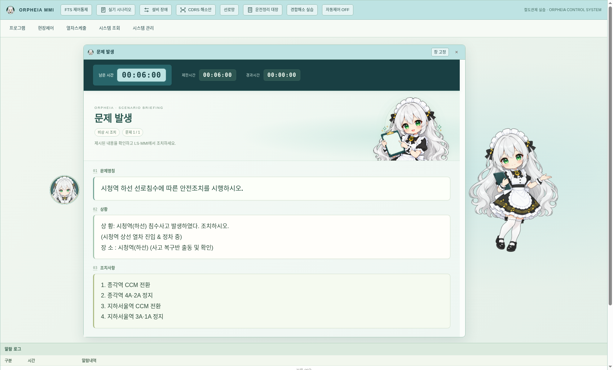

# v0.31.1 문제 발생 화면

문제명칭·상황·조치사항을 읽는 공간을 확보하면서 오르페이아 디자인을 적용했습니다. main의 v0.31.0(`f73e6d6`) 접근쇄정·오버랩 개선을 포함한 상태에서 작업했습니다.

## 표시 구성

- 남은 시간·제한시간·경과시간은 상단에 고정합니다. 스크롤 중에도 카운트다운을 볼 수 있습니다.
- 새 캐릭터 에셋은 제목 오른쪽의 독립된 영역에 배치합니다. 본문 뒤에 그림을 깔지 않습니다.
- 문제명칭·상황·조치사항은 전체 너비 카드로 표시합니다. 본문은 16px 이상이며 줄바꿈과 긴 문자열을 보존합니다. 고정 높이로 내용을 자르지 않고 창 안에서 스크롤합니다.
- 시험 설정에서 조치사항을 숨기면 해당 영역 자체를 표시하지 않습니다. 대기·진행·종료·오류와 추가 안내도 구분합니다.
- 문제 창이 열린 상태에서도 교수용 메뉴를 이용할 수 있도록 기본 위치를 조정했습니다.

미리보기는 기존 `em-01` 문제와 실제 대본의 조치 내용을 사용한 연습 설정입니다. 그림을 위해 새 시험 문제를 추가하지 않았습니다.

## 에셋

`simulator/assets/orpheia/briefing.png`는 2026-10-30 imagegen으로 생성한 새 브리핑 포즈입니다. 기존 `guide.png`를 캐릭터 참고로 사용했습니다. 은발·녹안·악보 모티프와 #BEE3E3, 아이보리, 짙은 청록색을 반영했습니다. 1312×1199 RGBA PNG 원본을 변형 없이 보관하며 생성 정보·크기·SHA-256은 에셋 MANIFEST에 기록했습니다. 기존 배너와 엠블럼도 보존합니다.

## 검증

- Node 테스트 126개 통과.
- 1440×1000·1920×1080 데스크톱에서 FTS 전체 교육 흐름과 긴 문제명칭·16줄 상황·14줄 조치사항 표시 검사 통과. 특수문자, 긴 연속 문자열, 줄바꿈, 스크롤 중 시간 표시, 조치사항 숨김을 확인했습니다.
- FTS 편집 순서·이름 보존·스케줄 복사·참조 삭제 방지·모니터링 포커스 검사 통과.
- Linux Electron에서 LS·MMI·그래프, 독립 엔진 복구, FTS 진행·채점·이력 검사 통과.
- Linux·Windows x64·Mac ARM64 패키징 및 각 ASAR의 필수 파일 124개 검증 통과. 새 PNG가 포함됩니다.

Windows와 Mac의 실제 실행·설치 결과는 각 OS의 GitHub Actions에서 확인해야 합니다. 여기서 수행한 두 OS 검증은 교차 패키징과 내용 검사입니다.
