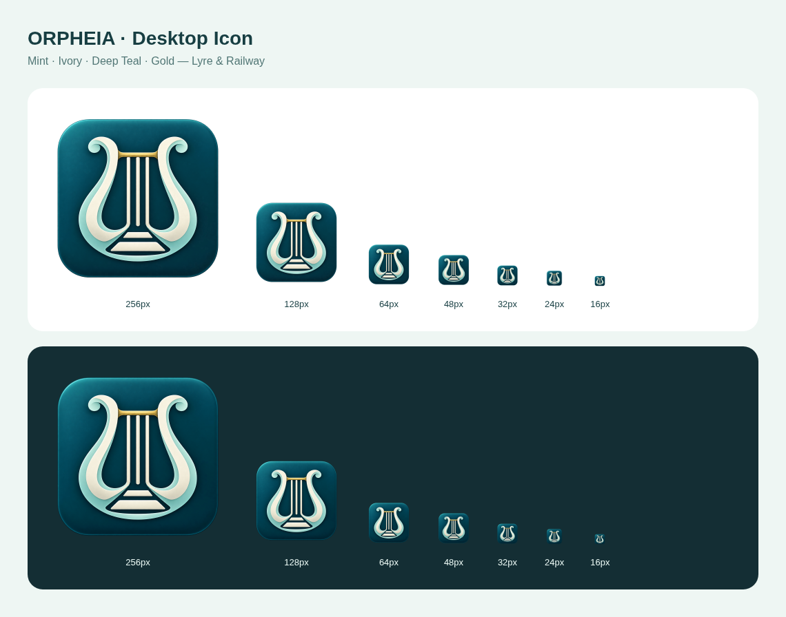

# v0.32.1 앱 아이콘

기존 원형 캐릭터 초상화를 앱 아이콘 전용 심볼로 교체했습니다. 은은한 입체감의 짙은 청록 타일에 #BEE3E3 민트·아이보리 리라와 선로를 결합하고 금색 브리지를 넣었습니다. 프로그램 내부의 캐릭터·배너·브리핑 그림은 유지합니다.

## 적용

- Mac ARM64: Finder·설치 앱 번들에는 다중 해상도 ICNS를 사용합니다. 실행 중 Dock도 새 아이콘을 설정합니다.
- Windows x64: 설치 파일·프로그램 EXE·바로가기에는 16~256px ICO를 사용합니다. 모든 창에 ICO를 지정하고 작업표시줄 그룹의 AppUserModelID를 앱 ID와 맞췄습니다.
- LS 기본 창·추가 창, MMI·열차 그래프·독립 FTS 창에 동일한 아이콘을 지정합니다. Windows 트레이는 새 PNG를 사용합니다.
- Mac ICNS는 일반·Retina 표현을 포함해 최대 1024px, Windows ICO는 16·20·24·32·40·48·64·128·256px를 포함합니다. 외곽 모서리는 투명합니다.

2026-10-31 imagegen 생성 원본은 `assets/orpheia-app-icon-source.png`에 수정 없이 보관했습니다. 포맷 변환은 `tools/build-app-icons.cjs`로 재현하며 해시·제작 정보는 `desktop/resources/MANIFEST.json`에 기록했습니다.

## 검증

Node 테스트 126개와 Linux Electron의 창·독립 엔진·FTS 교육 흐름 검사 통과. 16~256px 밝은·어두운 배경 미리보기를 확인하고 PNG·ICO·ICNS의 크기별 이미지와 투명 외곽을 검사했습니다. Linux·Windows x64·Mac ARM64 교차 패키징과 ASAR 파일 일치, Mac 번들 바깥 ICNS 일치를 검사했습니다. CI 패키지 검사에도 실행 자산과 Mac 번들 아이콘 확인을 추가했습니다.

Windows EXE의 아이콘 삽입 및 두 OS의 실제 설치·실행은 각 OS의 GitHub Actions에서 검증합니다. 로컬 Windows 교차 패키징은 서명·리소스 편집을 생략했으며, 실제 Dock·작업표시줄 화면을 검증한 것으로 간주하지 않습니다. 기존 고정 바로가기에 이전 이미지가 남으면 앱을 종료한 뒤 새 설치 파일로 갱신하고 바로가기를 다시 고정하세요.

v0.32.0의 독립 FTS 창 변경을 포함한 main 위에 적용했습니다. 원본 보존 브랜치를 사용하는 저장소 정리 방침에 따라 버전 ZIP은 다시 추가하지 않습니다.
