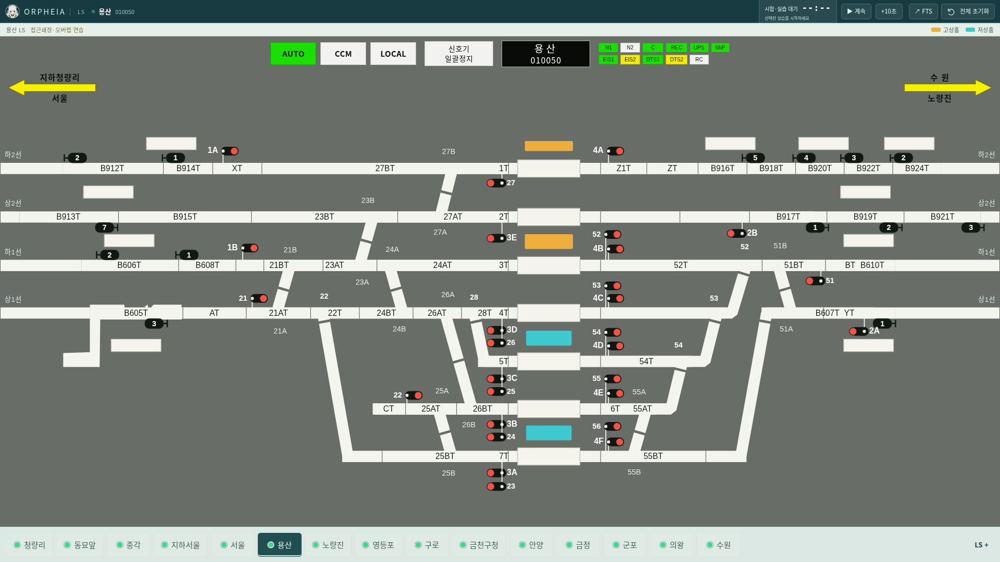
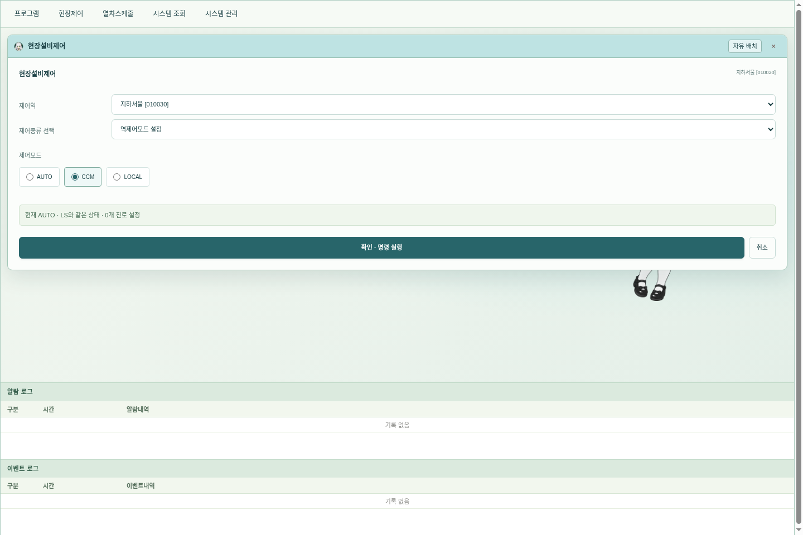

# v0.38.0 화면 정리와 전체 초기화

제공된 5개 화면을 기준으로 UI를 정리하고, 역 한 곳만 지우던 초기화를 프로그램 전체 초기화로 바꿨습니다.

| 요청 | 적용 |
| --- | --- |
| MMI 상단의 큰 로고 띠 삭제 | 54px 높이의 브랜딩 띠를 DOM에서 제거하고 메뉴·작업 영역을 위로 확장 |
| LS 화면 선택 드롭다운 삭제 | 하단 드롭다운·관련 이벤트 제거. 직접 역 버튼과 도면 위 노란 화살표로 이동 |
| 하단 역 버튼 확대, 좌우 바로가기 삭제 | 최소 46px 높이·15px 글자, 84px 이상 너비로 확대. 하단의 이전/다음 버튼 제거. 좁은 데스크톱 창에서는 역 버튼 영역만 가로 스크롤 |
| 안내·기록 저장 삭제, 초기화 강화 | 안내 버튼·안내 창·기록 저장 버튼·해당 데스크톱 메뉴 제거. 전체 초기화 버튼 추가 |
| 배선도 다듬기 | 같은 회로의 인접한 추출 조각에서 반복되던 용산 `23AT`를 한 번 표시. 회로명과 인라인 열번칸의 간섭을 줄이고 전환기 글자 위치 탐색 범위 조정 |

운영자 선호화면은 삭제된 드롭다운 대신 하단 역 버튼의 순서를 바꿉니다. 역간 감시 화면 3곳은 도면 위 노란 화살표로 엽니다. 기존 열번칸 입력·이동·조회 기능은 유지합니다.

A/B 전환기 표기가 실제로 중복 표시된다는 증거는 확인되지 않았습니다. 기존 코드에도 좌표 중복 제거가 있었습니다. 추가로 넣었던 이름 중복 제거는 철회했고, 정상적인 A/B 쌍동 표기·제어는 유지했습니다. 엔진의 구내 연결·진로·쇄정 규칙은 이번 화면 정리에서 바꾸지 않았습니다.

## 전체 초기화

누르면 삭제 범위를 안내하는 확인창이 나옵니다. 취소하면 상태가 유지됩니다. 확인하면 다음을 초기화합니다.

- 모든 역의 진로·점유·열차번호·설비·단선 설정 및 가상시계
- 교육 진행·결과·이력, 삽입한 교육 열차와 수정한 시간표
- 사용자가 추가·가져오기한 문제·상황·시나리오·스케줄·사용자 정보
- 완료 과제·선호화면·초안 등 앱 내부 저장 설정과 창 배치

기본 시간표 12편과 내장 교재 시나리오로 복원합니다. 자동운행은 꺼지고 시계는 일시정지로 시작합니다. 실행 중인 추가 LS·MMI·그래프·FTS·문제 창을 닫고, 기본 LS·MMI 작업 공간을 다시 엽니다. 사용자가 앱 밖으로 내보낸 파일은 삭제하지 않습니다.

엔진은 기존 저장 작업을 먼저 마치고 새 런타임으로 교체합니다. 자동 저장의 주 파일과 `.bak` 복구 파일 모두 새 초기 상태로 기록하며, 초기화 중에는 기존 시계·자동 저장·화면 명령이 끼어들지 않게 합니다. 화면의 localStorage·sessionStorage와 데스크톱 앱의 저장 공간을 지운 뒤 새 화면을 만듭니다. 삭제 전에 주 저장본이나 백업을 따로 남겨 다음 실행에 되살리는 동작은 하지 않습니다.

## 미리보기

## 검증

- Node 테스트 159개 통과. 전체 초기화 후 주 저장 파일을 손상시켜도 백업에서 삭제한 교육이 살아나지 않는 검사 포함.
- 1440×1000·1920×1080 데스크톱에서 15개 역 버튼·18개 화면·3개 역간 감시 화면·모든 A/B 제어의 누락/중복 여부·브라우저 전체 초기화 검사 통과.
- 운영자 선호화면 정렬, 노란 화살표 이동, 역간 열번칸 입력·이동·조회·크기 변경 검사 통과.
- Linux Electron의 기본 창·엔진 독립 실행·세션 복구·추가 LS·FTS 교육 흐름 및 실제 전체 초기화 검사 통과. 초기화 취소/확인, 삽입 교육·캐시 제거, 불필요한 창 종료, LS·MMI 재구성, 주/백업 파일을 확인했습니다.
- Linux·Windows x64·Mac ARM64 교차 패키징과 패키지 내용 일치 검사. Windows·Mac의 실제 설치·실행은 각 OS의 GitHub Actions에서 확인합니다.

버전 ZIP을 작업 트리에 다시 추가하지 않습니다.
