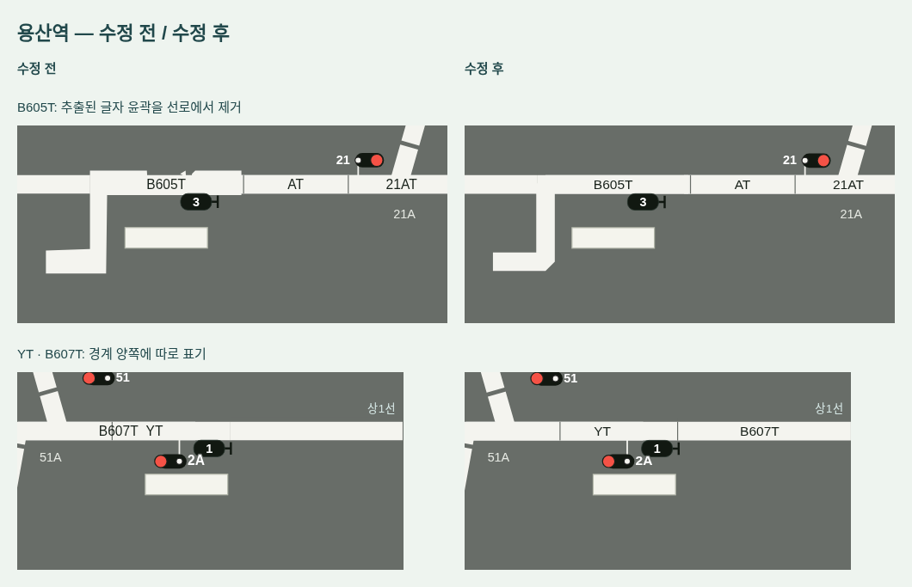

# v0.38.1 역 바로가기·MMI 메뉴·용산 배선

하단 역 버튼이 왼쪽에만 모이던 문제와 MMI 메뉴의 과한 세로 여백을 줄이고, 용산 `B605T` 위의 깨진 선로 윤곽 및 `YT` 옆으로 밀리던 `B607T`를 수정했습니다.

## 화면

[전체 LS](preview-v0.38.1-ls.png) · [얇아진 MMI 메뉴](preview-v0.38.1-mmi.png)

- 하단 15개 역 버튼은 남은 바 너비를 균등하게 나눕니다. 고정 너비 버튼을 왼쪽에 모으지 않습니다. 최소 높이는 50px이며, 1920px 창에서 버튼 하나가 약 117px입니다. 진로 개수 배지는 위 모서리에 두어 이름 너비를 빼앗지 않습니다.
- MMI 상단의 프로그램·현장제어·열차스케줄 메뉴는 **25px 높이**입니다. 위아래 패딩을 줄이고 글자·드롭다운·키보드 조작을 유지합니다.
- `B605T` 주변 외곽 선로는 추출된 다각형에 글자 윤곽이 섞여 있었습니다. 원래 코드의 바깥 꺾임과 수평 회로 중심을 따라 4점 중심선으로 다시 그렸습니다. 모든 선로와 동일한 두께를 쓰므로 위쪽의 톱니 모양이 없어집니다. 정리한 중심선은 검토 전사 데이터의 `joins`에 남겨 생성기를 다시 실행해도 유지됩니다.
- `B607T`는 소스 표시 셀에서 이름이 빠져 보완 라벨로 그려졌고, 기존 위치 탐색이 이를 `YT` 왼쪽으로 밀었습니다. 기존 오른쪽 화면 연결선 위, `YT`의 오른쪽 경계 바깥으로 옮기고 경계 눈금을 넣었습니다. 같은 유형인 `BT`·`B610T`도 구분됩니다. 열차번호와 전환기·신호·진로 데이터는 유지합니다.

## 검증

1280×800·1440×1000·1920×1080 데스크톱 창에서 15개 버튼의 양끝이 역 바에 일치하고, 버튼 너비가 동일하며, 글자 잘림이나 가로 스크롤이 없는 것을 확인했습니다. MMI 메뉴는 세 크기에서 모두 25px이고 현장제어 드롭다운으로 실제 제어 창을 열 수 있습니다.

`YT`와 `B607T` 글자 사이 간격은 각각 약 99·113·150px입니다. 용산에는 원래의 복잡한 추출 다각형을 그리지 않고 정리한 중심선 하나를 그리는 것을 확인했습니다. Node 테스트 159개(710개 진로 렌더링 포함)와 Linux Electron 전체 창·엔진·FTS·전체 초기화 검사가 통과했습니다.

Linux·Windows x64·Mac ARM64 패키징과 파일 일치도 검사합니다. Mac·Windows 실제 설치·실행은 각 OS의 GitHub Actions 결과를 확인해야 합니다.
