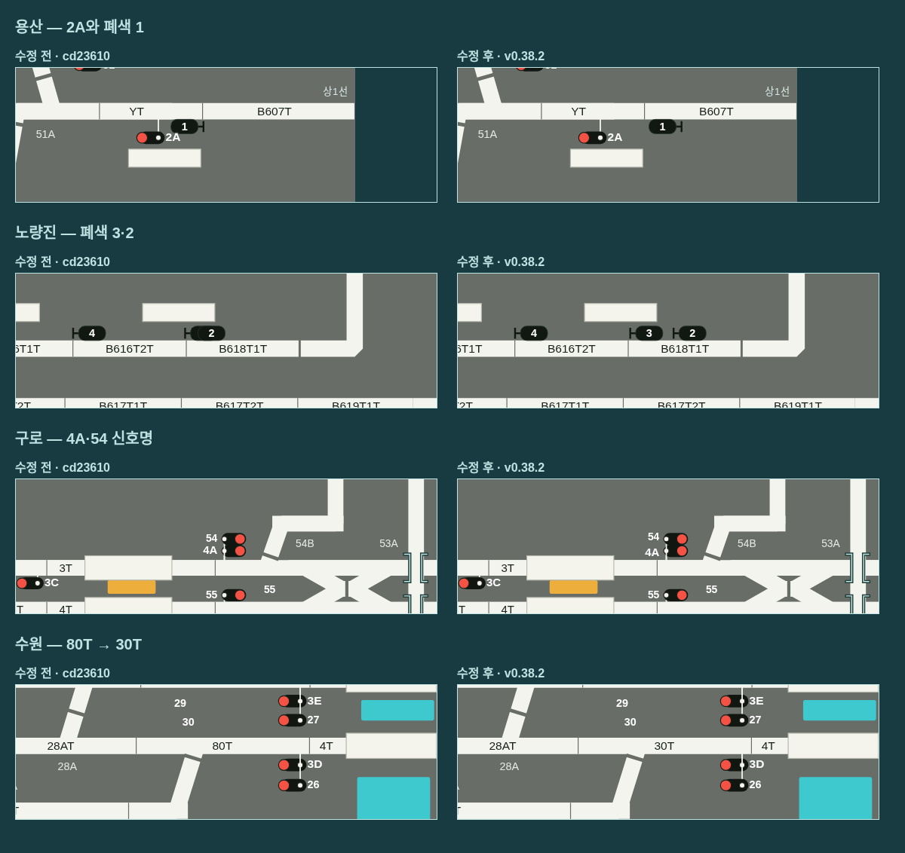

# v0.38.2 전체 역 배선 표시 정리

15개 역과 역간 화면 3개를 모두 확인하고, 추가로 발견한 표식 겹침 세 곳과 회로명 오독 한 곳을 수정했습니다. 기준은 v0.38.1 `cd23610`입니다. 용산 B605T 윤곽과 YT/B607T 분리는 앞 버전의 수정을 유지합니다.



[18개 화면의 수정 전후 보기](layout-review-v0.38.2/index.html) · [수정 후 전체 화면 모음](layout-review-v0.38.2/after/sheet.png)

| 위치 | 발견한 문제 | 수정 |
|---|---|---|
| 용산 B607T | 폐색 1 표식이 2A 신호명에 닿음 | 오른쪽 경계의 B607T 연결선 쪽으로 표식을 옮김. 신호 위치는 유지 |
| 노량진 B618T1T | 폐색 3과 2가 포개져 3이 가려짐 | 같은 회로 안에서 순서를 유지하며 두 표식을 분리 |
| 구로 | 54와 4A 등 가까운 신호명의 줄 간격이 부족함 | 겹치는 세로 묶음의 이름 간격을 최소 18 SVG 단위로 확보. 이동은 최대 약 2.15 단위, 등과 신호 기둥은 유지 |
| 수원 4T 서쪽 | 원본 30T를 80T로 읽은 추출 오류 | 위치와 원문을 지정한 보정 전사로 표시명을 30T로 수정 |

수원의 보정은 `references/transcriptions/intermediate-circuits.json`에 원본 쪽·좌표·수정 전후를 남겼으며 생성 데이터에도 반영했습니다. 금천구청 28T는 원본에 있는 이름이므로 유지합니다. 전환기 A/B 표기도 유지합니다.

## 검사 범위와 결과

청량리·동묘앞·종각·지하서울·서울·용산·노량진·영등포·구로·금천구청·안양·금정·군포·의왕·수원과 안양–금정·군포–의왕·의왕–수원을 검사했습니다.

- Chromium 데스크톱 1920×1080·1440×1000·1280×800에서 각 화면의 모든 전환기를 정위(N)·반위(R)로 전환한 **108개 경우**를 검사했습니다. 전환 명령의 성공과 실제 상태도 확인합니다.
- 실제 SVG 경계로 회로·신호·전환기 이름 사이, 이름과 열번창·신호/폐색 몸체·표식 기둥 사이의 겹침, 비회로 이름과 승강장 사이의 겹침, 표식 간 겹침 및 잘림·글자 압축을 측정했습니다. 수정 전 보고서의 겹침 18건(창 크기·N/R 반복 포함)이 수정 후 **0건**입니다.
- 기준 버전과 108개 경우를 비교해 신호 수, 전환기 제어 ID, 열번창 ID, 폐색 ID·번호·회로가 동일한 것을 확인했습니다. 세 창 크기에서 용산 2A·구로 4A·54의 **이름을 실제 마우스로 클릭**해 올바른 진로 메뉴가 열리는지 검사했습니다.
- Node 테스트 **159개 통과**. Linux Electron에서 LS/MMI·공유 엔진·복수 LS·FTS·재시작 복원·전체 초기화 검사가 모두 통과했습니다.
- Linux x64·Windows x64·Mac ARM64 패키징 및 각 ASAR의 **127개 파일 원본 일치 검사**가 통과했습니다. Mac·Windows 네이티브 실행은 이 Linux 작업 환경에서 수행하지 않았습니다.

선로 그래프는 기준 버전과 객체 전체가 동일합니다. 회로 320개, 전역 노드 1,355개·연결 1,444개, 진로 710개이며 연결 검사 문제도 없습니다. 이번 변경은 표시와 간격 보정입니다. 검증은 지정한 창 크기·기본 화면·N/R 상태를 대상으로 하며 모든 열차·교육 상황 조합을 검사했다는 뜻은 아닙니다.

## 재검사

Python Playwright와 `/usr/bin/chromium`이 설치된 환경에서 저장소 루트에서 실행합니다.

```sh
python tools/audit-ls-layout.py --out /tmp/ls-layout-review --capture --check
python simulator/e2e/all-stations-layout.browser.test.py
npm test
DISPLAY=:99 ORPHEIA_TEST_NO_SANDBOX=1 npm run test:desktop
```

[검사 메타데이터·수정 파일 해시](layout-review-v0.38.2/metadata.json) · [수정 전 결과](layout-review-v0.38.2/before/summary.json) · [수정 후 결과](layout-review-v0.38.2/after/summary.json). `audit.json`에는 겹친 요소의 경계와 화면별 제어 목록을 보관합니다. PNG는 두 버전 모두 같은 1920×1080·N 상태를 캡처한 것입니다.
