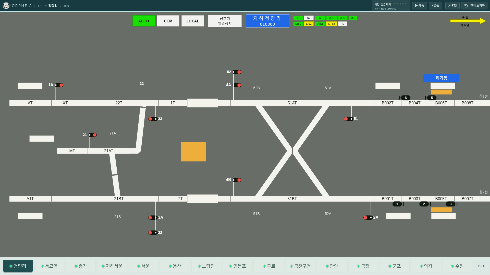
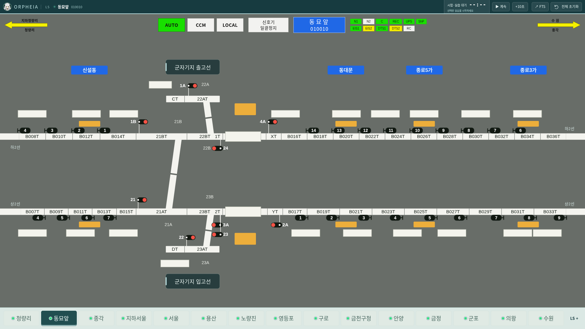

# v0.39.0 빈 실습·FTS 시간표·본선 표기·화살표 정렬

새 실습과 전체 초기화 뒤에는 시간표·진행 중인 시나리오·교육이 없습니다. 시작할 때 12개 열차를 만들던 코드를 프로그램에서 제거했습니다. FTS 선택용 프리셋 3종은 유지하고, 교수가 선택해 적용할 때 필요한 시간표와 초기 상태를 함께 불러옵니다.



## 빈 상태와 시간표 입력

- LS의 역명·관할·접근쇄정/오버랩 문구와 고상홈/저상홈 범례가 있던 가로 안내 띠를 제거했습니다. 승강장 색과 마우스 설명은 유지합니다.
- 새 실습의 온라인 시간표는 **0개 열차**입니다. 온라인 열차스케줄 관리의 생성·열차운행패턴 적용·편집 적용 또는 시간표 파일 입력으로 채웁니다.
- 전체 초기화는 교육·추가 자료·설정과 자동 복구 백업을 지우고 시간표·열번창·진행 중인 교육이 없는 상태로 돌아갑니다. 확인창도 빈 상태와 FTS 선택용 프리셋 유지로 안내합니다.
- 사용자가 저장해 둔 세션의 복원은 유지합니다. 기존 작업까지 비우려면 전체 초기화를 실행합니다.

## FTS와 함께 적용하는 시간표

FTS 시작용 시간표 **19개(90001~90019)**를 생성해 선택용 프리셋에 연결했습니다. 3개는 열차를 생성하거나 구술하는 과제이므로 의도적으로 비어 있습니다. 나머지 16개에는 각 문제에 필요한 열차만 담았으며, 서로 다른 문제 사이의 같은 열차번호를 포함해 총 69개 열차 항목입니다.

| 문제 종류 | 적용 시간표 |
|---|---|
| C4201 생성 | 빈 시간표. 생성 후 이어지는 수정·운휴·부활 과제에서는 입력한 열차 유지 |
| K1135 그래프 검색 | K1135만 삽입 |
| 구술 과제 | 빈 시간표 |
| 대피 5종 | 대본의 고장·후속·반대 방향 열차 전부 |
| 비상시 조치 9종 | 대본의 초기 열차 전부 |
| 스케줄 생성 | 빈 시간표에서 출제 |
| 경합 해소 | K1131을 삽입하고 대본이 B0000 경합 열차 생성 |

대본에 있는 열차번호·방향·초기 위치와 본선 계열을 사용합니다. 일반선 열차는 서울~수원 일반선 계열을 따라 계획하고 지하철 구간으로 넣지 않습니다. 초기 진로와 정차 선로를 연결해 출발진로를 정하며, 교육생이 해야 할 대피 진로 수정은 미리 완료하지 않습니다. 승강장·역별 정확한 시각이 없는 부분은 교육용으로 생성했습니다. 초기 위치의 계획 도착은 문제 시작 후 약 10분, 열차별 간격은 3분입니다. 실제 영업 시간표를 옮긴 자료는 아닙니다.

시간표의 시각은 문제 시작·재로딩 시점에 맞춰 이동합니다. 열번창의 대본 열차는 FTS의 진로·지시로 움직이며, 시간표 자동운행이 같은 열차를 다시 만들지 않습니다. FTS 시간표를 온라인 편집용으로 불러온 뒤 저장하면 편집한 절대 시각을 유지합니다. 문제에서 사용하는 시간표를 삭제할 때도 참조를 확인합니다.

[생성한 FTS 프리셋 JSON](layout-review-v0.39.0/fts-presets.json) · [FTS의 시간표 목록](layout-review-v0.39.0/fts-schedules.png) · [형식](FTS-시나리오-형식.md). JSON은 문제·상황·시나리오·시간표를 함께 포함하며 FTS의 라이브러리 가져오기에 사용할 수 있습니다.

## 지하청량리의 몇 선인지

기존 `하선 · 1선 / 상선 · 2선`은 표시 코드가 구내 선로번호 `1T·2T`를 본선 이름 뒤에 붙인 것이었습니다. 본선 계열과 구내 번호를 혼용한 잘못된 표시입니다.

현재 연결 코드에서 지하청량리~지하서울의 하행 `MD`는 서울의 **1T에서 ED로**, 상행 `MU`는 **2T에서 EU로** 이어집니다. ED/EU는 각각 하2선·상2선입니다. 따라서 이 코드의 본선 계열 기준으로 지하청량리는 **하2선·상2선**으로 표시합니다. 일반선 GD/GU는 하1선·상1선으로 구분합니다.

| 코드 | 실제 코드의 연결 | 화면 표기 |
|---|---|---|
| MD → ED | 서울 1T에서 지하철 하행과 전동선 하행 연결 | 하2선 |
| MU → EU | 서울 2T에서 지하철 상행과 전동선 상행 연결 | 상2선 |
| GD | 일반선 하행 | 하1선 |
| GU | 일반선 상행 | 상1선 |

숫자를 지우거나 역별로 임의 지정하지 않고, 엔진의 `transitions`를 따라 본선 계열을 찾는 함수를 화면에서도 사용합니다. 이 변경으로 물리 선로나 진로를 새로 연결하지 않습니다.

## 노란 화살표



화살표를 배선도 SVG에서 분리해 AUTO·CCM·LOCAL 메뉴와 **같은 상단 행**에 둡니다. 모든 15개 역과 3개 역간 화면은 같은 56px 행 높이·같은 좌우 자리·같은 화살표 크기를 사용합니다. 제어 메뉴가 없는 역간 화면도 화살표 위치를 유지합니다. 마우스와 Enter로 이웃 화면에 이동하는 기능은 유지합니다.

## 검증

- Node 테스트 **166개 통과**. 빈 시작, FTS 시작 시간표 19개, 시작 시각에 따른 재로딩, 대본 열차 중복 방지, C4201 후속 문제의 시간표 유지, 일반선 대본 열차의 본선 계열, 지하철/일반/전동선의 실제 인계를 검사합니다.
- Chromium 1280×800·1440×1000·1920×1080에서 모든 18개 화면의 화살표 중앙이 메뉴 중앙과 맞고 제어 영역을 침범하지 않는 **54개 화면 검사**가 통과했습니다. 세 크기에서 온라인 스케줄 양식으로 C4201 생성, 전체 초기화 후 0열차·교육 없음·FTS 프리셋 유지, FTS 시간표 편집·저장도 검사했습니다.
- 18개 화면 × 세 창 크기 × 정위/반위 **108개 경우**에서 측정한 표시 겹침·잘림 0건입니다. [전체 화면 모음](layout-review-v0.39.0/all-stations/sheet.png) · [측정 결과](layout-review-v0.39.0/all-stations/summary.json) · [화살표 좌표](layout-review-v0.39.0/header-metrics.json)
- FTS 편집(순서·중복·스케줄 복사·참조 삭제 보호), 스케줄 생성·경합 대본, 온라인 패턴·실적 편집, 승강장 표시도 브라우저에서 검사했습니다.
- 물리 선로 그래프와 진로 연결 검사는 기존 버전과 동일합니다: 회로 320개, 전역 노드 1,355개·연결 1,444개, 진로 710개. 측정은 지정된 기본 화면과 상태를 대상으로 하며 모든 열차·교육 상황 조합을 검사했다는 뜻은 아닙니다.
- Linux Electron의 LS/MMI·독립 엔진·복수 LS·FTS·세션 복원·전체 초기화 검사가 모두 통과했습니다. Linux x64·Windows x64·Mac ARM64 패키징 및 각 ASAR의 127개 파일 원본 일치 검사가 통과했습니다. 예제 시간표 테스트 파일이 세 패키지 모두에 없는 것도 확인했습니다. Windows·Mac의 실제 OS 실행은 각각의 CI에서 확인해야 합니다.

재검사:

```sh
npm test
python simulator/e2e/empty-start-header.browser.test.py
python simulator/e2e/fts-active.browser.test.py
python tools/audit-ls-layout.py --out /tmp/ls-layout-review --check
DISPLAY=:99 ORPHEIA_TEST_NO_SANDBOX=1 npm run test:desktop
```

기존 운행 테스트에 필요한 예제 시간표는 테스트 전용 입력 파일로 옮겼으며 앱 패키지에서는 제외합니다. [검증 메타데이터·소스 해시](layout-review-v0.39.0/metadata.json)
