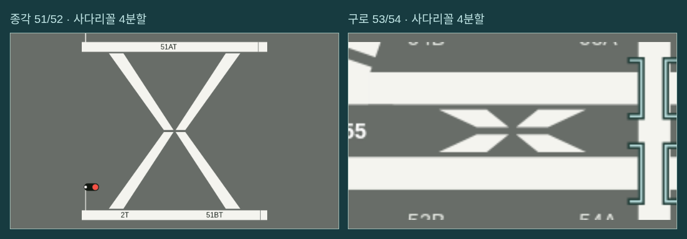
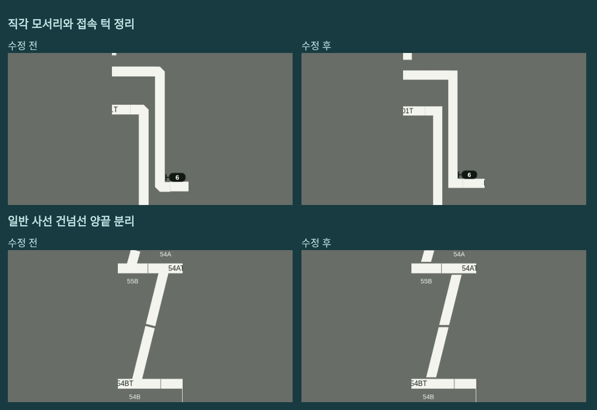
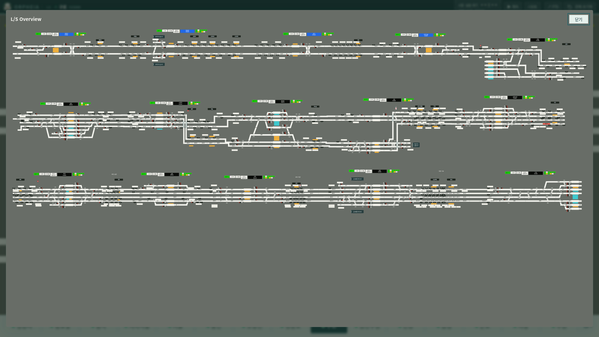

# v0.39.1 배선 트림과 연속 오버뷰

사용자가 올린 종각·구로 건넘선 및 서울 배선 사진을 기준으로 표시를 다듬었습니다. X 교차부의 네 사다리꼴, 중앙 십자 절개, 본선과 평행한 끝단 간격을 구분해서 그립니다. 실제 선로 그래프·전환기 번호·진로 자원은 유지합니다.

## X 교차부

겹친 두 굵은 선의 모서리를 깎는 방식 대신 **넓은 바깥 면과 좁은 안쪽 면을 가진 사다리꼴 네 개**를 직접 만듭니다. 중앙은 가로·세로로 분리하고, 정위일 때 각 조각의 바깥 면은 본선과 평행한 틈을 남깁니다. 실제 대각선 교점을 기준으로 하므로 역마다 찌그러진 목이나 작은 육각형 조각이 생기지 않습니다.

8쌍 전체에 적용했습니다: 청량리 51/52, 종각 51/52, 지하서울 21/22, 서울 58/59·52/53, 영등포 52/53, 구로 53/54, 금천구청 21/22. 네 전환 조합(NN·RN·NR·RR)을 모두 확인합니다. 반위에서는 해당 분기가 본선에 연결되고 대체 직선에 단절이 표시됩니다. 설정된 진로 색은 선택된 네 조각의 실루엣 안에서 흐르고 중앙을 이어 줍니다.

[전환 조합별 수정 전후](layout-review-v0.39.1/comparison.png) · [진로 설정 화면](layout-review-v0.39.1/selected-route.png)

## 직각 모서리와 일반 건넘선

- 직각 반환선은 모서리를 45°로 깎지 않고 반듯하게 이어 줍니다. 급한 사선 접속이 과하게 튀어나오지 않도록 모서리 길이 제한은 유지합니다.
- 검토 전사한 연결선과 본선 사이의 작은 높이 차이는 같은 표시 중심선으로 맞춰 접속부의 턱을 없앱니다. 원본 전사와 실제 연결 데이터는 바꾸지 않습니다.
- 일반 사선 건넘선도 정위에서는 양끝과 본선 사이에 간격을 둡니다. 가운데 절개와 양끝 절단면은 본선에 평행하게 맞춥니다. 반위 선택과 쇄정에 따른 표시 변화는 유지합니다.

## 연속 오버뷰

역별 미리보기 카드를 없애고, 전체 구간을 북부·중부·남부의 3단 연속 배선으로 표시합니다. 모든 역은 같은 원본 좌표 축척과 같은 선 굵기를 사용합니다. 같은 행에서 인접 역의 본선 계열이 일치하는 경계끼리 연결하고, 높이가 다른 곳은 직각 연결로 잇습니다. 이는 표시용 연속선이며 새 회로나 진로를 추가하지 않습니다.

15개 역 배선과 역간 감시 화면 3개의 선택 영역이 있습니다. 기존의 북부·중부·남부 부분 오버뷰도 각각 한 행의 연속 배선으로 보입니다. 운행 모드·설비·진로 색·열번을 현재 상태로 갱신하며, 오버뷰를 누르거나 Enter로 선택하면 해당 화면으로 이동합니다. 갱신 중 키보드 포커스도 유지합니다.

## 검증

- Node 테스트 **168개 통과**. 119개 전환기 그룹의 정위/반위 변화와 접근쇄정 중 전환 금지, 8쌍의 네 조합, 사다리꼴 네 꼭짓점·넓은 바깥 면·평행한 절단면을 검사했습니다.
- 1280×800·1440×1000·1920×1080에서 8쌍 × 네 조합의 **96개 실제 화면 픽셀 검사**가 통과했습니다. 각 교차부의 중앙은 분리되고 네 조각 내부는 흰색으로 표시되는 것을 확인합니다. 서울 일반 건넘선 54의 양끝 간격, 반환선의 위·아래 직각 모서리, 설정 진로의 중앙 연결도 픽셀로 확인했습니다.
- 18개 화면 × 세 창 크기 × 정위/반위의 **108개 표시 검사**에서 측정한 글자·조작 대상 겹침과 잘림은 0건입니다.
- 오버뷰의 15개 배선·18개 이동 대상·같은 행의 경계 연결 40개, 고유 SVG 참조, 실시간 열번, 부분 오버뷰, 갱신 중 포커스, 역 선택 전후 엔진 상태 보존을 검사했습니다. 기존 LS 메뉴·열번 조작·표지판·스캔·276개 열번창 검사도 통과했습니다.
- Linux Electron의 LS/MMI·독립 엔진·복수 LS·FTS·복원·전체 초기화 검사가 통과했습니다. Mac ARM64·Windows x64는 교차 패키지와 포함 파일 일치를 검사하며 실제 OS 실행은 브랜치 CI 결과로 확인합니다.

물리 선로 그래프는 기준 버전 `e57da49`와 동일합니다. 회로 320개, 전역 노드 1,355개·연결 1,444개, 진로 710개를 유지합니다. 지정한 화면·상태를 검사한 결과이며 모든 교육·열차 상태 조합의 시각 검증을 의미하지는 않습니다.

[픽셀 검사 기록](layout-review-v0.39.1/crossing-pixels.json) · [전체 표시 검사](layout-review-v0.39.1/all-stations/summary.json) · [소스 해시·검증 메타데이터](layout-review-v0.39.1/metadata.json)

검토 브랜치는 `codex/ls-trim-overview`입니다. 이 브랜치의 CI는 테스트 설치 파일을 만들고, 정식 릴리스는 main에서만 실행하도록 제한합니다. 이번 작업은 main에 병합하지 않습니다.
