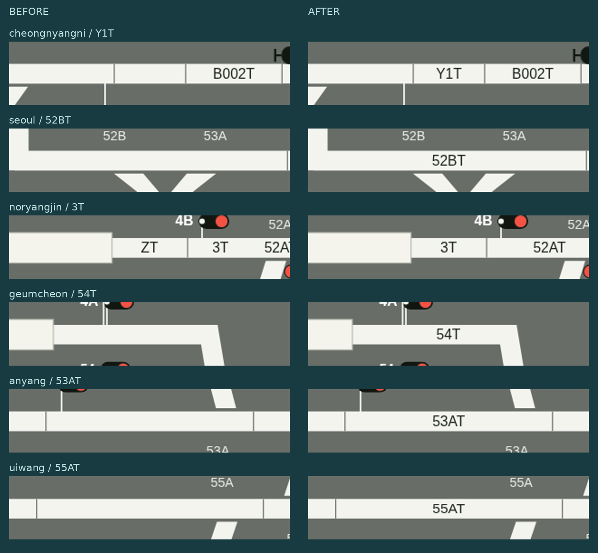

# 전체 역 회로명 누락·오독 대조 (v0.39.1 테스트 브랜치)

용산만의 문제가 아니었습니다. 원본 PPT 15개 역 화면과 역간 화면 3개를 대조해, **11개 역의 표시를 수정**했습니다. 겹침이 없다는 검사만으로 누락이 없다고 판단한 기존 검증을 보완했습니다.

## 발견한 문제와 수정

| 역 | 빈칸·누락 복원 | 잘못 합치거나 읽은 표기 |
| --- | --- | --- |
| 청량리 | YT, X1T, Y1T | — |
| 종각 | — | 2T와 51BT를 원래 위치로 분리 |
| 서울 | 52BT | — |
| 용산 | Y1T1T, Y1T, X1T, 53T, 51AT | 21BT·23AT, 6T·55AT의 잘못된 합침 분리 |
| 노량진 | 1T | 1T·51AT, 3T·52AT, 4T·52BT 분리; ZT 오독을 3T로 수정 |
| 영등포 | DT, 52AT | — |
| 구로 | X1T | — |
| 금천구청 | 55AT, 54T | 54T는 이름이 있는 선로의 셀 자체가 추출되지 않았음 |
| 안양 | Y1T, 53AT | — |
| 금정 | Y1T | — |
| 의왕 | X1T, 55AT | 52BT·Y1T가 두 구간에 중복된 것을 분리 |

동묘앞·지하서울·군포·수원과 역간 화면 3개도 같은 원본 목록으로 대조했습니다. 이름 없는 선로는 원본에서도 이름이 없는지 확인했으며 새 이름을 추측해서 채우지 않았습니다. 흰 셀의 빈 이름 106곳을 검토한 기록과 각 원본 이미지의 SHA-256을 [전사 목록](../references/transcriptions/circuit-label-review.json)에 남겼습니다.

노량진 1T는 B615T1T의 뒤쪽 문자열을 독립된 1T로 잘못 취급해 표시를 생략하던 문제였습니다. 결합된 폐색 회로명은 한 이름으로 판정하고, 별도의 1T 표기는 유지하도록 고쳤습니다.

표시 전용 보정이므로 선로 연결·진로 자원·열번창·클릭 영역 식별자는 그대로입니다. 생성 파일은 `python tools/build-circuit-label-review.py`로 다시 만들 수 있습니다.

## 원본과 출력의 일치 검증

- 15개 역의 전체 배선에서 원본 회로명 표기 **700개**를 목록으로 대조했습니다. 각 이름이 한 번씩 출력되고, 원본에 없는 이름·누락·중복이 없는지 검사합니다.
- 18개 분리 화면은 화면 경계에 맞는 원본 목록과 비교했습니다. 1280×800·1440×1000·1920×1080, 정위·반위의 **108건** 모두 목록 일치·겹침·잘림 검사가 통과했습니다. 수정한 표기는 **168건의 실제 글자 픽셀**도 확인했습니다.
- 전체 오버뷰와 부분 오버뷰 세 종류에서도 각 역의 원본 목록을 확인했습니다.
- Node 테스트 **173개** 통과. 기존 열번 조작·표지판·스캔·276개 열번창과 실시간 오버뷰·키보드 이동·읽기 전용 상태 검사도 통과했습니다.
- Linux Electron 실행과 Mac ARM64·Windows x64·Linux 패키지 생성을 확인했습니다. 각 패키지의 로컬 소스 파일 135개가 일치하며, Mac·Windows의 실제 OS 실행은 이 환경에서 검사하지 않았습니다.

## 전체 화면

| 화면 | 회로명 표기 수 | 확인 화면 |
| --- | ---: | --- |
| 청량리 | 22 | [수정 후](layout-review-v0.39.1/all-stations/cheongnyangni.png) |
| 동묘앞 | 41 | [수정 후](layout-review-v0.39.1/all-stations/dongmyo.png) |
| 종각 | 34 | [수정 후](layout-review-v0.39.1/all-stations/jonggak.png) |
| 지하서울 | 22 | [수정 후](layout-review-v0.39.1/all-stations/underground-seoul.png) |
| 서울 | 40 | [수정 후](layout-review-v0.39.1/all-stations/seoul.png) |
| 용산 | 55 | [수정 후](layout-review-v0.39.1/all-stations/yongsan.png) |
| 노량진 | 48 | [수정 후](layout-review-v0.39.1/all-stations/noryangjin.png) |
| 영등포 | 43 | [수정 후](layout-review-v0.39.1/all-stations/yeongdeungpo.png) |
| 구로 | 64 | [수정 후](layout-review-v0.39.1/all-stations/guro.png) |
| 금천구청 | 55 | [수정 후](layout-review-v0.39.1/all-stations/geumcheon.png) |
| 안양 | 54 | [수정 후](layout-review-v0.39.1/all-stations/anyang.png) |
| 안양~금정 | 13 | [수정 후](layout-review-v0.39.1/all-stations/anyang-geumjeong.png) |
| 금정 | 30 | [수정 후](layout-review-v0.39.1/all-stations/geumjeong.png) |
| 군포 | 30 | [수정 후](layout-review-v0.39.1/all-stations/gunpo.png) |
| 군포~의왕 | 16 | [수정 후](layout-review-v0.39.1/all-stations/gunpo-uiwang.png) |
| 의왕 | 50 | [수정 후](layout-review-v0.39.1/all-stations/uiwang.png) |
| 의왕~수원 | 39 | [수정 후](layout-review-v0.39.1/all-stations/uiwang-suwon.png) |
| 수원 | 36 | [수정 후](layout-review-v0.39.1/all-stations/suwon.png) |

[용산 수정 전후](layout-review-v0.39.1/yongsan-labels-comparison.png) · [108건 상세 결과](layout-review-v0.39.1/all-stations/audit.json) · [검증 메타데이터](layout-review-v0.39.1/metadata.json)

작업은 `codex/ls-trim-overview` 브랜치에만 올립니다. main에 병합하지 않습니다.
