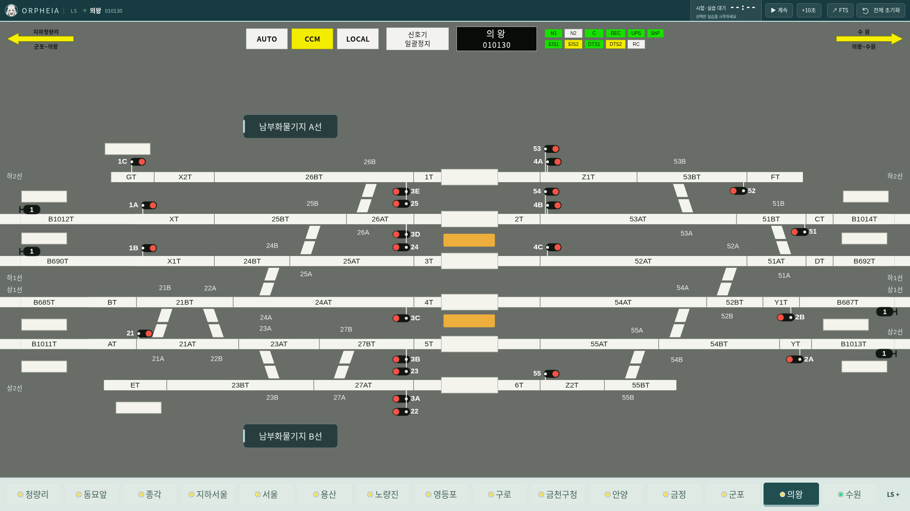

# v0.39.3 테스트 브랜치 통합

`v0.39.3` (`14cc6bd`)을 배선·회로명 표시 작업 (`eca3293`)에 병합했습니다. 결과는 `codex/ls-trim-overview` 브랜치에만 올립니다. main과 정식 릴리스는 변경하지 않습니다. 패키지 버전은 **0.39.3**입니다.

포함된 변경:

- v0.39.3: 온라인 열차스케줄 ID 관리에서 선택한 오프라인 ID를 오늘/내일에 적용하고, 오늘 적용 시 실제 운행 시간표를 갱신합니다. 달력과 하단 버튼 배치 수정도 포함합니다.
- v0.39.2: 의왕 3T 양쪽 건넘선이 한 접점에 겹치지 않도록 원본 위치에 맞춰 분리합니다.
- 정식 v0.39.1: 서울·수원의 진로 8개에서 반위 전환기가 적은 경로를 선택합니다.
- 테스트 브랜치: 사다리꼴 네 조각의 X 교차부, 일반 건넘선 끝단·직각 모서리 트림, 원본 구간의 연속 오버뷰, 11개 역의 회로명 누락·오독·중복 보정입니다. [회로명 대조](v0.39.1-전체회로명대조.md) · [표시 변경](v0.39.1-배선트림과연속오버뷰.md)

충돌은 변경 이력·릴리스 설명과 패키지 버전에서 발생했습니다. 양쪽 변경 내역을 보존하고 버전은 0.39.3으로 맞췄습니다. 엔진·MMI 변경은 v0.39.3의 소스를 유지했습니다. 이전 표시 검토의 ‘e57da49와 그래프가 동일하다’는 기록은 병합 전 작업에 대한 결과이며, 이번 통합에는 정식 버전의 의왕 배선·진로 선택 변경이 포함됩니다.

## 통합 검증

- Node 테스트 **174개 통과**, 실패 0개.
- 18개 화면 × 세 창 크기 × 정위/반위의 **108건**: 원본 회로명 목록 일치, 겹침·잘림 없음. 보정한 글자의 픽셀 검사 168건 통과.
- MMI 브라우저 검사: 1440×1000·1920×1080에서 스케줄 ID 선택·오늘 적용·원본 확인 절차를 포함해 통과.
- 연속 오버뷰 검사: 세 창 크기에서 전체/부분 구간·열번 갱신·포커스·화면 이동·읽기 전용 상태 검사 통과.
- Linux 데스크톱 전체 검사: LS/MMI, 독립 엔진, 복수 LS 창, FTS, 저장·재시작, 전체 초기화 통과.
- Mac ARM64·Windows x64·Linux 패키지 생성 통과. 각 패키지 버전 0.39.3 및 로컬 소스 135개 일치 확인. Mac·Windows의 실제 OS 실행은 이 환경에서 검사하지 않았습니다.

[전체 화면 검사](integration-v0.39.3/audit.json) · [검증 메타데이터](integration-v0.39.3/metadata.json)
