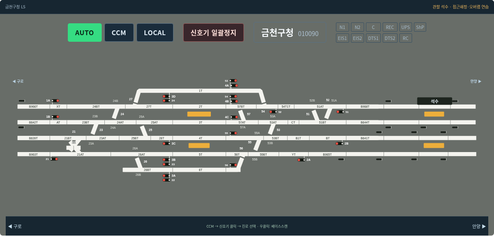
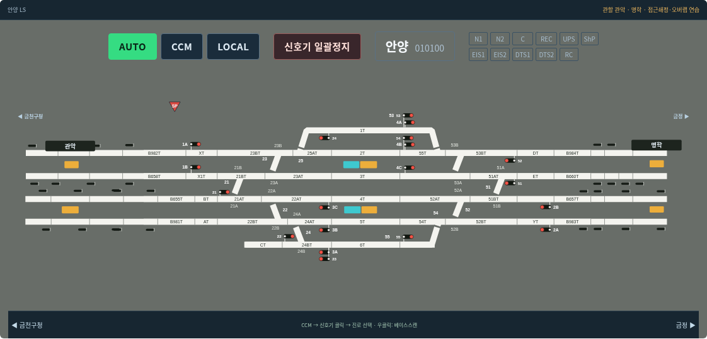
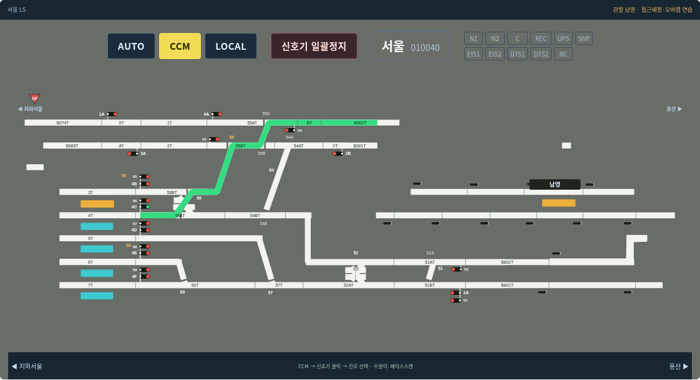

# v0.11.0 데스크톱 배선 정리

15개 취급역을 공통 SVG 좌표계로 다시 정리했다. 구내와 관할 중간역을 함께 표시하고, 선로는 원본의 가로·세로 비율을 유지한다. 캡처를 앱 배경으로 사용하지 않는다.

- 독립적인 세로 확대, 수백 픽셀 신호기 이동, 긴 지시선을 제거했다. 신호기 마스트는 실제 선로 위치에 고정하고 쌍 신호기의 원본 배치를 유지한다. 번호는 해당 분기부 주변에서만 조정한다.
- 정위의 건넘선은 한쪽 끝과 연결된 상태로 개방부를 표시한다. 반위에서는 분기 연결과 대체 직선의 개방부가 바뀐다. 표시와 진로·점유·수동 쇄정·접근쇄정은 같은 상태를 사용한다.
- 금천구청은 석수까지 표시한다. 관악 이름판·승강장·네 줄 선로·원본 캡슐 표시를 안양 화면 앞쪽으로 함께 이관했다. 원본 추출 좌표는 보존한다.
- 데스크톱 전용으로 전환하고 모바일 분기와 검증 대상을 제거했다. PC 화면 안에 전체 관할 배선이 들어오며 내부 가로 스크롤로 중간역을 숨기지 않는다.

## 클로드 브랜치 통합

`claude/practical-dirac-68tgp6`의 `27c6fe2`까지 병합했다. 청량리·동묘앞·종각·지하서울·서울의 확정 LS 메뉴 95개와 용산 10개 신호기의 개별 확인 답변 26개를 적용했다. 용산 AT·BT 중간 목적지는 원본 선로의 통과 가능한 노드로 추가했다. LS 지하서울 3A는 B065T만 제시하며, 교재의 B070T는 MMI 연습 목록에 남는다.

미확정 신호기는 배선에서 도출한 연습 경로임을 구분한다. 용산 전체나 나머지 미확인 역의 실제 메뉴를 모두 검증한 것으로 표시하지 않는다. 출처는 [원본 대조 기록](진로목록-원본대조.md)과 [용산 확인 답변](../references/route-menus/answers/yongsan-2026-10-21.txt)에 보존했다.

## 검증

Chromium 1440×1000·1920×1000에서 15개 역의 정위·반위 글자 경계를 검사한다. 신호기 246개 실제 클릭, 진로 설정·점유·정지·해정, 118개 전환기 그룹의 형태 변경과 접근쇄정 회귀 검사를 유지한다. 654개 도출 경로는 교육용 연결 모델이며 실설비 전체 연동표 검증과는 구별한다.
