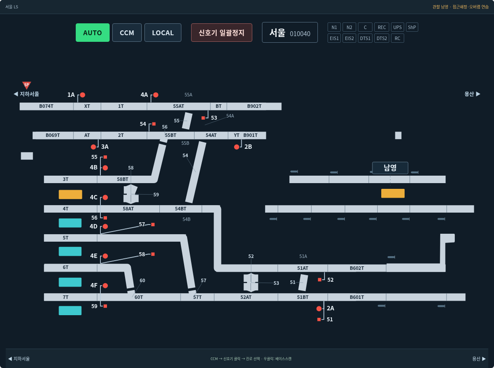
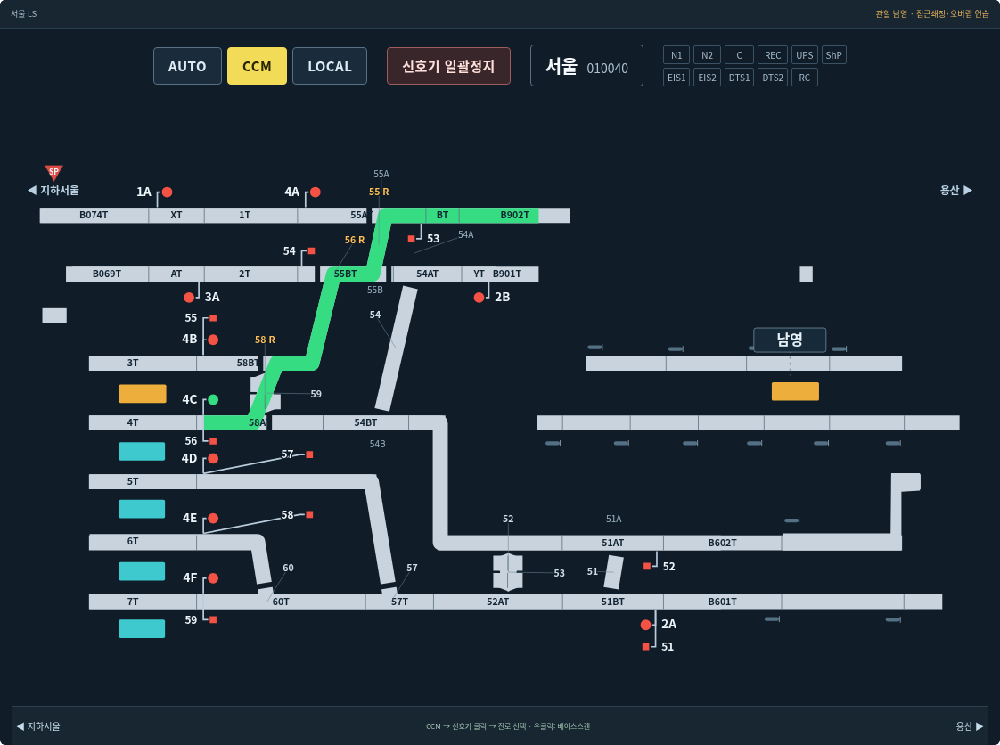

# v0.10.0 — 선형 전환과 화면 정리

## 사진과 같은 전환기 표시

서울역 `4C-B902T`를 설정하면 58번 교차부에서 4T가 3T 쪽으로 이어지고, 56·55번을 통해 상부 선로로 연결된다. 전환기 위치에 따라 사용하지 않는 직선 또는 분기 방향에 실제 틈이 나타난다. 색상 변화뿐 아니라 SVG 연결 도형 자체가 달라진다.

- 정위 N: 직선이 이어지고 분기 연결 끝에는 틈이 있다.
- 반위 R: 분기 방향이 이어지고 그 대신 사용할 수 없는 직선 방향에 틈이 있다.
- 진로·접근쇄정·점유·오버랩 쇄정 중: 같은 N/R 상태를 유지하며 core가 전환기 변경을 거부한다.
- 해정 후: 쇄정만 풀리고 실제 위치는 유지한다. 새 진로 또는 MMI 전환 명령으로 N/R을 바꾼다.
- 전체 15개 역의 전환기 118개 그룹에 적용한다. 건넘선과 측선·대피선의 종단 접속부를 구별한다.





`ls-switches.js`는 `wiring.js`의 접속과 core의 전환기 위치를 읽어 연결선과 개방부 마스크를 만든다. 선형 표시를 위해 별도의 가상 전환기 상태를 만들지 않는다. 실설비의 상세 정반위 조건표까지 모두 검증한 모델이라는 뜻은 아니다. 기존 진로·접근쇄정 모델의 범위는 [SVG 통합 문서](SVG배선도통합.md)와 같다.

## 덧붙인 표시 정리

- 역 구내와 중간역의 궤도 칸을 하나의 선로 중심선·굵기로 렌더링한다. 추출 좌표의 미세한 높이 차이는 같은 중심선에 맞춘다.
- 검은 이중 테두리, 칸마다 겹친 상자, 전환기 번호 배지를 제거했다. 궤도 경계는 가는 구분선으로 표시한다.
- 전환기 번호와 A/B 구성 표기는 실제 위치에 연결되는 문자로 배치한다. 신호기도 표기를 옮길 때 실제 선로 위치에 마스트를 연결한다.
- 번호·신호·승강장·역 이름판·선로가 차지하는 영역을 함께 고려한다. 브라우저에서 실제 글자 경계를 재어 충돌과 잘림을 검사한다.
- 추출 칸 하나가 분기부를 가로질러도 진로가 통과하는 부분만 설정·점유·접근쇄정 색상으로 표시한다. 사진의 4C 진로에서는 사용하지 않는 3T 58BT 쪽까지 녹색이 번지지 않는다.
- 용산의 종단 번호 중첩, 노량진·영등포의 합쳐진 내부 경계 별칭 중복을 정리했다. 별칭은 core와 SVG 메타데이터에 유지하고, 실제 궤도 식별자는 나눠 표시한다.
- 원본 확대본과 대조해 영등포 4T를 ST로 읽던 OCR 결과를 4T로 보정했다. 원시 OCR 후보는 별도 원본 목록에 보존한다.

## 이미지 생성 도구 사용

`image_gen.imagegen`으로 구로역 화면의 디자인 참조를 생성했다. [생성 시안](design/ls-v0.10-imagegen-reference.png)은 선로의 일관된 굵기, 이음새, 구분선, 기호와 문자 체계를 검토하는 용도다. 생성 이미지의 문자나 접속을 배선 데이터로 가져오지 않았으며 앱 배경에도 사용하지 않는다. 실제 화면은 원본 자료·기존 상태 데이터와 대조한 SVG다.

## 검증

```sh
node simulator/ls-switches.test.cjs
node simulator/ls-view.test.cjs
python3 simulator/ls-layout.browser.test.py
python3 simulator/ls-switches.browser.test.py
python3 simulator/ls.browser.test.py
python3 simulator/schematic.browser.test.py
```

118개 그룹의 N/R 모양 변경, 사진의 4C 진로와 30초 접근쇄정 유지·해정 후 전환을 검증한다. 1440px·390px에서 15개 역의 전체 글자를 정위·반위 상태로 측정하며, 기존 246개 신호기 실제 클릭과 621개 경로의 상태 연계 검사도 유지한다. 화면에 래스터 이미지를 요청하지 않는 검사도 유지한다.
