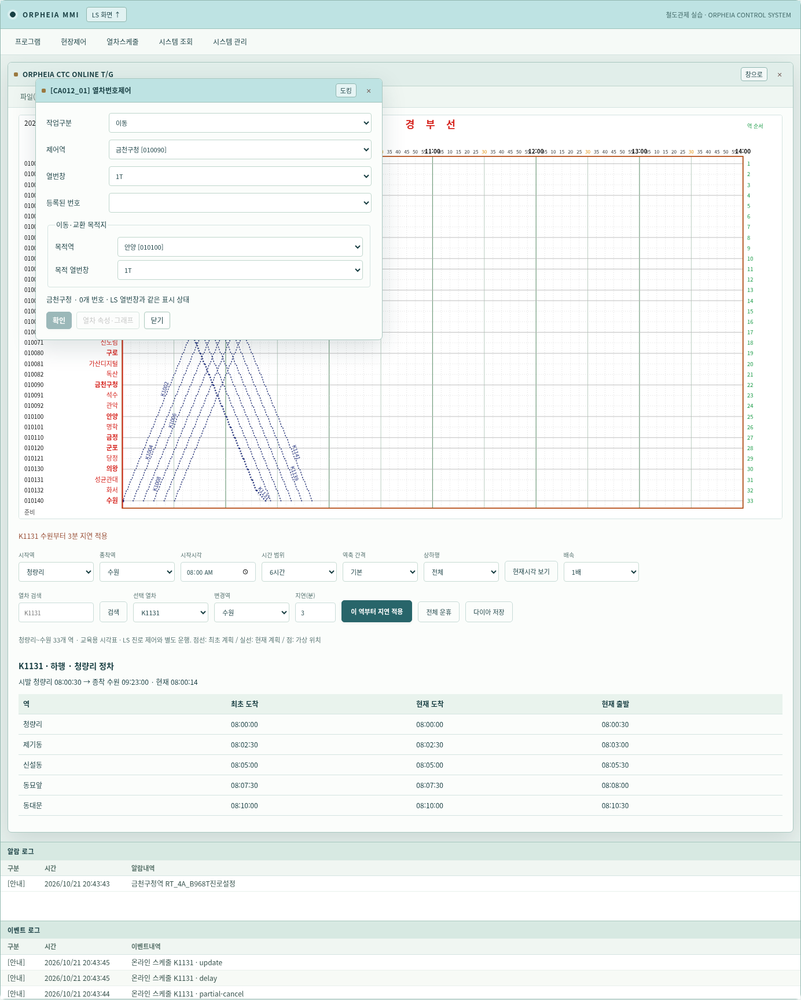
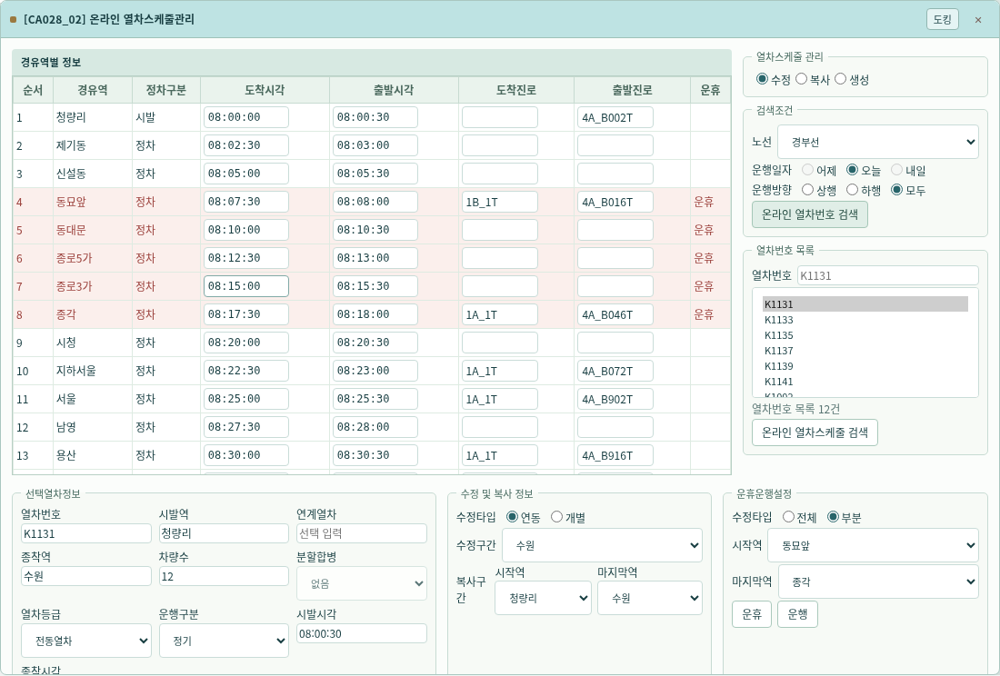
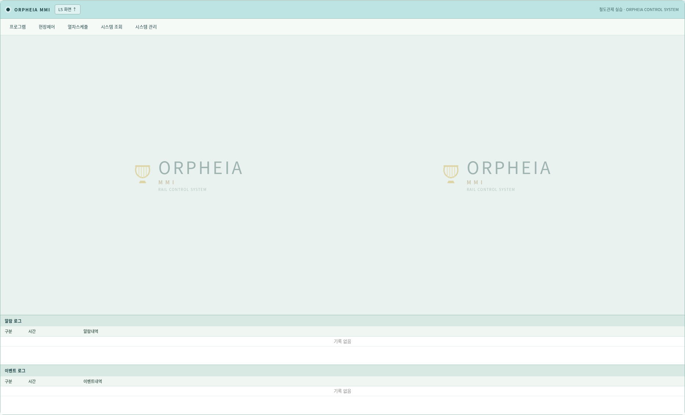

# ORPHEIA 디자인 — v0.15.0

이 프로젝트는 철도관제 프로그램의 화면·조작 구조를 역공학으로 재현하고 오르페이아 스타일로 구성하는 데 목적이 있다. 실물의 메뉴 계층, 제어 대상, 배선 식별 정보와 동작은 유지하면서 앱의 시각 체계를 통일했다.

| 역할 | 색 |
| --- | --- |
| 주조색 / 활성 창 제목 | `#BEE3E3` |
| 헤더 / 주요 텍스트 | `#193F43` |
| 명령 버튼 / 포커스 | `#28656A` |
| 작업 영역 바탕 | `#F0F5F3` |
| 패널 / 입력 표면 | `#FBFDFB` |
| 구분선 | `#D4E4E1` |
| 작은 장식 / 번호 | `#9A7940` |

민트색에는 짙은 청록 글자를 사용한다. 금색은 작은 장식과 영역 번호에 한정한다. 리라 문양을 코드로 그려 상단 브랜드와 MMI 배경에 사용한다. 외부 폰트나 이미지 요청 없이 로컬에서 실행된다.

앱 헤더·역 탭·세션 바·패널·MMI 메뉴와 도킹 창·로그·스케줄 표·열차번호 제어·확인 대화상자·우클릭 메뉴를 같은 팔레트로 맞췄다. 활성 창과 선택 역의 대비, 입력 테두리, 키보드 포커스, 비활성 상태를 구분한다. 모션 감소 설정을 지원한다. 데스크톱의 넓은 배선 영역을 유지한다.

선로·신호·쇄정·점유·운휴의 의미 색과 배선 데이터는 변경하지 않았다. 그래프의 흰 배경·역 이름·계획선 색도 원본 판독 구조를 유지한다. 디자인 정의는 `simulator/orpheia.css`에서 관리하며 기능 모듈과 분리한다.

1440·1920px에서 MMI 메뉴·창 이동·도킹, LS/MMI 진로·열번 데이터 공유, 시각표와 다이아 편집·운휴·복사, LS 우클릭·276개 창, 전 역 N/R 글자 배치 검사를 통과했다. 모바일 검증은 수행하지 않았다.

