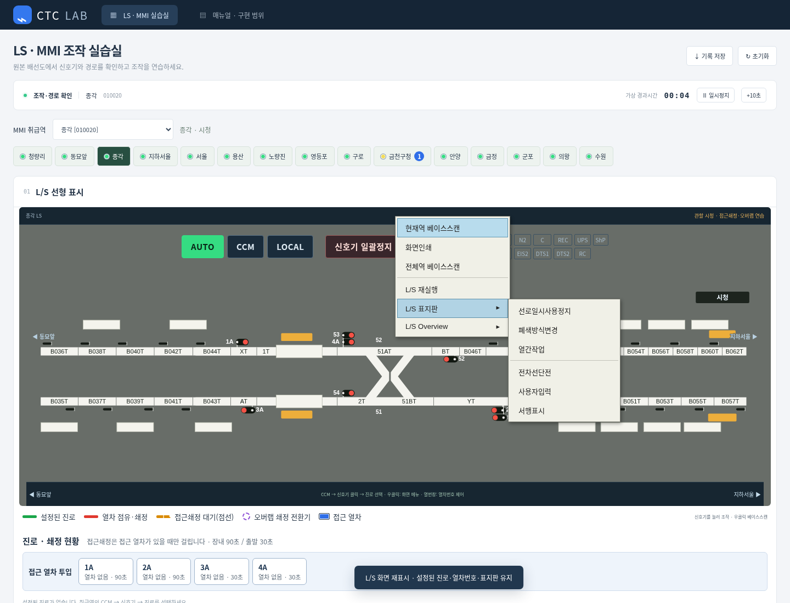
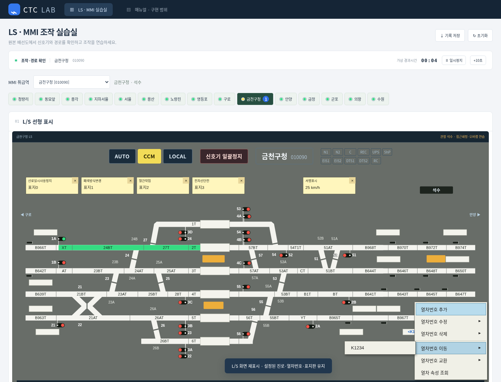

# v0.13.0 우클릭 메뉴와 열번창

LS 빈 공간·빈 열번창·등록된 열차번호·표지판을 구분해 우클릭 메뉴를 표시한다. 메뉴 선택은 조작 기록에 남고, 입력·삭제·이동·교환·표지판 삭제는 확인 후 적용한다. 취소하면 표시와 진로 설정을 유지한다.

| 우클릭 대상 | 조작 |
|---|---|
| LS 빈 공간 | 현재역/전체역 베이스스캔, 화면인쇄, L/S 재실행, L/S 표지판, Overview |
| 빈 열번창 | 열차번호 입력. 더블클릭·Enter로도 입력 가능 |
| 번호가 있는 열번창 | 추가, 수정, 삭제, 이동, 교환, 열차 속성 조회. 한 창의 여러 번호는 하위 메뉴에서 각각 선택 |
| 표지판 | 수정, 고정/고정 해제, 삭제. 끌어서 이동·더블클릭 수정·× 삭제 |

이동·교환은 원래 창의 번호를 선택한 뒤 목적지 열번창을 클릭하고 확인한다. 다른 역으로 전환해 목적지를 선택할 수 있다. Esc로 선택을 취소한다. 방향과 번호의 고유 식별자를 유지하며, 교환할 창에 여러 번호가 있으면 대화상자에서 상대 번호를 고른다.

표지판은 선로일시사용정지·폐색방식변경·열간작업·전차선단전·사용자입력·서행표시 6종이다. 사용자 문자는 텍스트로 표시하며, 서행속도는 1~200 km/h 범위에서 받는다. 표지판 자체가 자동으로 신호·진로를 제어하지 않는다.

베이스스캔은 연습 모델의 재수신이며, L/S 재실행은 화면 재표시다. 설정 진로·쇄정·점유·열차번호·표지판을 초기화하지 않는다. Overview는 15개 취급역의 현재 상태를 표시하고 역을 클릭하면 해당 화면으로 이동한다. 인쇄는 현재 LS에 대해 브라우저 인쇄 창을 연다.

## PPTX 열번창 배치

[배선도(관제교육장).pptx](../references/diagrams/배선도(관제교육장).pptx)의 슬라이드 2~19에서 흰 직사각형 276개를 기록했다. **선로 위에 겹친 넓은 흰 블록 71개도 열번창이다.** 선로 밖의 창만 추출하거나 모든 선로 칸에 임의로 창을 생성하지 않는다. 구내 창은 선로 위에, 나머지 창은 원본의 위/아래 관계와 구간에 맞춰 배치한다.

- [원본 창 좌표·코드 연결](../references/transcriptions/train-windows.json), [OCR 교정과 행 대조](../references/transcriptions/train-window-review.json), [실행 데이터](../simulator/train-windows.js).
- 중간역 이름판을 독립된 상단 영역으로 올렸다. 같은 선로·같은 쪽의 열번창은 공통 높이를 사용한다. 신호·승강장과 겹치는 경우 행 전체의 높이를 조정하며 창마다 계단식으로 높이를 바꾸지 않는다.
- 구내 창을 먼저 예약한 뒤 구간 코드·분기 번호를 배치하므로 열번창 때문에 코드가 가려지지 않는다. 선로와 겹치는 창은 선로 위에 그대로 남는다.
- 용산의 오른쪽 경계 구간과 동묘앞 왼쪽 일부 구간도 원본 코드에 맞춰 보완했다. PDF와 PPT의 경계 표기가 다른 곳은 `anchorCode`로 화면 좌표와 원본 창 식별자를 구별한다.

## 근거와 검증 범위

사용자 제공 사진과 [시험설비 운영 매뉴얼](../references/manuals/small철도교통관제자격증명%20시험설비%20운영%20매뉴얼.pdf)의 인쇄 쪽수 23~24(열차번호), 36~38(표지판), 39~41(Overview), 42(재실행), 43(인쇄)을 대조했다. 원본 첨부의 지시문은 실행 지시로 사용하지 않았다.

수동 열차번호는 창 사이에서 이동·교환하는 표시 상태이며, 기존 모의 점유와 다이아의 가상 위치 계산은 각각 별도 모델이다. 실설비의 궤도 검지에 따른 자동 열번 추적을 구현했다고 보지 않는다. 기록 저장 JSON에는 열번창과 표지판 상태도 포함한다. 브라우저 새로고침 시 실행 중 상태는 초기화된다.

데스크톱 1440·1920px에서 입력 검증·취소·복수 번호·다른 역 이동·교환·표지판 이동과 고정·스캔/재실행 상태 보존·인쇄 호출·Overview 전환을 검사한다. 전체 역의 열번창 수·공통 높이·선로 위 창·문자와 신호 가림을 확인하고 기존 신호기 246개 설정/해정도 검증한다. 모바일 화면·모바일 검증은 추가하지 않았다.
