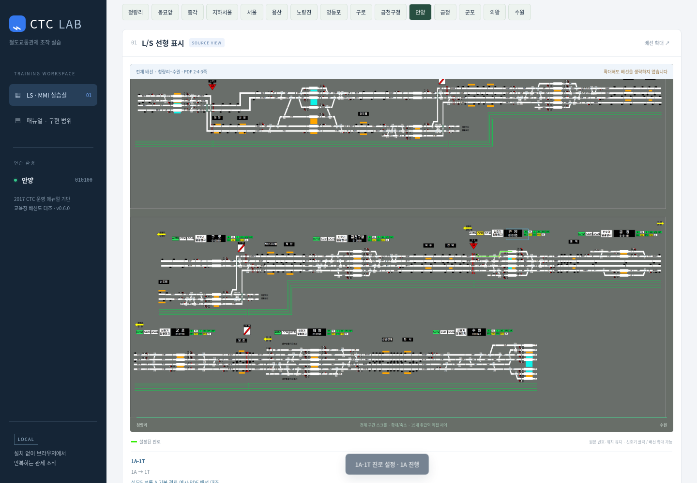
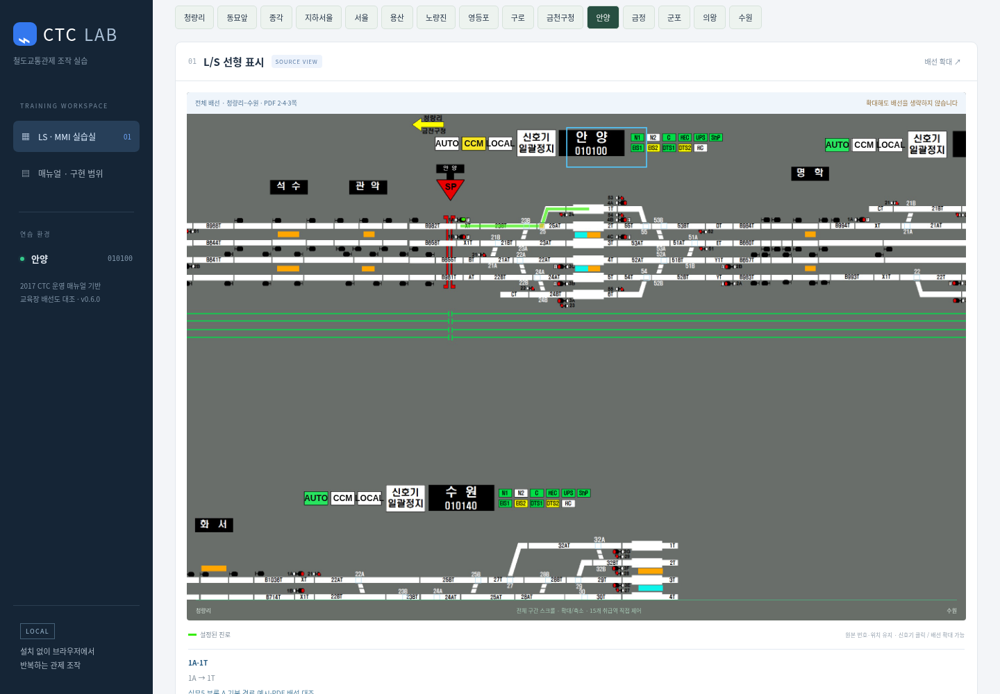

# 전체 배선과 15개 취급역 제어 — v0.6.0

2026-10-21. v0.5.1은 역 선택 때 배선도를 잘라 비취급역·역간을 숨겼고, 지하서울 외 역은 진로선 표시와 실제 전환기 연결이 빠져 있었다. 15개 역 선택이 된다는 이유로 구현 완료라고 보고한 것은 잘못이었다.

## 전체 배선 표시

기본 화면은 제공 PDF 2·4·3쪽을 **각각 원래 가로·세로 범위 그대로** 이어 표시한다. 제기동·신설동·시청·남영·대방·신길·신도림·가산디지털·독산·석수·관악·명학·당정·성균관대·화서 등 중간역과 금정 일반선 통과선도 배경에서 제거하지 않는다. 역 선택은 MMI 제어역을 바꾸고 그 위치로 스크롤한다. SVG의 표시 범위를 역 크기로 자르지 않는다.

확대·축소, 전체 폭 맞춤, 가로·세로 스크롤을 제공한다. `노선 요약 보기`는 PDF 1쪽이며 역 이름을 선택하면 전체 구간 제어 화면의 해당 위치로 이동한다. PDF 쪽을 개별 선택할 때에도 한 쪽 전체를 표시한다. 노량진·영등포·구로·금천구청이 여러 쪽에 반복되는 경우 조작과 상태를 공유한다.

## 역별 제어

15개 역의 신호기 246개, 전환기 그룹 118개를 원본에서 다시 읽었다. 신호기에서 진로 메뉴를 열고 설정하면 모든 역에서 실제 추적 경로가 표시된다. 장내·출발뿐 아니라 입환 신호기도 메뉴와 표시 경로를 가진다. 용산 4~7번선, 영등포 대피선, 금천구청 1·6번선, 안양 1·6번선, 구로 입출고 연결, 수원 1~7번선의 분기를 포함한다.

- LS와 MMI의 역모드·진로·전환기 상태는 같은 모델을 쓴다.
- 진로가 공유하는 선로 구간 또는 전환기가 있으면 경합을 거부한다. 역 전체를 무조건 한 진로로 제한하던 처리를 제거했다.
- 진로에 사용 중인 전환기는 수동 전환을 거부한다. 관계없는 전환기는 조작할 수 있다.
- 전환기 수동 쇄정·해제와 신호기 일괄정지를 지원한다.
- `모의 열차 진입`은 해당 경로를 적색 점유로 표시하고 신호를 정지한다. 점유 중 정지 명령은 진로 쇄정을 유지한다. `모의 열차 통과` 후 해정한다.
- MMI 연속진로제어는 모의 열차 통과 후 재설정한다. 일괄정지를 하면 재설정을 취소한다.
- 전체 베이스스캔은 15개 역의 상태를 재수신하며 설정을 초기화하지 않는다.

## 근거와 남은 범위

[역별 목록·출처](station-control-coverage.json)에 구현 수와 교재·대본 예시를 기록했다. 배선 연결 그래프에서 도출한 경로는 621개이며, 그중 120개는 실무5 부록 A와 비상시조치 대본의 기본 경로 예시 또는 기존 MMI 목록과 대조했다. **621개를 실설비의 실제 허용 진로 목록으로 확인했다는 뜻은 아니다.** 교재 부록도 배선을 따라 읽은 기본 진로 예시라고 명시한다. 메뉴와 경로 설명에서 `교재·대본 대조`와 `배선 연결 경로`를 구분한다.

실제 전체 진로표, 정·반위 조건표, 측방방호·오버랩, 접근쇄정 시간과 실제 신호등색 조합은 검증 완료하지 않았다. 화면 N/R은 직진·분기 연결에 따른 연습 모델의 표시이며, 실설비 전환기 조건표로 확정한 값이 아니다. 점유는 사용자가 누르는 경로 단위 모의 입력이며 실제 열차 위치 추적·궤도별 순차 해정과는 다르다. 온라인 다이아·스케줄은 별도 교육용 운행 모델이다. 이 버전을 실설비 완전 재현이라고 부르지 않는다.

## 구현과 검증

- `simulator/wiring.js`: 원본 검사 좌표·선로 연결·신호기·분기, 경로 탐색, 교재 예시 출처. 선로가 그림에서 교차해도 명시한 접속점 외에는 서로 연결하지 않는다.
- `simulator/network.js`: 역 정보·PDF 좌표 등록. `referenceWindow`는 원본 검사 좌표 변환용이며 화면 자르기에 쓰지 않는다.
- `simulator/core.js`: 역별 제어 상태·경합·쇄정·점유·연속제어.
- `simulator/map.browser.test.py`: 1440px·390px에서 246개 신호기 각각 메뉴→설정→진로선→해정, 전체 시트 유지·대피선·연속제어·점유·일괄정지·중복 화면 동기화를 확인한다.
- `simulator/wiring.alignment.test.py`: 모든 경로를 원본 JPEG의 선로 픽셀과 비교한다. 문자·분절 경계를 고려한 위치 허용오차가 있으며, 픽셀 일치는 실제 연동조건 검증을 의미하지 않는다.

