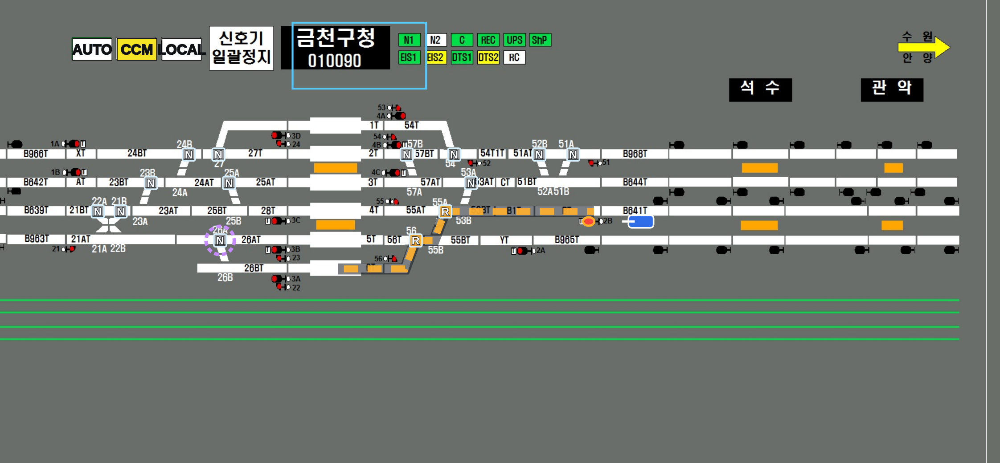

# 접근쇄정과 오버랩 — v0.7.0

## 근거
- 실무5 구술 8번(접근쇄정): 열차가 신호기 외방 일정구간에 진입한 뒤 신호를 취소해도 장내 90초, 출발 30초 동안 진로를 쇄정한다. [KR S-06030]
- 실무5 구술 9번(오버랩·조사쇄정): 출발신호기 전방 일정거리 안의 선로전환기를 안전측으로 개통하고 쇄정한다. 과주여유거리는 일반 200m 이상, 전동차 전용 150m 이상이다.
- 대본 해설: 대피 시 장내 신호를 정지시킨 뒤 접근쇄정이 풀려야 새 진로를 잡는다. 금천구청 2B-6T는 전방 26B 정위, 1B-1T는 54번 반위, 영등포 1A-1T는 4B를 오버랩 때문에 해정한다.

## 구현한 동작
1. 진로 현황판의 「접근 열차 투입」에서 신호기별 열차를 놓는다(장내·출발신호기만).
2. 그 신호기를 정지(LS 재클릭 또는 MMI)하면 진로가 `접근쇄정` 상태로 남고 신호는 정지, 남은 시간이 표시된다.
3. 쇄정 중에는 같은 진로·경합 진로 설정, 해당 전환기 조작, 모의 열차 진입, 접근 열차 제거, 정지 재실행(타이머 재시작)이 거부된다. 거부 메시지에 남은 시간이 나온다.
4. 90초(출발 30초)가 지나면 진로가 해정된다. 가상 시계 +10초 버튼으로 앞당길 수 있다.
5. 접근 열차가 없으면 정지 즉시 해정한다. 시간 경과만으로는 쇄정도 해정도 생기지 않는다.
6. 오버랩: 해당 진로 설정 시 오버랩 전환기를 지정 위치로 놓고 진로가 있는 동안 조작을 막는다(보라 점선 링). 영등포 1A-1T는 4B 진로가 설정돼 있으면 거부한다.

## 단순화·미구현
- 접근구간은 거리·궤도 감지 없이 신호기별 열차 유무로 표현한다.
- 오버랩은 대본에 나온 3개 진로만 있다. 과주여유거리 계산, 용산 6번 통과 순서(3B-B605T 먼저)는 미구현이다.
- 접근쇄정 시간은 신호기 종류(장내 90·출발 30)로만 구분한다. 연동도표별 개별 시간은 확인하지 않았다.

