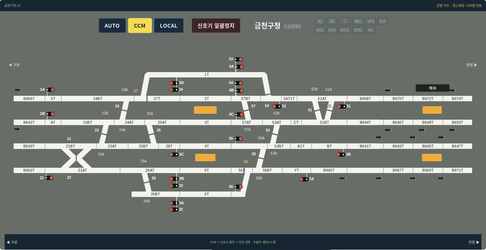
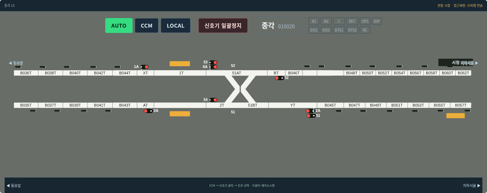
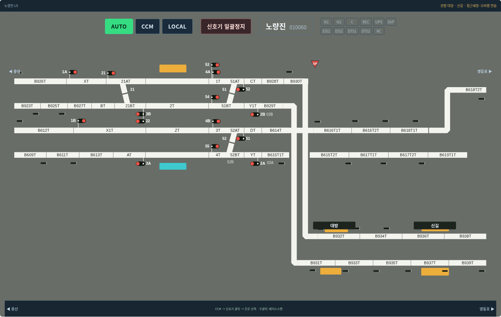
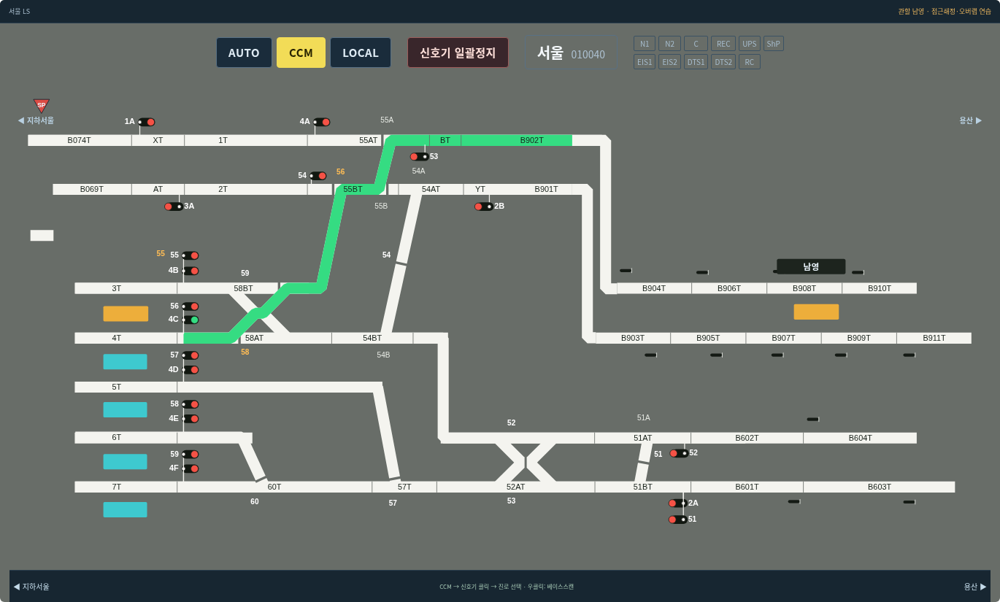

# v0.12.0 중간역 코드와 건넘선

중간역 선로의 빈 칸에 원본 코드를 표시했다. 원본 PDF의 배치와 PPT의 식별자를 각각 대조했으며, PDF에서 여러 구간이 합쳐진 부분은 코드별 경계로 나눴다. 번호를 빈 칸 수만으로 자동 생성하지 않는다.

대조 기록: [슬라이드별 순서·등록 좌표](../references/transcriptions/intermediate-circuits.json). 이 파일은 PPT 원본에서 확인한 코드 순서와 인접 화면의 공통 접근 구간을 기록한다. 61개 선로 열의 226개 코드 배치가 포함된다. 원본 그림과 원시 추출 데이터는 보존한다.

- 종각의 시청 방면 B058T·B060T·B062T 등 합쳐진 칸을 분리.
- 금천구청의 석수까지 코드와 안양 화면으로 이관한 관악 구간을 구분.
- 금정의 비취급 통과선 B670T~B676T / B665T~B671T도 표시.
- 당정·성균관대·화서 등 역간 코드 표시.
- 노량진 대방·신길 구간의 B616T1T·B616T2T·B618T1T·B618T2T 등 복합 식별자를 축약하지 않음.
- 남영과 대방·신길의 단차 연결선을 이어 선로가 떨어져 보이는 부분을 보완.

## 건넘선 모양

PPT 슬라이드 2·4·5·6·9·10·11의 쌍 건넘선을 참고해 가로 폭을 확보하고 중앙이 좁아지는 목과 세로 틈을 그렸다. 단일 건넘선은 중앙 개방부를 표시한다. 정위에는 중앙 틈이 있고, 반위에는 선택 방향이 연결되며 대체 직선 방향에 개방부가 생긴다. 기존 정반위·수동 쇄정·접근쇄정 상태를 그대로 사용한다.

진로를 설정하면 녹색 경로도 같은 중앙 목을 통과한다. 선형과 다른 직선 색 띠를 겹쳐 그리지 않는다. 목적지 경계 코드가 끝나면 다음 중간역 구간까지 녹색을 연장하지 않는다. LS 표시 변경은 중간역에 새 조작 권한을 부여하지 않는다. 제어역 15개·신호기 246개·도출 경로 654개·전환기 그룹 118개는 유지한다.

실설비 전체 정반위 조건표와 연동표는 기존과 같이 검증 완료 범위가 아니다. 표기 대조와 연결 모델의 동작 검증을 구분한다.
